# Capital pass (Oct 17)

The graphics and correction pass for the Capital (zone id `final`, `scenes/capital_zone.tscn`), both halves, after the layout pass and the art pass
(`docs/art/capital_slice.md`). Parts A-F of the brief; judgment calls are CAP-40... in `docs/design/open_questions.md`. Rules followed:
`docs/art/art_bible.md` (storybook scale, no readable world text, characters clearest) and `docs/art/zone_rollout_playbook.md` (declutter, clusters
not scatter, 60 fps on Medium). Targets: the ten `docs/art/paintovers/PAINTOVER-CAP-*.png` and the kit concepts in `docs/art/zone_kits/final/concepts/`.

Screenshots: `bash tools/capital_pass_shots.sh <phase> [prefix,...]` shoots the same spots every time into `docs/art/capital_pass/<phase>/`: the ten
paint-over cameras (`CapitalLayout.PO_CAMERAS`, gate open, enemies held, districts broken) from the default camera (Cinematic / Normal, `_default`)
and Overview (Far, `_overview`), the four restored districts, the front wall, the shut gate, the west edge, the castle from both halves and its
sides, the map's edges, the Ward and the tunnel mouth, plus top-down plans (`plan_outside`, `plan_inside`, `plan_west`: green = where the hero can
stand, red = solid circles, yellow = anchors; `--top=x,z,size --plan=true` on any zone scene now, `PlanView`). What sways: `--windlog=true`.

Coordinates are world metres (x east, z south; the camera looks north). The great wall stands on rows z 72-75, the city inside (z 2-71), the
outside south of it (z 76-121).

## Part A: the audit

Before shots: `docs/art/capital_pass/before/`.

| | |
|---|---|
| 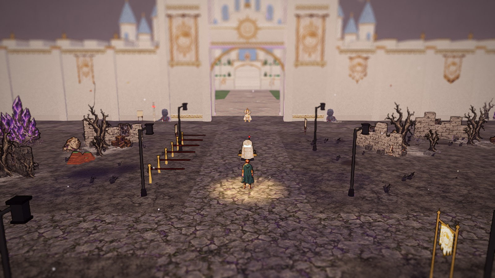 the Gate Road | 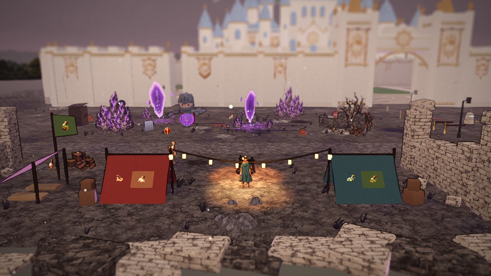 the camp |
| 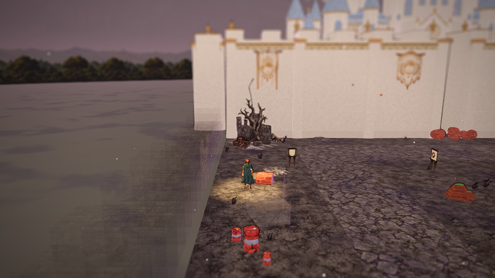 the outside's west edge | 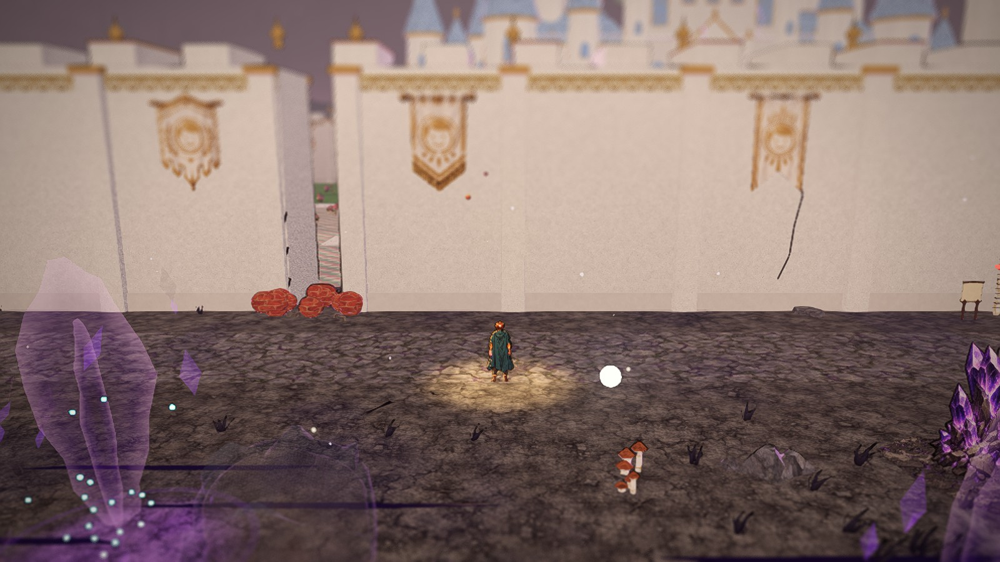 the old passage |
| 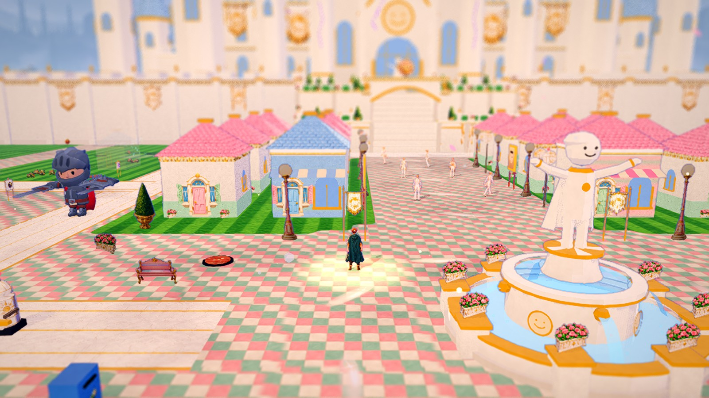 the Gate Plaza | 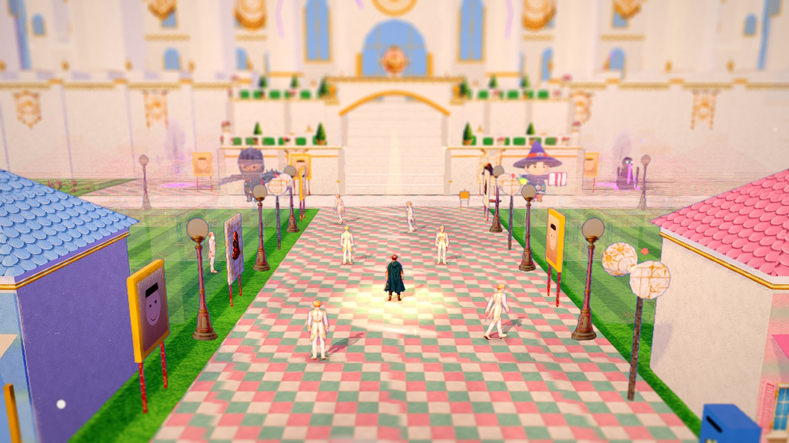 the approach |
| 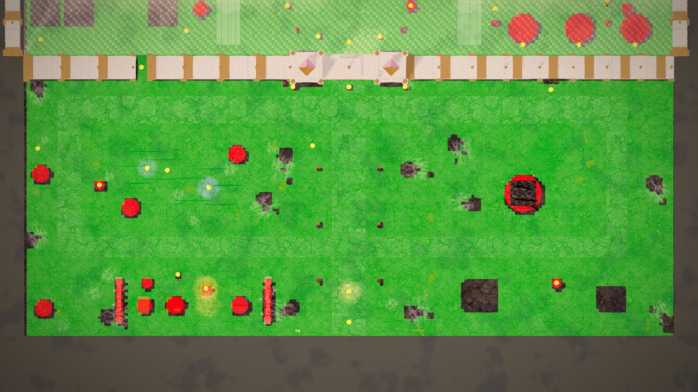 plan, outside | 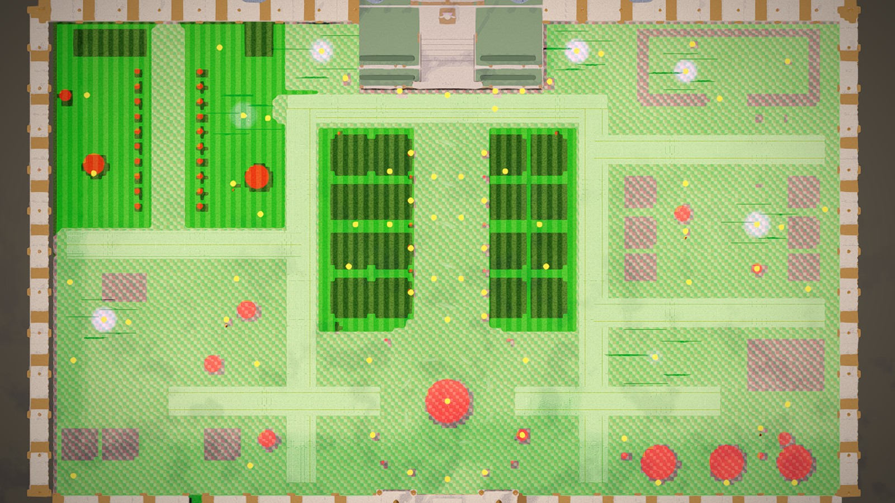 plan, inside |

### 1. Blocky and primitive-looking objects

| Object | Where (x, z) | What is wrong | Decision |
|---|---|---|---|
| The great wall (`CapitalLandmarks.wall_piece`), front, sides and north | z 72-75 across the map; x 0 and 119; z 0.5 | One long flat white slab: shallow pilasters, square merlons, nothing projecting, no plinth; the concept and every outside paint-over have square towers along it, a stone plinth, deep pilasters with gold pinnacles and dark sun banners | **rework**: towers along the outer face, a battered plinth, ashlar courses, deep pilasters with pinnacles, a cornice under the crenellations, sun banners on the towers |
| The two corners where the front wall meets the side walls | (0, 72-76) and (119, 72-76) | nothing there: the front wall starts at x 2 / ends at x 118, the side walls stop at z 72 (an open slot at each corner, seen from Overview) | **rework**: corner towers |
| The gate towers (`gate_tower`) | (52.5, 73.5), (67.5, 73.5) | plain square boxes with a gold cone | **rework**: corner pinnacles, buttress bases, deeper bands |
| The outside's side edges (`AshEdge`) | x 0.5 and 119.5, z 76-121 | a stepped row of ash-textured boxes 1.6-3 m high, a flat grey plain beyond it | **replace**: the rim terrain (ridges of rough ash ground, rocks, rubble, dead trees) |
| The outside's south edge (`RubbleEdge`, `_rock_wall`) | z 123.8, x 0-56 and 64-120 | runs of tilted boxes (the camp's foreground: big cut slabs) | **replace**: the rim terrain; the road runs on south between hills |
| The ground's rim | every edge of the walkable floor | the floor stops at the last cell and drops 0.4 m to a flat colour plane (`Wasteland`, `Meadow`) | **rework**: rim terrain flush with the floor's edge, haze beyond |
| Generic outside scatter (`ZoneDressing` recipe `capital_outskirts`) | all over the outside | Kenney low-poly crates, red-and-white barrels, logs, metal panels, fence bits, planks, stones and mushrooms; the painted-texture binding paints several of them as red brick (the "red wedges", the red balls and boxes at the wall) | **remove** the props from the recipe; dry grass only in clumps at edges and clusters (Part C) |
| The camp's tents (`CapitalLandmarks.camp`) | (29, 116.5), (40.5, 116.5) | an A-frame whose ridge runs across the view: from the camera it is a flat coloured rectangle | **rework**: draped canvas on a pole frame at three-quarter angle (the concept), sagging, pegged, its emblem patch |
| The camp's crates and barrel, the lean-to's bedrolls | round the tents and the lean-to | plain boxes and a lathe | **rework**: plank crates with edge frames, banded barrels, rolled bedrolls, log seats by the fire |
| The camp's ruins (`_ruin_wall`), the wasteland's ruin fragments (`ruin_fragment`), the outpost's fallen houses (`ruined_house`) | x 19 / 45.5 at the camp; the twelve clusters; (83, 114.5), (106.5, 115) | stepped columns of cut boxes with a brick texture (the concept's ruins are stacked stone blocks) | **rework**: masonry of individual bevelled blocks in courses, a ragged top, fallen blocks at the foot |
| The street lamps of the Gate Road (`street_lamp`) | x 54.6 / 65.4, z 92-112 | a black box lantern on a pole | **rework**: an old iron lamp with a turned post, a curled arm and a cage lantern |
| The abandoned checkpoints (`checkpoint_booth`) | (15.5, 95), (97, 112.5) | a box of boards under a flat slab | **rework**: a plank shack with a gabled broken roof, corner posts, a boarded window |
| The queue posts, the height post | x 54.4, z 90-100; (48.5, 76.8) | a box rope; a box post with box ticks | **rework**: a sagging rope between turned gold posts; a turned measuring post |
| The hidden shaft's rubble (`hatch_cover`) | (4.5, 88.5) | two plain boxes (one brick-painted) | **rework**: a slab and rubble cards |
| The tunnel mouth | (96, 76) | fine (the concept) | keep |
| The watchtower | (91, 96.5) | box courses; reads fine at its distance | **rework** lightly: masonry relief at its foot, rubble |
| Primm's Castle (`CapitalCastle`) | the hill, x 22-98, z -30..12 | big white boxes with round arched windows; flat cornices; the concept's many small spires, pointed windows, cypress on the terraces and the turned corners are missing; the hill terraces' side faces (x 47 and 74, seen from the side pockets) are blank slabs | **rework**: pinnacles along every roofline and on the keep, pointed windows, deeper cornices, cypress rows on the terraces, dressed terrace ends and corners |
| The complaint boxes | (49, 63), (65.4, 45.5) | a plain blue box | **replace**: a white-and-gold post box |
| The loudspeakers | the avenue's verges, the Ward | cylinders and two horns | **rework**: a gold pole, a turned head, two flared gold horns |
| The portraits and posters | the avenue's verges, the forecourt | a gold box with a quad | **rework**: an ornate gold frame (moulded, a crest) on a gold easel |
| The paste dispenser | (105.5, 38.5) | a plain white block | **rework**: rounded machine body, a hopper, gold bands |
| The manholes | six spots | painted red brick by the texture binding | **rework**: kept from the binding, iron rings |
| The Ward's beds and its window booth | (99-111, 6), (103, 12.2) | boxes | **replace**: white iron beds (tubes), the civic kiosk |
| The sick patch, the power cable, the seed jar | the Reek, the yards | flat disc and sticks, a box cable | **rework**: a kerbed soil bed with dead stalks / flowers, a tube cable |
| Primm's fallen houses (`_ruined`, only once Primm has fallen) | the approach | boxes | **replace**: the kit row house, cracked and slumped |
| The Crease (underground hall) | z 133-155 | boxes (tables, columns, stall) | out of scope (not either half; noted) |

### 2. Disorganized clusters and scatter

| What | Where | Decision |
|---|---|---|
| The generic scatter (stones, crates, barrels, logs, panels, planks, stumps, mushrooms) and its dark purple ground patches | evenly over the outside | **remove** the props; ground patches and dry grass only in the clusters and along the edges (Part C) |
| Ash drifts (`CapitalWasteland._drifts`) | sixteen at random spots | **regroup**: under the clusters and along the road edges |
| The wasteland's twelve clusters | edges of the outside | pieces at random angles round a centre: **regroup** into purposeful vignettes (a ruin wall parallel to the road or edge, a dead tree behind it, debris at its foot), placed along the roads' sides and the edges |
| The rubble by the old passage (red "scrub" balls, loose stones) | (21-25, 77) | **remove** (Part D) |
| Hidden chests turned at random (`_build_chests`) | everywhere | **regroup**: inside square to the streets, outside a few set angles |
| The inside rows (`CapitalDressing`) | ring streets, boulevards, separators, forecourt | gaps where a slot was refused on one side and not the other: **regroup** so every refused slot is refused on its mirror too (the city is perfect) |

### 3. Floating and detached pieces

| What | Where | Decision |
|---|---|---|
| District plaques of style "wall" with no wall behind them: a white plaque floating on a post | the Reek's (22, 39), the Hungry Quarter's (100, 23.6) and others (listed by the check in Part B) | **rework**: a plaque that has no wall within reach stands on its own white-and-gold post |
| The side walls' ends | the corners | see the corner towers above |
| A faint ghost of the west side wall at the outside's north-west corner | (0, 70) from the west edge | the fader's ghost of the side wall seen from outside; goes with the corner tower and the hidden strip (Part D) |

### 4. Things that move when they should not

Every rigid kit model in the Capital is built with `no_wind` (`CapitalLandmarks.finish`) and the card fields of the inside rows are `prop` kinds (never
sway). The sway log of the default shots lists only the plants' and trees' cards and the generic scatter's grass and mushrooms (which go in Part C).
Moving by design: the energy wheels (`Spin`), the rifts' shards and tears, Grave Row's ghosts, the castle cracks' glow, the camp fire, the gate when it
opens. Checked again in Part B (`--windlog=true`).

### 5. Readable text in the world

| Text | Where | Decision |
|---|---|---|
| The floating name plates of place spots ("Complaint Box", "Exit Interview Booth", "Rift Stone", the poster...) drawn over everything when the hero is near | every non-person spot | **remove** in the Capital, as in town (CP-3): the HUD prompt names them; people keep their name |
| Banners, plaques, posters, portraits, emblems | everywhere | pictures (faces, icons, the civic sheet); nothing to do |

### 6. Unclear boundaries

| Place | Problem |
|---|---|
| The outside's west, east and south edges | an invisible stop at a stepped box wall, a flat plain beyond it reads as open ground |
| The Gate Road's south end | the road just ends at the map's edge in an open plain; nothing says it goes on to Crosspath, nothing stops the hero but the exit spot |
| The old wall passage | a 2 m gap in the front wall at x 22-23 (the front wall is meant to be impassable) |
| The city's inner west and east edges | the floor stops 0.75 m short of the west wall (an invisible stop); at the east wall the hero walks 0.25 m into the wall |
| The corners of the city wall | open slots (above) |
| The castle hill's side pockets (x 36-47 and 74-84, z 0-12) | the hill's terrace ends are blank slabs |

### 7. Map edges

From Overview every outside edge shows the floor's rim: the cells end, a 0.4 m drop to a flat plain, the stepped box wall (`west_edge_south_overview`).
There is no hexagonal terrain in the Capital (the layout is a 1 m grid; the hub's old hex tiles are not built here). The backdrop cards
(`CAP-BD-WASTELAND`, `CAP-BD-CITY`) stand on the far ring and the haze is there; what is missing is the land between the walkable floor and them.
**Decision**: one rim of rough ground round the outside, flush at the floor's edge and rising to ridges a few metres out (rocks, rubble and dead trees
on them), falling back to the plain under the haze; the road to Crosspath carved through it; the west of the city wasteland, the meadow and a belt
of dark pines behind the city's other walls (seen over them from inside).

### 8. The wall and the passage (for Part D)

The front wall has a 2 m walk-through gap at x 22-23 hinted by two cracks, loose stones and three clumps of scrub (`docs/design/secrets.md`). The
city's west side wall stands on the map's west edge (x 0), with nothing outside it. Part D closes the gap and moves the secret round the corner.

**fps on Medium before the pass** (`bash tools/capital_fps.sh 1`): see the table in Part B.

## Part B: the blocky objects replaced

Shots: `docs/art/capital_pass/part_b/` (same spots as `before/`).

| | Before | After Part B |
|---|---|---|
| The Gate Road |  | 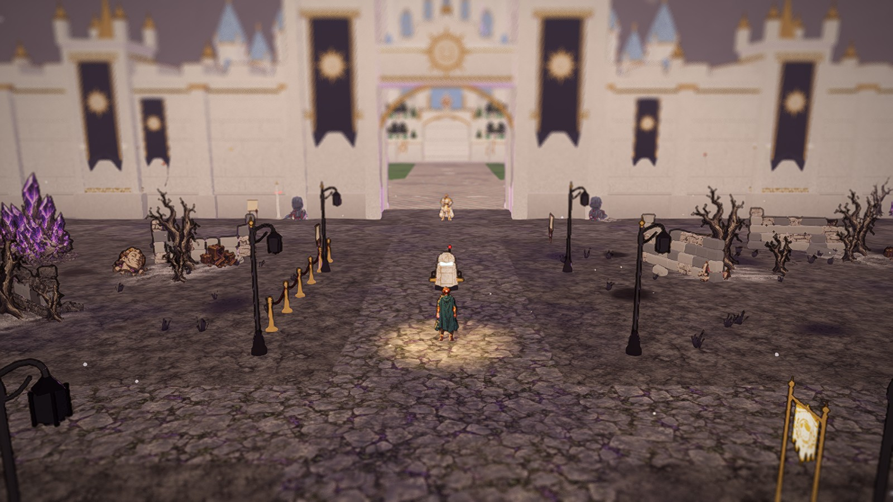 |
| The camp |  | 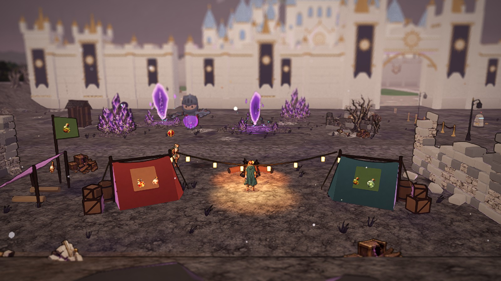 |
| The outpost | 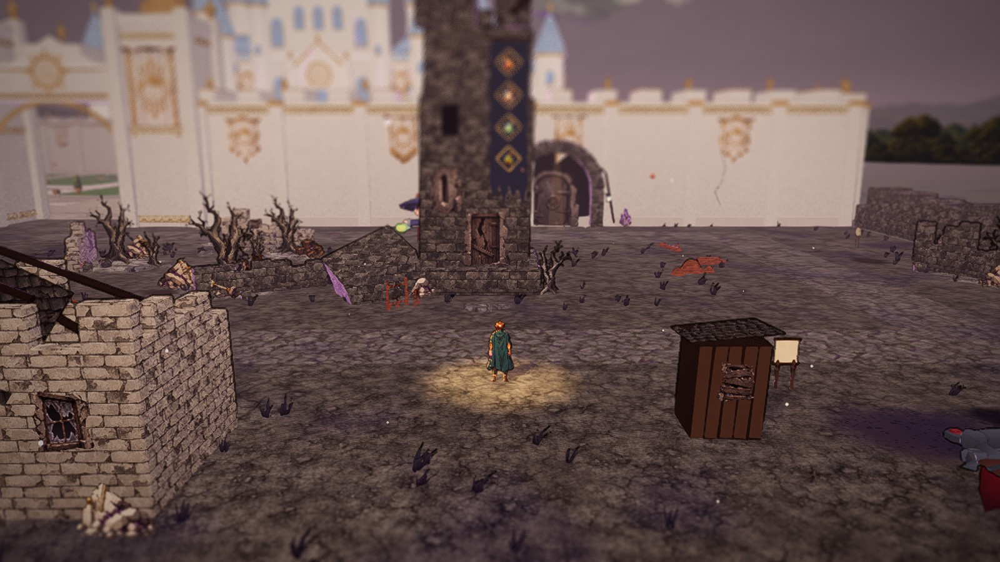 |  |
| The outside's west edge (Overview) | 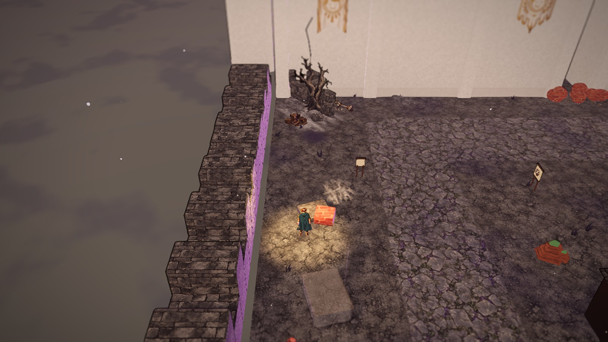 | 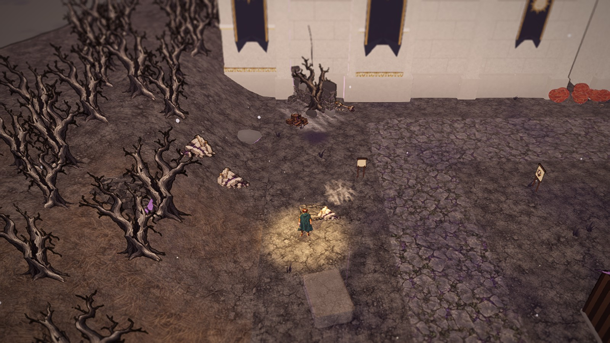 |
| The south edge (Overview) | 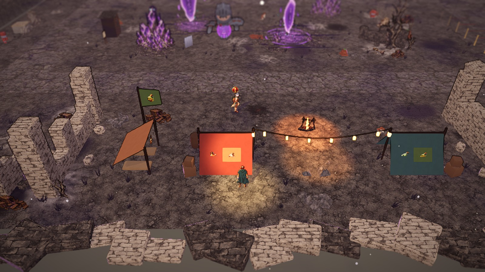 | 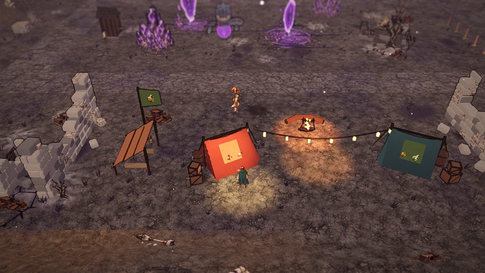 |
| The castle's west side | 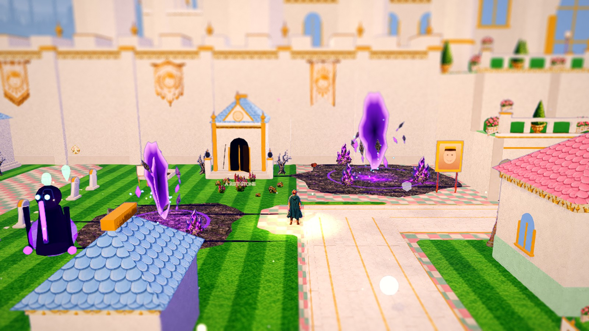 | 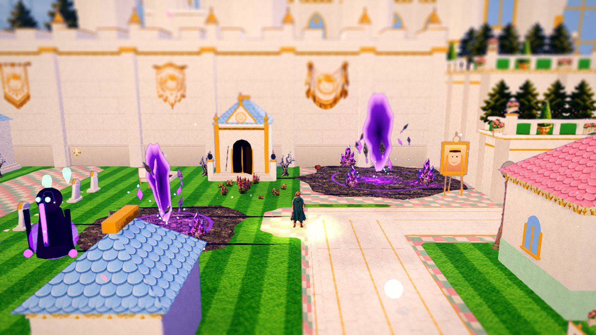 |

- **The great wall** (`CapitalLandmarks.wall_piece`) is a wall, not a slab: a battered stone plinth (it steps out at the foot on the outer face),
  ashlar courses with staggered joints, deep pilasters on stone bases with gold capitals rising into gold-capped pinnacles over a parapet of
  gold-coped merlons, a cornice under it, and on the outer face the dark navy sun banners of the concept and every outside paint-over (a
  swallow-tailed cloth with a gold border and the radiant sun, `sun_banner`; the pale kit banners stay on the city face). Four square towers stand
  out from the front wall's outer face (`CapitalLayout.WALL_TOWERS`, x 9, 37, 83, 109: off the gate, the tunnel mouth and the corners; their
  row in front is solid), each with a battered base, gold bands, a crenellated top, four corner pinnacles, a gold spire and a long sun banner.
  Corner towers (`corner_tower`) close the two corners where the front wall met the side walls (an open slot before). The gate towers gained
  pinnacles on their corner posts and a stone plinth.
- **The rim** (`CapitalRim`, new): the stepped box walls along the outside's sides and the cut-box rubble along its south edge are gone. One ring of
  rough ground round the whole outside: its height comes from a distance field on the layout's grid (flush with the floor at the last walkable
  cell, a ridge 4-5 m up a few metres out, rolling with a slow noise, falling back to the plain under the haze at 26 m), painted with the
  wasteland's own painted ground so the edge has no seam. Rocks (irregular faceted boulders, no two alike), the rubble sheet's piles and dead
  trees stand on it: the blockers you see. Because the camera always trails south of the hero, wherever walkable ground lies just north of the
  rim (the south edge) the rise is capped under the camera's line to the hero and carries no trees, so the hills climb out of the frame, never into
  it (tested). The road from Crosspath runs on south between the hills (a view floor of road cells, then a road strip). The far planes moved to
  meet it (`WastelandWest` under the city's west side). Beyond the city's other walls a belt of dark pines on the meadow and the castle hill
  (the paint-overs' dark accents over the white walls).
- **The camp** (`CapitalLandmarks.camp`): the two A-frame "sheets" are draped tents (canvas sagging between two poles and flaring at the hem, the
  back closed, the front flaps tied back, guy ropes and pegs, the patch and both Paths' essences on the slope the camera sees), each turned three
  quarters so its open end looks at the fire, as in the concept. Plank crates with edge battens and braces, banded barrels behind each tent, log
  seats round the fire, the lean-to a sagging canvas on four posts over rolled bedrolls. The ruins it shelters in are stacked stone.
- **Ruins as masonry** (`CapitalLandmarks.masonry`): every ruin is stacked bevelled blocks in staggered courses under a ragged top (the ends stand
  longest), a block or two askew at the top, fallen blocks at its foot, mixed from a set of stone tones (`PALE_STONE`, `ASH_STONE`): the camp's
  walls, the wasteland's ruined walls, the outpost's fallen guardhouses (and the identical houses once Primm has fallen, which were box ruins).
- **Props** (`CapitalProps`), each a kit mesh now: the Gate Road's lamps (a turned iron post, a curled arm, a cage lantern), the queue (turned gold
  posts and a sagging velvet rope), the height post, the checkpoints (plank shacks on a stone footing with a caved-in gabled roof and a boarded
  window; `plank_walls`), Fern's shack (the same planks under a mossy lean-to roof and a stovepipe), the shaft's cover (a heaved road slab and a
  rubble card), the complaint boxes (a pastel post box on a turned pedestal), the loudspeakers (a turned pole and two flared gold horns), the
  portraits (a moulded gold frame with Primm's crest on an easel), the lost-property poster, the manholes (an iron grate in a gold ring; the
  painted binding drew them as red brick), the paste dispenser (a rounded machine with a hopper, pipes and a dial), the Ward's beds (white iron
  frames), its window (the civic kiosk), the sick patch (a kerbed bed of dead stalks or flowers), the power cable, the seed jar, the recipe cards.
  A test builds every prop the layout places and finds no raw box, cylinder or sphere in any of them.
- **The castle** (`CapitalCastle`): pointed lancet windows in place of the round-headed ones on the keep and the wings, a gold-capped pinnacle over
  every wing bay and pilasters between them, a ring of four pinnacles round each big tower's eaves (the concept's crown of little spires), cypress
  columns behind the terraces' balustrades, and the terraces' outer ends dressed like their fronts (pilasters, gold bands, balustrades turning
  the corner, a cypress) instead of blank slabs.
- **No floating plaques**: a "wall" plaque with no wall behind it stands on its own posts (`CapitalBuilder.sign_backed`, `_sign_stand`).
- **The outside scatter**: the generic recipe for the outskirts keeps only dry grass (no Kenney crates, barrels, logs, panels, planks, stones,
  stumps or mushrooms: the red "brick" wedges and boxes are gone); the sway log now lists only that grass. Nothing rigid sways (a test applies the
  toon shader to every prop, the wall, the towers, the camp, the ruins and the castle and finds none swaying).
- **Readable world text**: the place spots' lettered plates are hidden in the Capital (CAP-41); people keep their names.
- **The city floor** ends where the east wall's foot begins (x 116; it ran 0.25 m into the wall).

Shots: 51 of the 56 spots (the run was stopped for low memory before the Ward and tunnel-mouth views; skipped). **fps on Medium**
(`bash tools/capital_fps.sh 1`): 59.7-60.1 average at all ten cameras (the Gate Road 59.7, the camp 60.0, the rift fields 60.1, the outpost 59.9,
the plaza 59.8, the Transit Yards, the Hungry Quarter, Grave Row and the Reek 60.0, the approach 59.8). **Checks**: GUT 1693/1694 (the one failure is
the pre-existing camera-FOV test, CP-2); new `tests/world/test_capital_pass.gd`; `test_zone_dressing` allows the outside's grass-only recipe.
