# Capital inner-city rebuild (Nov 1-2)

Everything inside the great wall rebuilt to match the target `docs/art/paintovers/PAINTOVER-CAP-INNER-CITY.png` (also on the Drive under
`Approved_ZoneKits/Capital/`): a tyrant's dream of perfection - grand, symmetrical, spotless, slightly too perfect. Zone id `final`,
`scenes/capital_zone.tscn`, the code under `world/capital/`. The brief's Parts A-G; judgment calls are logged in `docs/overnight_inbox.md`
("Capital rebuild Nov 1-2"). Rules kept: only art already in the game or approved on the Drive (new geometry built in code from the kit's textures
and meshes is fine); the dialogue freeze; one Godot at a time; the gameplay inside the walls (every road, NPC, spot, sign, rift, entrance, the tram,
the Lost Property spot, the Crease, the roamers, the drain logic, the hidden hole and the gate) keeps working and the Capital tests stay green.

Shots: `bash tools/capital_rebuild_shots.sh <phase> [prefix,...]` writes the same standard spots every iteration into
`docs/art/capital_rebuild_nov1/<phase>/` (1280x720 JPEG, no HUD, gate open, enemies held, districts broken): `ref` (the target's framing: on the
boulevard south of the fountain, looking north up the axis to the castle), `ref_mid` / `ref_play` (the same spot from the Classic and the play
camera), `gate_plaza`, `inner_gate`, `boulevard`, `fountain`, `palace_approach`, `transit_yards`, `hungry_quarter`, `grave_row`, `the_reek`,
`overview`. Coordinates below are world metres (x east, z south, the camera looks north); the great wall stands on rows z 72-75, the city inside
is x 2..116, z 2..71, the castle hill fills x 47..74, z 0..12 and the palace stands beyond it.

## The target

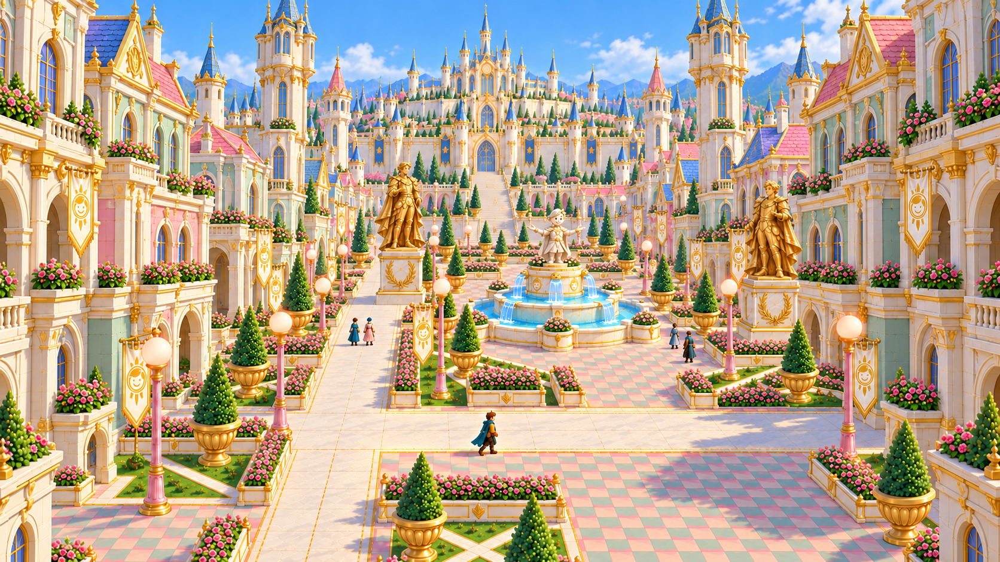

## Part A: the audit

Before shots (`docs/art/capital_rebuild_nov1/before/`):

| | |
|---|---|
| 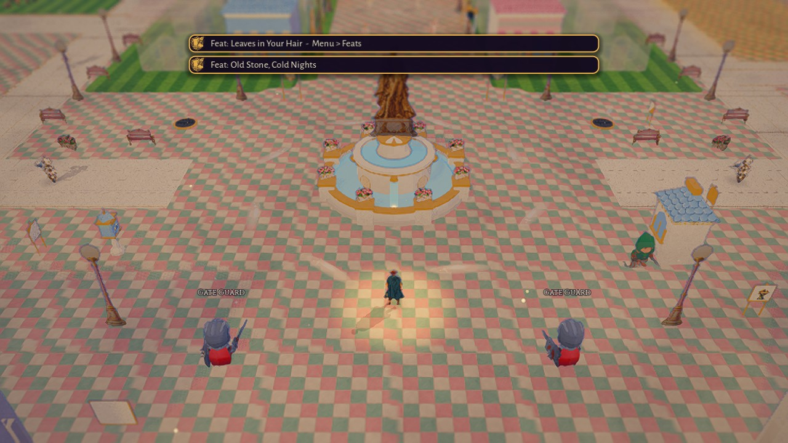 the target's framing | 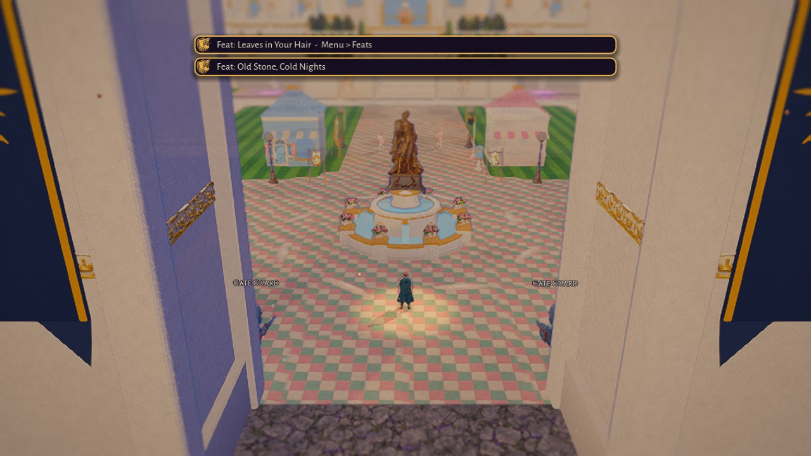 the same spot, Classic |
| 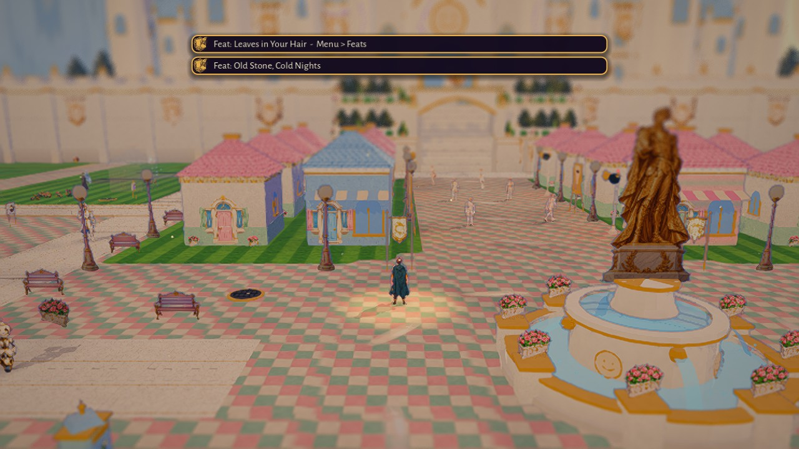 the Gate Plaza | 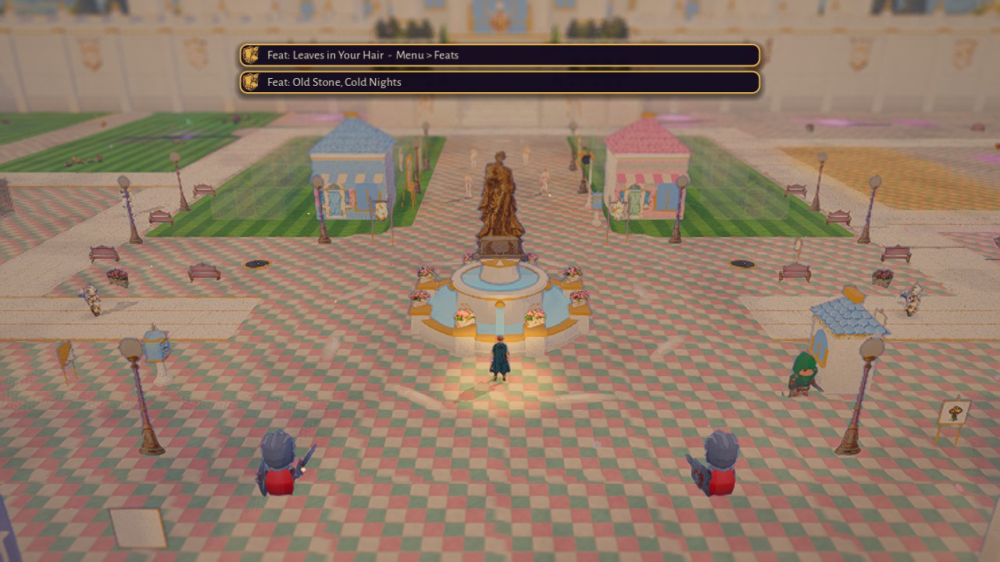 the fountain |
| 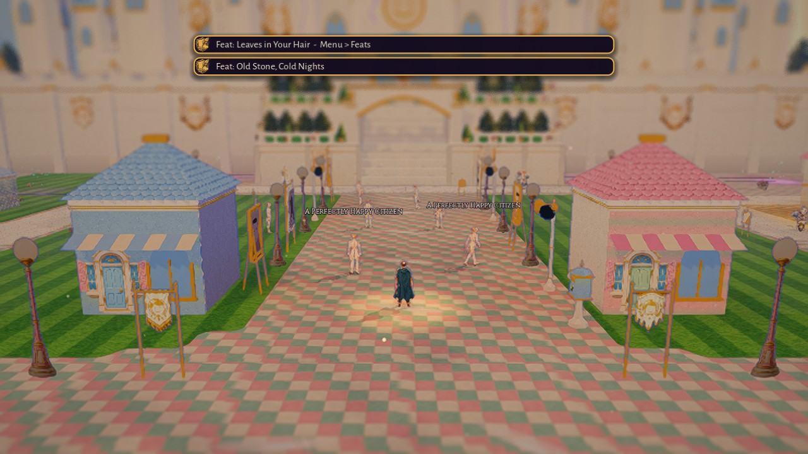 the boulevard | 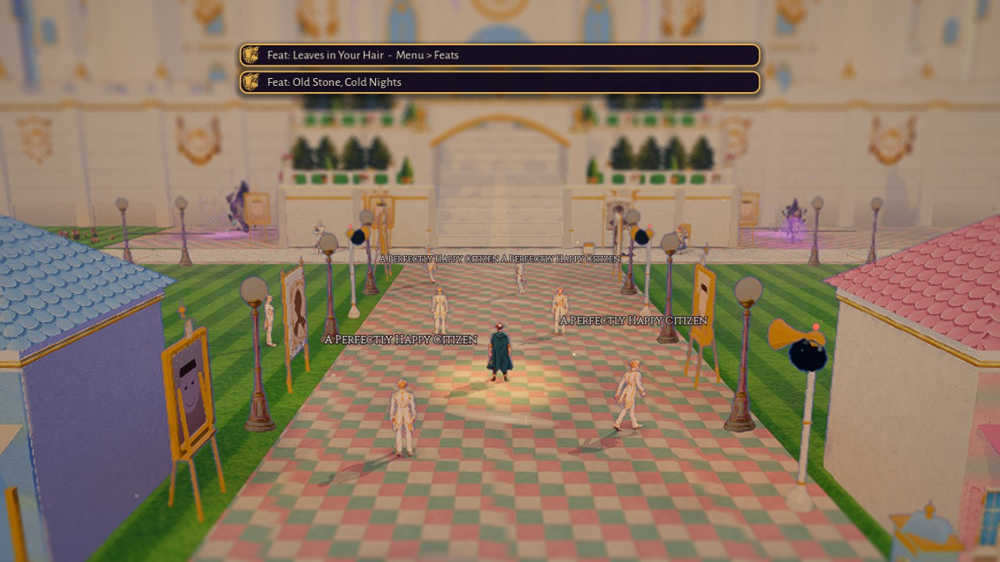 the palace approach |
| 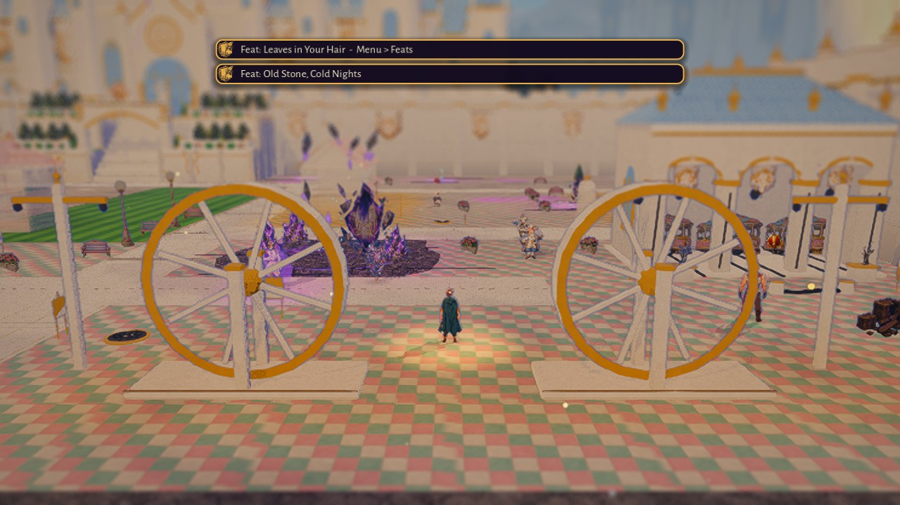 the Transit Yards | 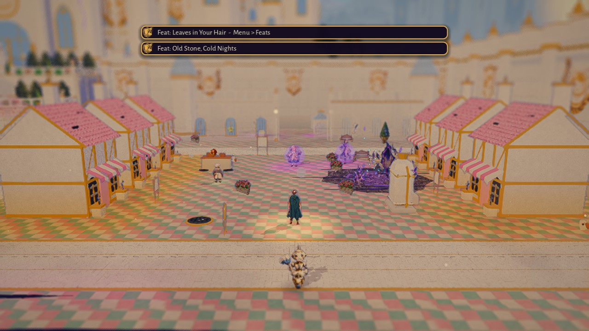 the Hungry Quarter |
| 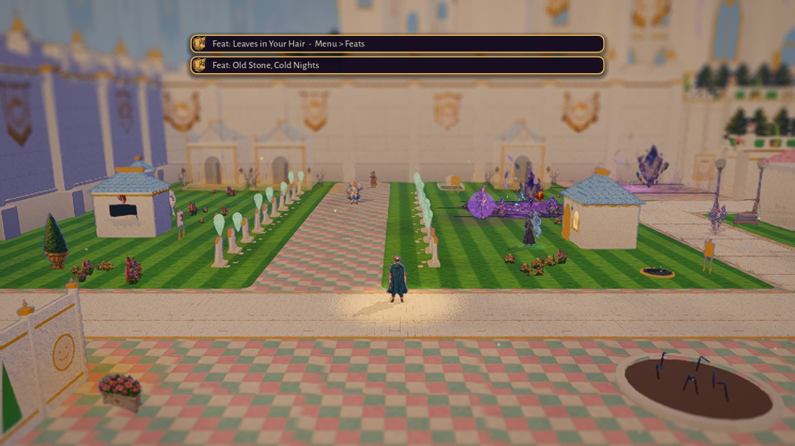 Grave Row | 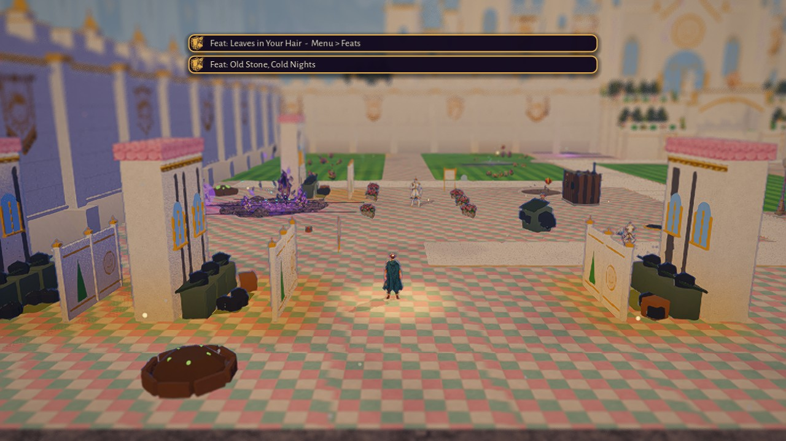 the Reek |

What the before shots show against the target, point by point of the brief:

| Target | Now | Decision |
|---|---|---|
| 1. A grand processional boulevard on one axis, the skyline stepping up to the castle | The axis exists (gate - fountain - avenue - stair - castle, x 60) but nothing rises along it: 4 m houses, 3.6 m lamps, a flat 9 m wall; the castle is a pale flat plate behind heavy haze and the far blur | keep the axis and every route; make the skyline (townhouses 12-18 m, towers 16-26 m, the castle sharper) and widen the paved boulevard visually |
| 2. Tall ornate townhouses in mirrored identical rows | Sixteen 4 x 4 m one-storey houses with hipped pink roofs and a painted door; two awning shops | a modular grand townhouse generator (storeys, bays, roof, balcony, arches, pediment, trim, flower boxes, banner) on the same sixteen footprints and the same doors (the "Try the door" spots stay); a second rank of taller ones behind |
| 3. Slender towers with pointed spires | none inside the city except the castle's | tower pieces (the kit's `spire` grown: a banded shaft, a balcony ring, a lancet lantern, a pink/blue/gold cone) at the plaza's four corners, the avenue's ends and the districts' corners, taller toward the castle |
| 4. Gilded Primm statues on tall plinths in pairs | one painted gold Primm on the fountain | the painted statue card (CAPI-PROP-PRIMM-STATUE: gold Primm on a laurel plinth, exactly the target) on a tall white-and-gold plinth, in mirrored pairs flanking the boulevard; toppled once Primm falls |
| 5. The fountain as a formal plaza's centrepiece | a 6.6 m single basin with a middle tier, eight rose posts, four jets, a 4.2 m statue | a tiered basin (three tiers, 9.4 m across), more water, the statue higher; a formal ring round it: a gold-bordered walk, four parterre quadrants, eight lamps |
| 6. Formal gardens only | lawn stripes with rows of topiary / rose / lamp cards along the white roads, wildflower clumps in Grave Row | geometric parterres: white planters with gold trim holding rose beds in straight runs, topiary cones in gold urns at every corner, lawn panels bordered by white paths; the clumps go |
| 7. Crisp checker plazas framed by white-and-gold borders | a 1 m pink/sage/cream checker over the whole inside | 2 m checker panels on the plaza and the boulevard framed by white borders with a gold line, cream streets elsewhere, a polish sheen |
| 8. Pink lamp posts, sun-face banners in identical sets | 3D ornate lamps with a gold pole; banners only on the gate towers and two plaza signs | the kit's pink globe lamp (CAP-PROP-LAMP) everywhere inside, as one MultiMesh; the sheet's sun banners on every townhouse, lamp pair and tower, the same angle |
| 9. Bright clean noon, warm gold, soft shadows, light haze, backdrop beyond the wall | washed out: the inside fog + the castle's own haze + the far depth blur grey everything past 30 m; the CAP-BD-CITY ring is lost behind the wall | Part D: thinner fog, haze only beyond the castle, a warmer sun, a sheen on the gold, less far blur in the Capital, the backdrop raised |
| 10. No scatter | the inside is already rows, not scatter, except Grave Row's flower clumps and the rose posts | remove the clumps; every piece in a row |
| 11. A few identical citizens | nine KayKit knights with a ":)" label, pale | keep nine, keep them identical, no change to their spots |
| 12. Eerily perfect touches | mirrored rows | exact symmetry everywhere; one banner a degree off per plaza |

The plan:

- **Axis**: unchanged (`CapitalLayout` routes). The boulevard is the avenue (x 57..63) plus its verges to the house fronts (x 53.5..66.5): the whole
  13 m reads as one paved boulevard with a white-and-gold border at the house line.
- **Buildings**: the sixteen footprints stay (x 43.5 / 49.5 / 66.5 / 72.5, z 19.5 / 26.5 / 33.5 / 40.5, 4 x 4 m), so every door spot, citizen alley and
  the walkability stay as they are; the inner columns become three-storey townhouses (12 m), the outer columns four-storey (15 m) so the skyline
  steps up away from the boulevard and nothing near the camera hides the hero (the camera looks north; the tallest masses stand at the sides).
- **Towers**: 2 x 2 m footprints on lawn, off every route and spot: the plaza's four corners (16 m), the avenue's north end either side of the
  forecourt (22 m), one at each district's corner (14 m).
- **Gardens**: parterres in the plaza's four quadrants and the lawn panels between the ring streets and the houses; the districts' lanes keep
  their planters.
- **Removed**: the Grave Row flower clumps, the generic lamp model, the old row pattern inside the Showcase (replaced by the parterres).
- **Pieces** (Part B, `world/capital/capital_grand.gd`): townhouse, tower, plinth + statue, fountain, planter run, urn + topiary, lamp, banner set,
  paving border, balustrade.

## Part B: the kit (`world/capital/capital_grand.gd`, look-dev `tools/capital_lineup.tscn`)

`bash tools/shot.sh res://tools/capital_lineup.tscn lineup_houses --pieces=old_house,house_hip,house_mansard,house_gable,house_tall --nohud=true`
(pieces: house_hip / house_mansard / house_gable / house_tall / tower / tower_pink / statue / statue_fallen / fountain / lamp / planter /
old_house / old_fountain; `--final=true` for the fallen state).

| | |
|---|---|
| 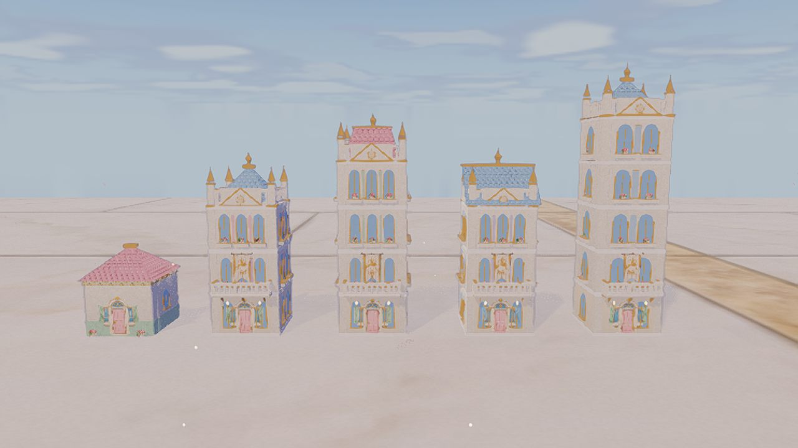 the old house, then the townhouse generator: hip, mansard, gable, five storeys | 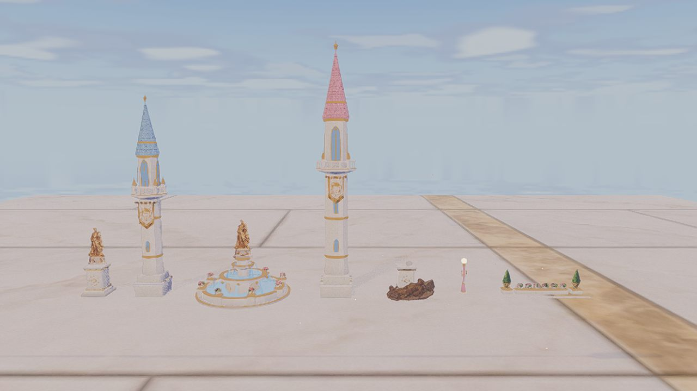 the gilded statue, towers (blue and pink spires), the tiered fountain, the toppled statue, a lamp, a planter run |

- **Townhouse** (`CapitalGrand.townhouse(spec)`): storeys (STOREY 2.6 m, a hero and a half), bays, accent (pink / sage / lavender / blue / cream:
  the upper storeys' plaster tinted, the ground storey cream), roof (hip blue slate / mansard pink / gable blue with a pediment), balcony on
  the first floor with a balustrade on gold brackets, pediment with the sun medallion at the roofline, gold trim at every floor line, corner
  pilasters with gold caps, arched mirrored windows in every bay (a flower box with a rose card under each upper one), the doors sheet's door
  under a small pediment with the emblem and two lanterns, a parapet balustrade with pinnacles at the corners, one sun banner over the door
  (`banner_roll` degrees off). `final`: dim gold, warm honest windows, the banner 7 degrees crooked, a warm light at the door.
- **Tower** (`tower(height, radius, roof, final)`): square gold-capped plinth, banded round shaft with slot windows, a balcony ring with its
  balustrade and four pinnacles, a lantern of four mirrored lancets, a pointed cone (blue / pink / gold) with a collar and finial, a sun banner
  below the balcony.
- **Gilded statue** (`statue_plinth`): the painted gold Primm on his laurel plinth (CAPI-PROP-PRIMM-STATUE: the target's statue) raised on a
  stepped white plinth with gold bands, a gold laurel-and-sun relief front and back, corner rosettes; toppled (the fallen card at its foot, a
  stump on top) once Primm has fallen. Never fades or culls.
- **Fountain** (`fountain(outer, final)`): a gold-bordered step, three tiers of white marble with gold rims, eight rose planters on the lowest
  rim, water in every tier, eight jets from the middle tier and four from the upper, four emblems on the drum, the painted statue on top; dry
  with the fallen card in the basin once Primm has fallen. The plaza's hazard circle grew from 3.3 to 4.6 m (the avenue now starts at z 46.5
  and the boulevards end at x 49 / 71, so the open ring round it keeps the layout rule).
- **Planters, borders, balustrades, lamp banners**: `planter_run` (a low white box with a gold lip; the rose cards' positions come back for the
  card field), `planter_box`, `border` (a white strip with a gold line on the paving), `ring_border`, `balustrade`, `card_rolled` (a card
  hung a few degrees off), `lamp_mesh` / `lamp_banner_mesh` (a 3D pink lamp and its banner pair, for MultiMeshes).

## Part C: the layout

- The sixteen footprints and every route, anchor, spot and sign stay where they were. The inner columns (x 49.5 / 66.5) are four-storey
  townhouses, the outer (43.5 / 72.5) five, each row its own roof and accent mirrored across the axis; the plaza-side pair keep the
  storefronts' doors, house 6 its different door; house 9's banner hangs a degree and a half off. One mesh per house (the fader dims one, not a
  row); every state (the fallen one loosened: crooked banners, warm windows) - the old ruined-house swap is gone (inbox 2).
- Towers ("spire" buildings, 2 x 2 m): the plaza's four corners (48, 49) (72, 49) (50, 67.5) (70, 67.5) at 16 m, one per district at its inner
  corner (Grave Row (33, 9.5), the Reek (33, 45), the Transit Yards (113, 62), the Ward (116, 9)) at 14 m; the tallest pair (20 m, gold) on the
  hill top either side of the stair's landing (the forecourt's lawn holds two rifts, so no pair fits there).
- Gilded pairs: (51.5, 47) and (68.5, 47) flanking the avenue's mouth, facing the gate.
- The skyline beyond the walkable city (`CapitalBuilder._build_skyline`): on the hill top either side of the palace four townhouses and two
  towers (20 / 26 m) per side; behind the side walls a row of five-storey fronts facing the city and a 24 m gold tower each; merged, never
  culled (`KitBatch` now carries `no_range_cull` through a merge).
- Gardens (`CapitalDressing`): four parterre beds on the plaza's diagonals (a 2.8 m white planter, sixteen roses, a topiary cone in its gold
  urn; the planter blocks), rose runs along both verges of the boulevard (x 56 / 64, z 18.5-44.5) and along the lawn panels by the ring
  streets (x 41.6 / 78.4, broken round the two hidden chests), a matched banner pair on each of the plaza's eight lamps (one a degree off); the
  Grave Row flower clumps are gone. The garden pieces live in `garden_fields`, apart from the rows the people-room rule governs.
- Paving: a 2 m checker of pink, sage and cream over every plaza cell (the painted plaza texture underneath is a 1 m checker that no vertex
  colour can change), white-and-gold borders along the avenue's edges, round the plaza and round the fountain's walk.
- The gate piers' faces toward the opening and the city carry the sun medallion, a mirrored lancet and a banner.

## Part D: light

`data/zone_styles/capital_inside.json` + the `capital_inside` mood in `data/art/zone_looks.json`: the violet ambient (#9a90d8) is a pale cool
white (#cfcde6) at 0.38, the sun 0.95 with shadows at 0.62 opacity, fog 0.0016 -> 0.0005 (and the castle's own haze 0.0012 -> 0.0005), exposure
0.78 -> 0.62 with contrast 1.18, warmth 0.15 -> 0.04, bloom 0.5/0.7 at 0.95 -> 0.2 at 1.25 (a white city bloomed everywhere), the tilt-shift's
far blur 7 -> 1.2 inside the walls, vignette 0.08. The pale look that remains at the Far zoom is the scene's own brightness (cream plaster in
full sun under AgX), not fog: a fog-off shot and an ACES shot were taken to check.

## Part F: the scores

A fresh critic (`docs/review/critic_brief_capital_nov1.md`: sees only the target and one folder of shots, reads nothing else, runs nothing)
scores each iteration 1-10. Reports: `docs/review/capital_critic_<phase>.md`.

| Iteration | Grandeur | Symmetry | Buildings | Towers | Statues/fountain | Gardens | Paving | Light | Overall |
|---|---|---|---|---|---|---|---|---|---|
| c2 (Showcase rebuilt, first light pass) | 4 | 5 | 4 | 2 | 7 | 4 | 6 | 3 | 4 |
