# Capital inner-city rebuild (Nov 1-2)

Everything inside the great wall rebuilt to match the target `docs/art/paintovers/PAINTOVER-CAP-INNER-CITY.png` (also on the Drive under
`Approved_ZoneKits/Capital/`): a tyrant's dream of perfection - grand, symmetrical, spotless, slightly too perfect. Zone id `final`,
`scenes/capital_zone.tscn`, the code under `world/capital/`. The brief's Parts A-G; judgment calls are logged in `docs/overnight_inbox.md`
("Capital rebuild Nov 1-2"). Rules kept: only art already in the game or approved on the Drive (new geometry built in code from the kit's textures
and meshes is fine); the dialogue freeze; one Godot at a time; the gameplay inside the walls (every road, NPC, spot, sign, rift, entrance, the tram,
the Lost Property spot, the Crease, the roamers, the drain logic, the hidden hole and the gate) keeps working and the Capital tests stay green.

Shots: `bash tools/capital_rebuild_shots.sh <phase> [prefix,...]` writes the same standard spots every iteration into
`docs/art/capital_rebuild_nov1/<phase>/` (1280x720 JPEG, no HUD, gate open, enemies held, districts broken): `ref` (the target's framing: on the
boulevard south of the fountain, looking north up the axis to the castle), `ref_mid` / `ref_play` (the same spot from the Classic and the play
camera), `gate_plaza`, `inner_gate`, `boulevard`, `fountain`, `palace_approach`, `transit_yards`, `hungry_quarter`, `grave_row`, `the_reek`,
`overview`. Coordinates below are world metres (x east, z south, the camera looks north); the great wall stands on rows z 72-75, the city inside
is x 2..116, z 2..71, the castle hill fills x 47..74, z 0..12 and the palace stands beyond it.

## The target

## Part A: the audit

Before shots (`docs/art/capital_rebuild_nov1/before/`):

| | |
|---|---|
|  the target's framing |  the same spot, Classic |
|  the Gate Plaza |  the fountain |
|  the boulevard |  the palace approach |
|  the Transit Yards |  the Hungry Quarter |
|  Grave Row |  the Reek |

What the before shots show against the target, point by point of the brief:

| Target | Now | Decision |
|---|---|---|
| 1. A grand processional boulevard on one axis, the skyline stepping up to the castle | The axis exists (gate - fountain - avenue - stair - castle, x 60) but nothing rises along it: 4 m houses, 3.6 m lamps, a flat 9 m wall; the castle is a pale flat plate behind heavy haze and the far blur | keep the axis and every route; make the skyline (townhouses 12-18 m, towers 16-26 m, the castle sharper) and widen the paved boulevard visually |
| 2. Tall ornate townhouses in mirrored identical rows | Sixteen 4 x 4 m one-storey houses with hipped pink roofs and a painted door; two awning shops | a modular grand townhouse generator (storeys, bays, roof, balcony, arches, pediment, trim, flower boxes, banner) on the same sixteen footprints and the same doors (the "Try the door" spots stay); a second rank of taller ones behind |
| 3. Slender towers with pointed spires | none inside the city except the castle's | tower pieces (the kit's `spire` grown: a banded shaft, a balcony ring, a lancet lantern, a pink/blue/gold cone) at the plaza's four corners, the avenue's ends and the districts' corners, taller toward the castle |
| 4. Gilded Primm statues on tall plinths in pairs | one painted gold Primm on the fountain | the painted statue card (CAPI-PROP-PRIMM-STATUE: gold Primm on a laurel plinth, exactly the target) on a tall white-and-gold plinth, in mirrored pairs flanking the boulevard; toppled once Primm falls |
| 5. The fountain as a formal plaza's centrepiece | a 6.6 m single basin with a middle tier, eight rose posts, four jets, a 4.2 m statue | a tiered basin (three tiers, 9.4 m across), more water, the statue higher; a formal ring round it: a gold-bordered walk, four parterre quadrants, eight lamps |
| 6. Formal gardens only | lawn stripes with rows of topiary / rose / lamp cards along the white roads, wildflower clumps in Grave Row | geometric parterres: white planters with gold trim holding rose beds in straight runs, topiary cones in gold urns at every corner, lawn panels bordered by white paths; the clumps go |
| 7. Crisp checker plazas framed by white-and-gold borders | a 1 m pink/sage/cream checker over the whole inside | 2 m checker panels on the plaza and the boulevard framed by white borders with a gold line, cream streets elsewhere, a polish sheen |
| 8. Pink lamp posts, sun-face banners in identical sets | 3D ornate lamps with a gold pole; banners only on the gate towers and two plaza signs | the kit's pink globe lamp (CAP-PROP-LAMP) everywhere inside, as one MultiMesh; the sheet's sun banners on every townhouse, lamp pair and tower, the same angle |
| 9. Bright clean noon, warm gold, soft shadows, light haze, backdrop beyond the wall | washed out: the inside fog + the castle's own haze + the far depth blur grey everything past 30 m; the CAP-BD-CITY ring is lost behind the wall | Part D: thinner fog, haze only beyond the castle, a warmer sun, a sheen on the gold, less far blur in the Capital, the backdrop raised |
| 10. No scatter | the inside is already rows, not scatter, except Grave Row's flower clumps and the rose posts | remove the clumps; every piece in a row |
| 11. A few identical citizens | nine KayKit knights with a ":)" label, pale | keep nine, keep them identical, no change to their spots |
| 12. Eerily perfect touches | mirrored rows | exact symmetry everywhere; one banner a degree off per plaza |

The plan:

- **Axis**: unchanged (`CapitalLayout` routes). The boulevard is the avenue (x 57..63) plus its verges to the house fronts (x 53.5..66.5): the whole
  13 m reads as one paved boulevard with a white-and-gold border at the house line.
- **Buildings**: the sixteen footprints stay (x 43.5 / 49.5 / 66.5 / 72.5, z 19.5 / 26.5 / 33.5 / 40.5, 4 x 4 m), so every door spot, citizen alley and
  the walkability stay as they are; the inner columns become three-storey townhouses (12 m), the outer columns four-storey (15 m) so the skyline
  steps up away from the boulevard and nothing near the camera hides the hero (the camera looks north; the tallest masses stand at the sides).
- **Towers**: 2 x 2 m footprints on lawn, off every route and spot: the plaza's four corners (16 m), the avenue's north end either side of the
  forecourt (22 m), one at each district's corner (14 m).
- **Gardens**: parterres in the plaza's four quadrants and the lawn panels between the ring streets and the houses; the districts' lanes keep
  their planters.
- **Removed**: the Grave Row flower clumps, the generic lamp model, the old row pattern inside the Showcase (replaced by the parterres).
- **Pieces** (Part B, `world/capital/capital_grand.gd`): townhouse, tower, plinth + statue, fountain, planter run, urn + topiary, lamp, banner set,
  paving border, balustrade.

## Part B: the kit (`world/capital/capital_grand.gd`, look-dev `tools/capital_lineup.tscn`)

`bash tools/shot.sh res://tools/capital_lineup.tscn lineup_houses --pieces=old_house,house_hip,house_mansard,house_gable,house_tall --nohud=true`
(pieces: house_hip / house_mansard / house_gable / house_tall / tower / tower_pink / statue / statue_fallen / fountain / lamp / planter /
old_house / old_fountain; `--final=true` for the fallen state).

| | |
|---|---|
|  the old house, then the townhouse generator: hip, mansard, gable, five storeys |  the gilded statue, towers (blue and pink spires), the tiered fountain, the toppled statue, a lamp, a planter run |

- **Townhouse** (`CapitalGrand.townhouse(spec)`): storeys (STOREY 2.6 m, a hero and a half), bays, accent (pink / sage / lavender / blue / cream:
  the upper storeys' plaster tinted, the ground storey cream), roof (hip blue slate / mansard pink / gable blue with a pediment), balcony on
  the first floor with a balustrade on gold brackets, pediment with the sun medallion at the roofline, gold trim at every floor line, corner
  pilasters with gold caps, arched mirrored windows in every bay (a flower box with a rose card under each upper one), the doors sheet's door
  under a small pediment with the emblem and two lanterns, a parapet balustrade with pinnacles at the corners, one sun banner over the door
  (`banner_roll` degrees off). `final`: dim gold, warm honest windows, the banner 7 degrees crooked, a warm light at the door.
- **Tower** (`tower(height, radius, roof, final)`): square gold-capped plinth, banded round shaft with slot windows, a balcony ring with its
  balustrade and four pinnacles, a lantern of four mirrored lancets, a pointed cone (blue / pink / gold) with a collar and finial, a sun banner
  below the balcony.
- **Gilded statue** (`statue_plinth`): the painted gold Primm on his laurel plinth (CAPI-PROP-PRIMM-STATUE: the target's statue) raised on a
  stepped white plinth with gold bands, a gold laurel-and-sun relief front and back, corner rosettes; toppled (the fallen card at its foot, a
  stump on top) once Primm has fallen. Never fades or culls.
- **Fountain** (`fountain(outer, final)`): a gold-bordered step, three tiers of white marble with gold rims, eight rose planters on the lowest
  rim, water in every tier, eight jets from the middle tier and four from the upper, four emblems on the drum, the painted statue on top; dry
  with the fallen card in the basin once Primm has fallen. The plaza's hazard circle grew from 3.3 to 4.6 m (the avenue now starts at z 46.5
  and the boulevards end at x 49 / 71, so the open ring round it keeps the layout rule).
- **Planters, borders, balustrades, lamp banners**: `planter_run` (a low white box with a gold lip; the rose cards' positions come back for the
  card field), `planter_box`, `border` (a white strip with a gold line on the paving), `ring_border`, `balustrade`, `card_rolled` (a card
  hung a few degrees off), `lamp_mesh` / `lamp_banner_mesh` (a 3D pink lamp and its banner pair, for MultiMeshes).

## Part C: the layout

- The sixteen footprints and every route, anchor, spot and sign stay where they were. The inner columns (x 49.5 / 66.5) are four-storey
  townhouses, the outer (43.5 / 72.5) five, each row its own roof and accent mirrored across the axis; the plaza-side pair keep the
  storefronts' doors, house 6 its different door; house 9's banner hangs a degree and a half off. One mesh per house (the fader dims one, not a
  row); every state (the fallen one loosened: crooked banners, warm windows) - the old ruined-house swap is gone (inbox 2).
- Towers ("spire" buildings, 2 x 2 m): the plaza's four corners (48, 49) (72, 49) (50, 67.5) (70, 67.5) at 16 m, one per district at its inner
  corner (Grave Row (33, 9.5), the Reek (33, 45), the Transit Yards (113, 62), the Ward (116, 9)) at 14 m; the tallest pair (20 m, gold) on the
  hill top either side of the stair's landing (the forecourt's lawn holds two rifts, so no pair fits there).
- Gilded pairs: (51.5, 47) and (68.5, 47) flanking the avenue's mouth, facing the gate.
- The skyline beyond the walkable city (`CapitalBuilder._build_skyline`): on the hill top either side of the palace four townhouses and two
  towers (20 / 26 m) per side; behind the side walls a row of five-storey fronts facing the city and a 24 m gold tower each; merged, never
  culled (`KitBatch` now carries `no_range_cull` through a merge).
- Gardens (`CapitalDressing`): four parterre beds on the plaza's diagonals (a 2.8 m white planter, sixteen roses, a topiary cone in its gold
  urn; the planter blocks), rose runs along both verges of the boulevard (x 56 / 64, z 18.5-44.5) and along the lawn panels by the ring
  streets (x 41.6 / 78.4, broken round the two hidden chests), a matched banner pair on each of the plaza's eight lamps (one a degree off); the
  Grave Row flower clumps are gone. The garden pieces live in `garden_fields`, apart from the rows the people-room rule governs.
- Paving: a 2 m checker of pink, sage and cream over every plaza cell (the painted plaza texture underneath is a 1 m checker that no vertex
  colour can change), white-and-gold borders along the avenue's edges, round the plaza and round the fountain's walk.
- The gate piers' faces toward the opening and the city carry the sun medallion, a mirrored lancet and a banner.

## Part D: light

`data/zone_styles/capital_inside.json` + the `capital_inside` mood in `data/art/zone_looks.json`: the violet ambient (#9a90d8) is a pale cool
white (#cfcde6) at 0.38, the sun 0.95 with shadows at 0.62 opacity, fog 0.0016 -> 0.0005 (and the castle's own haze 0.0012 -> 0.0005), exposure
0.78 -> 0.62 with contrast 1.18, warmth 0.15 -> 0.04, bloom 0.5/0.7 at 0.95 -> 0.2 at 1.25 (a white city bloomed everywhere), the tilt-shift's
far blur 7 -> 1.2 inside the walls, vignette 0.08. The pale look that remains at the Far zoom is the scene's own brightness (cream plaster in
full sun under AgX), not fog: a fog-off shot and an ACES shot were taken to check.

## Part F: the scores

A fresh critic (`docs/review/critic_brief_capital_nov1.md`: sees only the target and one folder of shots, reads nothing else, runs nothing)
scores each iteration 1-10. Reports: `docs/review/capital_critic_<phase>.md`.

| Iteration | Grandeur | Symmetry | Buildings | Towers | Statues/fountain | Gardens | Paving | Light | Overall |
|---|---|---|---|---|---|---|---|---|---|
| c2 (Showcase rebuilt, first light pass) | 4 | 5 | 4 | 2 | 7 | 4 | 6 | 3 | 4 |
| c3 (bolder pastels, gate piers, lamp banners, lawn rose runs, grade v2) | 5 | 6 | 6 | 2 | 7 | 6 | 7 | 4 | 5 |
| c4 (12 m plaza towers, more hill spires, gold horns, grade v3, ref reframed) | 6 | 7 | 5 | 4 | 8 | 6 | 7 | 4 | 5 |
| c5 (whiter key, less fill, shadows 0.85, exposure 0.47; terrace statue pair) | 6 | 7 | 6 | 4 | 7 | 6 | 7 | 4 | 5 |
| c6 (bluer horizon band; the Transit tower moved, the Ward tower dropped) | 6 | 6 | 5 | 4 | 7 | 6 | 7 | 4 | 5 |

What the critics could not see: the play camera (Cinematic, 20 degrees) sees about six degrees above the horizon, so the roofs, pediments and
pinnacles of any townhouse nearer than about 40 m and the spires of the 12 m plaza towers are above the frame; every critic scored "no roofs,
no spires" while the lineup shows them. Only the far skyline (the castle, the hill-top spires, the rows beyond the walls) reads in play. The
tallest masses therefore stand far (the hill top). The "black lamp globes" every critic reported are the loudspeakers' horns seen from the
front (now gold inside too). The light score stayed at 4 through four grade passes (exposure 0.84 -> 0.47, bloom cut, ambient cut, shadows
0.3 -> 0.85): what the critic calls "overexposed" is cream plaster in full sun under the toon shader's lit band, and the "white sky" is the
sky's horizon band, the only part of the sky the play camera sees. Both are look-wide decisions (inbox 1, 4), not fixable inside the Capital.

### The fallen state (`--flags=zone_final_completed`)

| | |
|---|---|
| 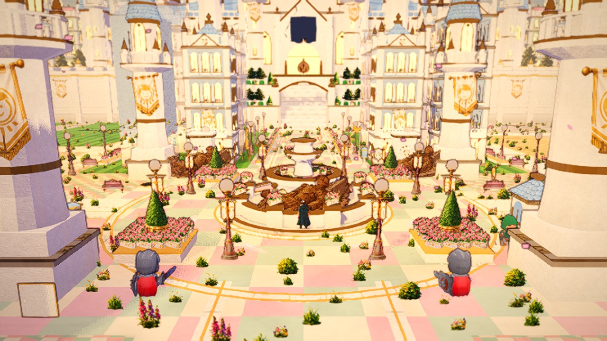 the plaza: toppled statues, the fountain dry, weeds in the checker | 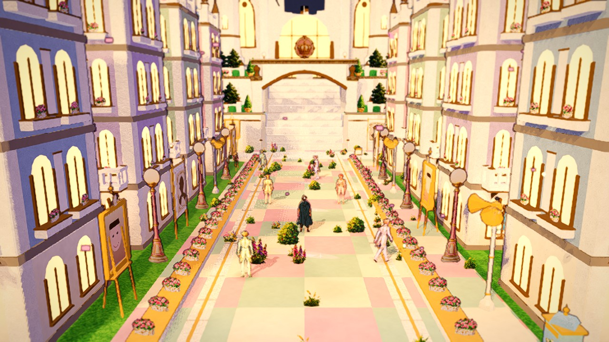 the boulevard: warm windows, dim gold, crooked banners |

## Part E: gameplay and performance

- Layout rules: the world test group (`bash tools/run_tests.sh --only=tests/world`, 431 tests) and the core group pass (see the note on the
  connectivity test below); the parterre pieces live in `CapitalDressing.garden_fields` (they stand inside their planters by design), the
  fountain's bigger circle keeps the plaza-open rule because the avenue now starts at z 46.5 and the boulevards end at x 49 / 71.
- `bash tools/run_capital_walk_smoke.sh`: OK (36 screenshots; the gate, every district, the Ward, the castle door, the hidden hole, save/load,
  the four Paths freed and welcomed).
- `bash tools/perf_budget.sh frame capital_in "0 1"` at the gate (`--at=gate_inside`, Medium 1600x900 on the development iGPU):

| capital_in Medium | avg ms | 1 % low ms | draw calls |
|---|---|---|---|
| budget | 18.5 | 25.0 | 850 |
| first rebuild (per-house meshes, cells) | 16.98 | 51.5 | 1004 |
| body / detail split, skyline per material | 16.92 | 26.5 | 934 |
| second rank + towers batched | 16.39 | 21.5 | 877 |
| lamps + benches as card fields, statues batched, gold lanterns | 16.48 | 22.1 | 847 (met) |

  Low: 12.9 ms avg, 424 draw calls (the Low budget line 390 / 24.1 ms predates the rebuild; its p99 25.8 is within noise; the budgets file was
  not re-based). Loading: the same path as before (layout, ground, build cache); the new pieces build in code, nothing new is imported.
- Shadows only from the bodies (plaster, roofs); windows, trim, cards, balustrades, lamps, benches, roses, topiary cast none.
- Occlusion: one mesh per inner-rank townhouse (the fader dims one house); the second rank, the towers and the statues merge and never fade
  (the statues and the fountain by the brief; the towers are thin; the second rank never stands between the trailing camera and the hero on the
  avenue or in the alleys).

## Part G: where it stands

The plaza, the boulevard and the castle approach match the target in composition and vocabulary (the critics' own words: "the composition and
asset set are right", "would pass as a decent indie screenshot"); the scores plateaued at c4-c6 because the three things every critic asked
for next are outside the Capital's own files: a higher camera pitch (roofs, spires, sky), the districts' models replaced by townhouse modules
(inbox 3), and the look-wide exposure of sunlit cream plaster under the toon shader. None of the nine criteria reached 8 on the strict scale
except statues/fountain once (c4). The after gallery is the c6 set (`docs/art/capital_rebuild_nov1/c6/`):

| | |
|---|---|
| 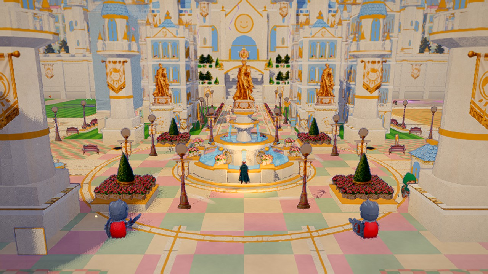 the plaza from the gate (was: 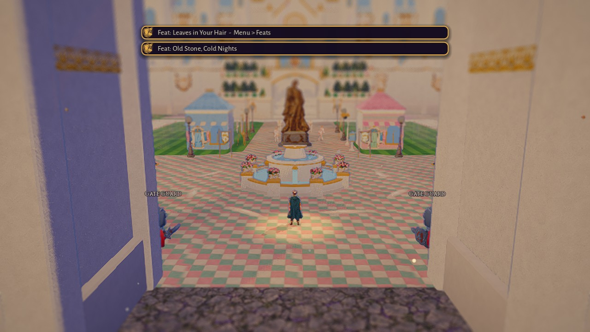) | 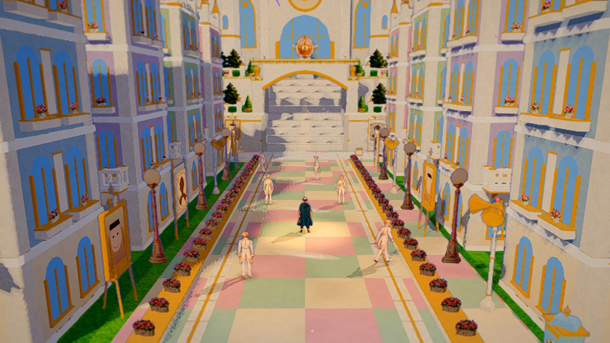 the palace approach (was: ) |
| 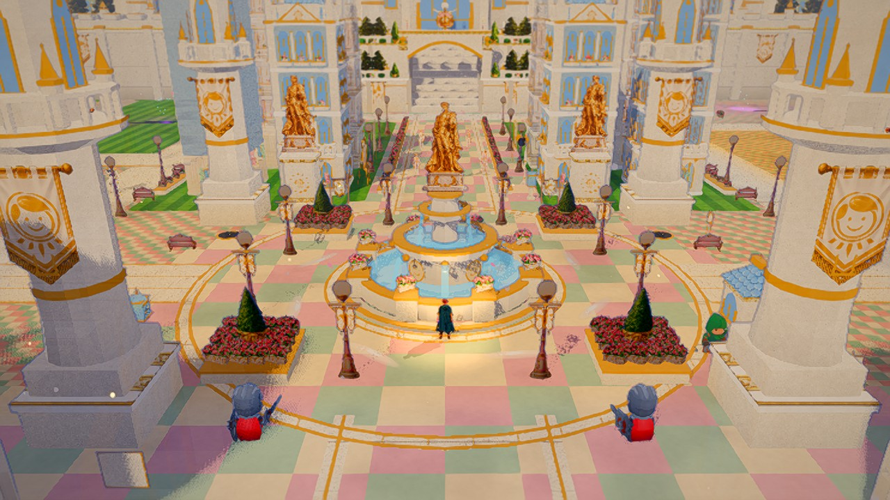 the fountain plaza | 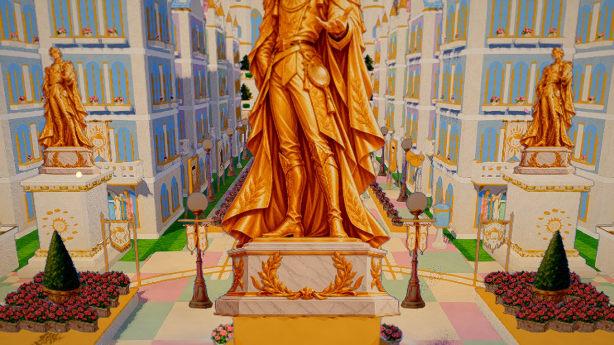 the boulevard's mouth |
| 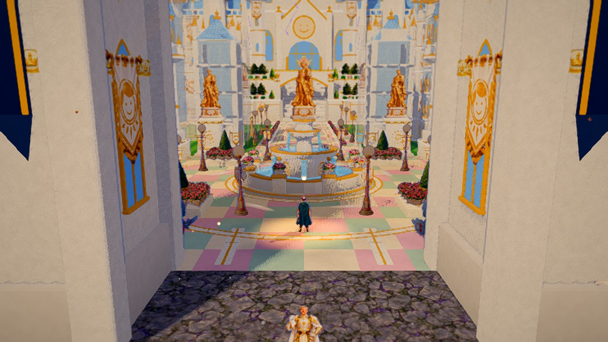 the inner gate | 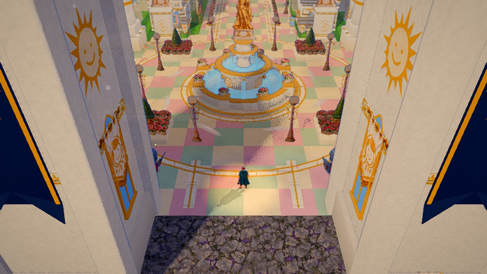 overview |
| 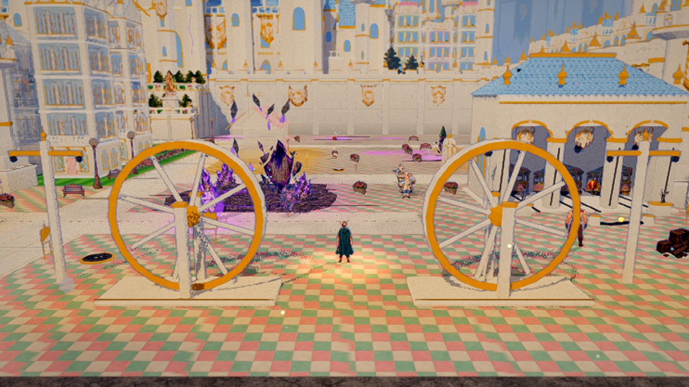 the Transit Yards | 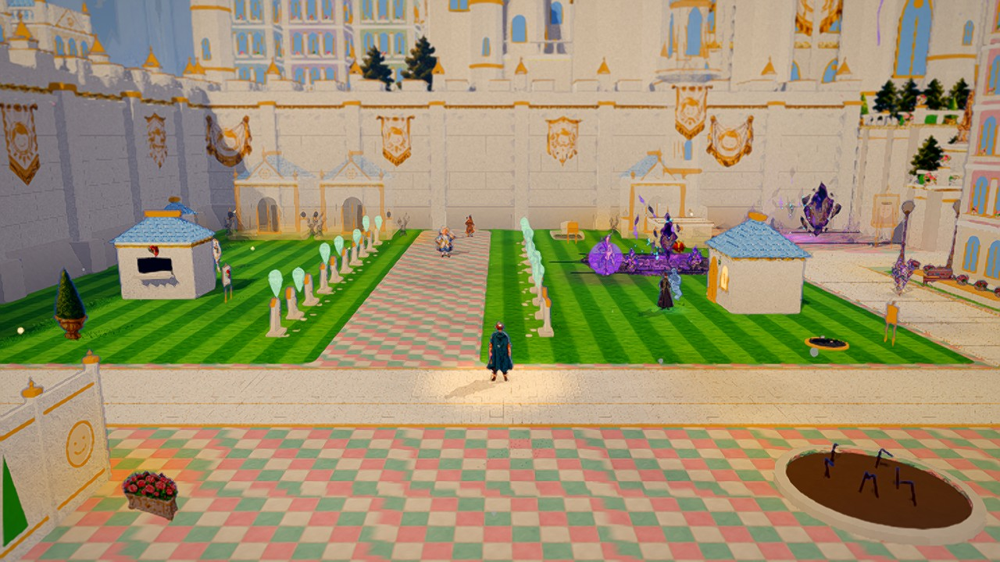 Grave Row |

Art requests (nothing missing was invented): a side / three-quarter painting of the gold Primm statue (the pairs could then face each other
across the boulevard instead of south); a sage pastel slate roof tile (only pink and blue exist); a gold urn card without the topiary; the
CAP-PATH-WHITE re-upload (truncated on the Drive since the art pass).

# The sides pass (Nov 2)

Brief: "CAPITAL SIDES PASS (follow-up to the inner-city rebuild)". Tag `pre-capital-sides-nov2`. The centre (the boulevard / fountain axis)
was judged good after the rebuild; the LEFT and RIGHT sides inside the wall were not. The user's screenshot is the Reek from its paint-over camera
(`capital_rebuild_nov1/c6/the_reek.jpg`): the two Reek yards' rear walls seen edge-on (the "pink-capped gateposts"), the lane planters' topiary
cards and rose beds loose on the district checker (the "scatter"), the yards' bins, bags and the rubble card (the "black objects"), the compost
heap pickup (the "brown mud disc"), the empty Reek floor against a bare wall. Everything below is code-built from the kit's own textures and
cards (nothing new imported); the dialogue is untouched. State: `docs/loop_state.md`; questions: `docs/overnight_inbox.md` ("Capital sides Nov 2").

## Part 1: no scatter on paving, no black objects

- **Scatter.** The rows along the white roads (`CapitalDressing._rows`) place a plant only on a cell the painted ground paints as lawn
  (`CapitalDressing.is_lawn_at`: the painted ground's own rule - Grave Row is a lawn but for its lanes, the Reek is paved whatever its cells say,
  elsewhere the lawn / soil / grass cells); a lamp or a bench may still stand on district paving, never the plaza. The old lane planters (loose
  topiary cones and rose beds along every district lane) are gone; in their place every inside route whose kerb is district paving gets a
  **continuous white planter with a gold lip** (`_kerb_planters`: 0.9 m off the edge, broken at the junctions and round the people and their
  spots, mirrored across the avenue on the mirrored streets) with roses in it and a **clipped cone in a gold urn every 4 m** (`CapitalGrand.gold_urn`).
  Every planter's footprint is recorded (`CapitalDressing.planters`); `loose_on_paving()` lists any plant off a lawn or outside a planter.
- **Black objects.** The cause was the palette, not a missing texture: the kit's flat slots `bag` (#2c2c34), `bin_dark`, `dark` (#141018),
  `wood_dark`, `iron_dark`, `stone_dark` and the dead-window flat (#2e2c34) sit at a linear luminance of 0.02-0.05, and under the toon shader's
  shadow band at noon they render black. Every inside piece that used them is restyled in the Capital's finish, "perfect even when broken":
  white enamel bins with gold bands and lids, cream sacks tied with gold cord, white crates with gold edges (`CapitalGrand.gilded_bin / sack /
  white_crate`), the compost heaps (pickups) under a gold domed cover with the sun emblem in a white planter ring with the healthy sprouts
  pushing out round it, the sick patch a formal round bed (white kerb, gold lip, pale ash soil until the seed goes in), gilded drain covers for
  the manholes, gold bars on the Ward's windows, gold tram rails, dead windows as mirrored glass, dead lamp globes pale, Old Fern's shack
  whitewashed with gold posts, the loudspeakers' bells gold inside (the "dark" inner quad was still drawn), the dead insulators pale, the
  planters' earth a lighter loam. The rubble card (`CAP-SHEET-RUBBLE-06`) that stood for the yards' crates is gone.
- **Tests** (`tests/world/test_capital_sides.gd`): `test_nothing_grows_loose_on_paving_inside_the_wall` (every plant inside is on a lawn or in
  a planter; the planters and the urn cones are counted) and `test_nothing_inside_the_wall_renders_near_black` - a probe that builds the whole
  Capital, walks every visible triangle inside the wall (x 1..119, z 1..72, y < 40), multiplies the material's albedo (sRGB -> linear) by the
  vertex colour and sums the area of triangles under a linear luminance of 0.10 (sRGB ~0.36), ignoring textured, emissive and shader
  surfaces, the rifts and the Transit Yards' cable (black by story). Before the restyle: **434.8 m2** of near-black inside the wall; after:
  **0.31 m2** (budget 0.6).

## Part 2: no skinny buildings

- The districts' houses are **CapitalGrand townhouses with a service layer** (`world/capital/capital_sides.gd`, `CapitalSides.district_house`):
  the Reek's three yards (two 4.5 m rear-wall slabs and a 4 m one) are an 8 m four-storey sage house against the west wall, a 4 m three-storey
  one east of the Reek's plaza and a 6.9 m four-storey one north by the rift - each with the painted white-and-gold screen across its front
  and the gilded bins and sacks in rows behind it (broken; flies over them) or white compost bins, a raised bed of blooms in a row, moss squares
  and a gold can (restored). Grave Row's three crypts are two three-storey lavender chapel houses (9.5 m and 6 m, gable roofs) with dead lanterns
  on posts and empty gold urns in a row (broken) or green lanterns, topiary in the urns and roses (restored, with a light). The Hungry Quarter's
  six stalls are **one long 14.5 m three-storey shop-house each side of the lane**, mirrored, the striped awning the whole length of the ground
  floor, marble shelves under every window with grey paste (broken) or real food, copper pots and a warm oven light (restored). The same
  `CAP-HERO-*` ids and states, so the district tests and the freed states hold.
- The **plaza corners' pylons are gate piers** (`CapitalSides.gate_pier`: a stepped plinth, a square pilaster with gold bands and the sun emblem
  on every face, a cornice, a gilded urn with a flame finial; 6.7 m); the three district pylons (the Reek, Grave Row, the Transit Yards) are gone.
- **The walls' inner faces are dressed** (`CapitalSides.wall_dressing`): along the west, east and north walls a blind arcade - a pilaster every
  4 m with gold caps, a gold semicircular arch over a cream panel in every bay, a sun medallion or a painted sun banner by turns, a gold string
  course - with a **small gilded Primm in a niche every fourth bay and a wall basin with a gold spout every fourth bay** (Part 4), and an
  **engaged tower every 14 m rising from the wall's top** (13 m to the eaves, pink / blue / gold spires by turns, a banner facing the city):
  eleven towers, so the skyline is spires from every angle. One merged piece, never culled or faded (it lies on the city's edge).
- Lineup pieces for look-dev: `--pieces=reek_house,grave_house,hungry_house,pier,side_fountain` (`_restored` variants).

## Part 3: the side plazas

- Where each boulevard meets its district lane - **(19, 58)** in the Reek and **(100, 58)** in the Transit Yards - a formal plaza: a paving
  disc of the 2 m checker (r 8.5) with white-and-gold ring borders at the rim and round the fountain, the **side fountain** at its centre
  (`CapitalGrand.fountain_side`: two tiers instead of three, an octagonal basin with gold balls on its corners, a fluted drum with the sun
  emblem on four faces, a scalloped upper bowl with eight spouts, a gilded urn with a flame finial on top; animated water and mist; dry once
  Primm has fallen), a **gilded statue pair** on tall plinths on its south side facing the gate, and eight pink banner lamps on a ring. The
  boulevards and the lanes end at the plaza's rim (2.4 m clear of the fountain's step), the plaza is open round it; `fountain_w` / `fountain_e`
  anchors (scenery, no prompt).
- Moved for the plazas: the Reek's chest to (9.5, 56.5), the untidy sign to (12, 61.5), the junk piles to (32.5, 48.5) and (25, 40.5), the
  Transit Yards' inspector home to (100, 49), the big transit rift two metres west to (88.5, 51), the three energy wheels re-spaced to x 88 / 100
  / 112 (their anchors with them) and the pylons to x 84 / 108.4, so the east plaza's statue pair stands clear of the wheels. Everything else
  (every NPC, talk spot, quest pickup, rift, entrance, the Crease, the tram shed) stays where it was.

## Part 4: the sides grand

- **Gardens**: the kerb planters with their urn cones on every district lane and separator (Part 1); a grid of garden candidates in every open
  district block, taken in mirrored pairs about the block's own axis - parterre beds on lawn, topiary urns on paving - wherever the ground is
  open, off the routes, the people, the junctions, the rifts, the chests and the enemies' homes (`CapitalDressing._district_gardens`,
  `GARDEN_BLOCKS`); the blocks are crowded with the districts' own things, so the grid yields little (one urn) and two parterre beds are placed by
  hand on Grave Row's lawns, mirrored about its lane (`GARDEN_SPOTS`). Pink lamps in exact rows along every district lane (`_lane_lamps`, both
  kerbs, 8 m, mirrored about the lane, where a slot is clear).
- The arcade's second rhythm of statues and the wall basins (above). The light and haze are the inside's one zone style, so the sides share the
  centre's. The sun banners stay on the plazas' lamps only: on a street lamp the pair hangs at the hero's eye level and hides the globe.

## Part 5: gameplay and performance

- World tests: `bash tools/run_tests.sh --only=tests/world` 432/433 (the one pending is the arrival-queue hotkey test, pre-existing); the new
  `test_capital_sides.gd` (2) and every Capital test (art / slice / pass / order / bounds / mood / walkability) pass; the slice test's stall
  count is 2 (one long shop-house a side). The walkability test skips the side fountains' anchors like the main one's (scenery, no prompt).
- `bash tools/run_capital_walk_smoke.sh`: OK (36 screenshots; the gate, every district, the Ward, the castle door, the hidden hole, save/load,
  the four Paths freed and welcomed).
- `bash tools/perf_budget.sh frame capital_in "1"` at the gate (Medium 1600x900, the development iGPU):

| capital_in Medium | avg ms | 1 % low ms | draw calls | VRAM MB | result |
|---|---|---|---|---|---|
| budget | 18.5 | 25.0 | 850 | 880 | |
| the rebuild (c6) | 16.48 | 22.1 | 847 | 845 | met |
| the sides, first measure | 16.95 | 27.3 | 859 | 845 | over (draw calls, p99) |
| the service layers drawn into the detail meshes, the side fountains batched | 16.84 | 25.0 | 857 | 882 | over (draw calls, VRAM) |
| the plazas' statics (statues, side fountains, gate piers) one batch per material for the whole city; gardens cast no shadow | 16.55 | 19.5 | 833 | 871 | met |

  The draw calls were in the batching cells: the gilded pairs, the side fountains and the four gate piers each sat in their own 16 m cell and
  cost a draw per material per cell; merged city-wide first (`CapitalBuilder._plaza_statics`, cell 4096) they cost one per material.
- Occlusion: the Reek's three houses stay single meshes (they stand between the trailing camera and a hero north of them, so the fader dims
  one house at a time); the Hungry Quarter's shop-houses and Grave Row's chapel houses merge (beside the lane / against the north wall, never
  between); the arcade, the towers, the statues and both fountains never fade.

## Part 6: compare and iterate (the sides scored on their own)

A fresh critic agent each round sees only the target, the brief (`docs/review/critic_brief_capital_sides_nov2.md`: the eight criteria below,
the sides only, the story's broken services judged on whether they belong) and one shot folder; it writes `docs/review/capital_critic_sides_<phase>.md`.

| phase | grandeur | perfection / symmetry | building scale + detail | fountains / statues | gardens | paving cleanliness | lighting | overall |
|---|---|---|---|---|---|---|---|---|
| s2 (Parts 1-4) | 4 | 4 | 5 | 5 | 4 | 3 | 5 | 4 |
| s3 (round 2: 3D pink lamps, rose arcs on the side plazas, compost covers on drums, the side cameras inside the wall) | 4 | 4 | 5 | 5 | 4 | 4 | 6 | 5 |

What each round changed and why:

- **s2 -> round 2.** The critic's lowest score was paving cleanliness (3), on "a raw dark dirt band across the bottom third" of every side shot:
  the side cameras stood at z 67-70, so the trailing camera hung over the front wall and saw the outside's cracked ground past the faded wall.
  The side shots now stand at z 64-66. "Brown lamp posts": the inside's lamps were the painted lamp card (CAP-PROP-LAMP), which reads brown and
  dark from the hero's eye level; they are now the 3D pink lamp post with its glowing globe in one MultiMesh (`CapitalBuilder._lamp_field`).
  "Two flat yellow basins": the compost covers, now on a white drum with a gold band and a flame finial. "Give each side plaza a formal
  garden": three arcs of rose planter round each lamp ring, between the lamps, in the sectors with no route mouth, the shed or the wheels,
  mirrored (`_kerb_planters`). Not done: the wheels cut to one pair, the rifts moved onto the axis, the Ward's props removed - story.
- **s3 -> round 3.** "A half-size fountain": the side fountains are half as big again (`SIDE_FOUNTAIN_RADIUS` 3.0 -> 3.6, the routes end 6.1 m
  from the centre) with the gilded Primm on a gold-banded pedestal on top instead of the urn. "Black earth under every rift": every rift inside
  the wall gets a white-and-gold cordon (eight posts with gold balls, a gold rope, a gap at the sealing spot's side; decoration, never a
  blocker: `CapitalBuilder._rift_cordon`), so the wrongness is framed the way the city frames everything. Not done (story or the centre): a
  second pavilion to mirror the tram shed, the wheels as a matched pair on plinths, the Hungry Quarter's dispenser as a fountain, the Ward's
  booth and ladder, the dry sick patch, the rifts' own black ground, the striped lawns (the approach's and Grave Row's are the paint-overs').
