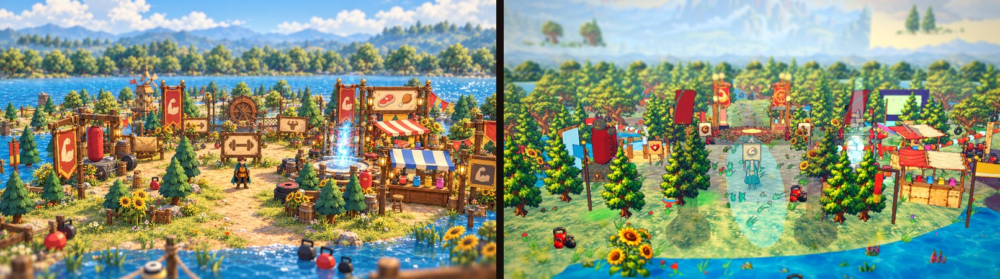
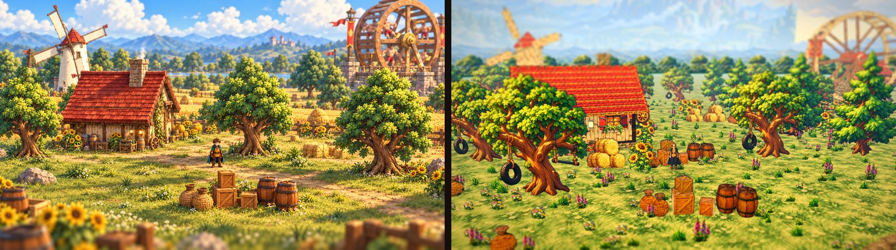
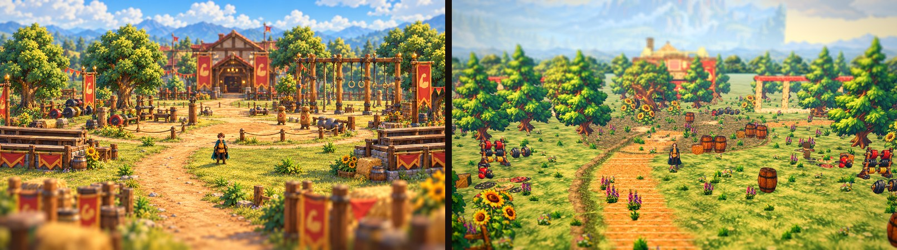
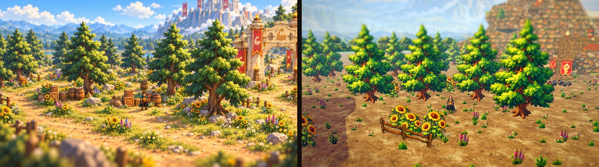
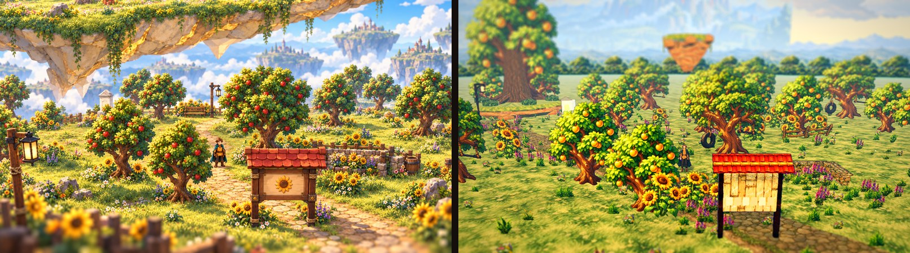
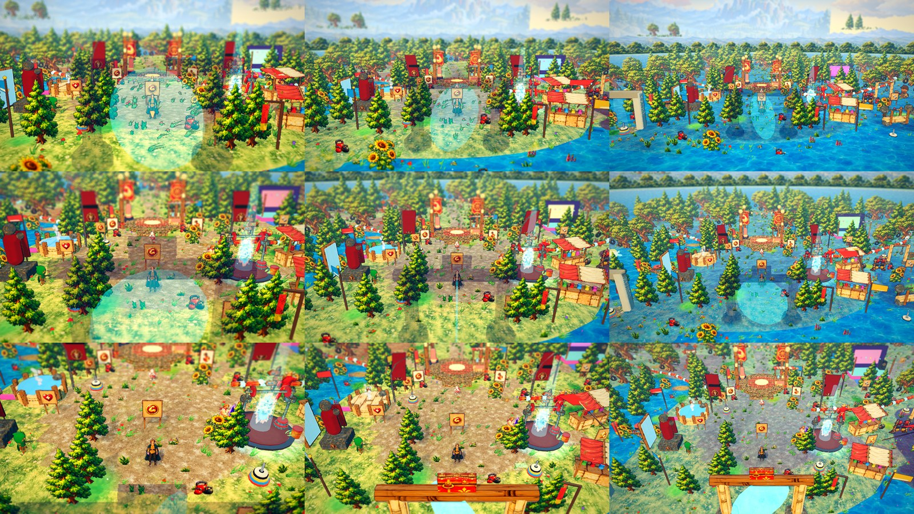

# The Gainlands slice

Note (2026-10-15): the sub-area scenes this report dresses were removed by design (docs/design/subarea_removal.md); the hub, the kit, the material swaps, the clusters and the modelled landmarks stay, and the Wheel, the Champions Arch and the Sky Tree now stand in the hub (SR-8). The sub-area sections below are history.

The Gainlands hub (Swole Station) and its four sub-areas (Mill Fields, the Proving Grounds, Mount Swolympus Trailhead, the Sky Garden) dressed with the approved zone kit
(`G:\My Drive\Card Game Art\Approved_ZoneKits\Gainlands`, 33 ids, imported by `bash tools/import_zone_kit.sh gainlands`) and matched against the five paint-overs
`docs/art/paintovers/PAINTOVER-GAINLANDS-{HUB,MILL-FIELDS,PROVING-GROUNDS,SKY-GARDEN,SWOLYMPUS-TRAILHEAD}.png` from the same camera positions (the paint-over inputs' cameras,
`tools/zone_shots.gd`). The process is written up as the recipe for every next zone in `docs/art/zone_rollout_playbook.md`; judgment calls are GK-1 .. GK-14 in
`docs/design/open_questions.md`. Gameplay, quests, NPC logic, sub-area connections and the camera system are untouched.

**Import result: 33 of 33 ids imported, 0 missing, 0 files that match no id** (`docs/art/zone_kits/gainlands_import_report.md`). Two things to know: the kit sheet
`data/source/gainlands_kit.csv` was not in the repo or on the Drive and was reconstructed from `docs/art/zone_kits/gainlands.md` and the Drive files (GK-1); `GAIN-SKY-NOON.png`
is an opaque painting of a windmill house, not a sky strip, so the zone sky stays the painted gradient (GK-2).

## Paint-over beside the result (left the paint-over, right the game, same camera)

| Scene | |
|---|---|
| **Swole Station (hub)**: the rift platform modelled after GAIN-HERO-SWOLE-STATION with banner posts, lanterns, the protein stall and punching bag; kettlebell and sunflower cards; pines kept small round the hub; the mountain and islands backdrops in the rings |  |
| **Mill Fields**: the giant wheel (GAIN-HERO-WHEEL, turning) on stone piers with its brick mill house, the bleached-plank mill cottage with red-gold roof, hay stacks, sunflower beds, tyre-swing oaks, wheel-rut decals |  |
| **The Proving Grounds**: the Champions Arch (brick pillars, banners, the golden barbell), the gym hall behind it, bleached-plank stands, weight racks, kettlebells, dropped plates, sweat stains and chalk on the plaza |  |
| **Mount Swolympus Trailhead**: the limestone mountain with its switchback stair, banner posts and cloud-wreathed temple, the Trailhead Gate (torches, banners, bell, rope posts), chalk-dusted dirt, pines |  |
| **The Sky Garden**: the Sky Tree (rock plinth, gnarled roots and trunk, the painted golden-fruit canopy), floating islands with grass domes and vines, fruit trees, sunflower beds |  |

Full-size results: `gainlands_slice/PO-GAINLANDS-*.jpg`.

## The hub at all nine camera combinations

Rows: Cinematic, Classic, Overview. Columns: Close, Normal, Far (`tools/zone_shots.gd --mode=grid`).

## Numbers

### fps (Medium, 1600x900, `tools/fps.sh <scene> 1`, final pass)

| Scene | avg fps | min fps |
|---|---|---|
| Swole Station (hub) | 60.0 | 60.0 |
| Mill Fields | 60.0 | 59.0 |
| The Proving Grounds | 60.0 | 60.0 |
| Mount Swolympus Trailhead | 60.0 | 58.5 |
| The Sky Garden | 60.0 | 60.0 |

### Grade (`tools/image_stats.gd`, paint-over then result; mean RGB, luma p5 / p50 / p95, mean saturation, sky / mid / ground thirds)

| image | mean RGB | luma p5 / p50 / p95 | saturation | sky / mid / ground |
|---|---|---|---|---|
| PAINTOVER-GAINLANDS-HUB | 141, 141, 123 | 61 / 140 / 223 | 0.47 | 141,171,184 / 147,123,88 / 135,131,98 |
| result | 133, 158, 130 | 60 / 149 / 225 | 0.46 | 169,192,184 / 130,129,88 / 101,154,118 |
| PAINTOVER-GAINLANDS-MILL-FIELDS | 155, 137, 90 | 55 / 137 / 226 | 0.54 | 161,165,164 / 145,116,53 / 159,129,54 |
| result | 158, 152, 90 | 56 / 153 / 222 | 0.57 | 179,184,172 / 138,123,50 / 159,149,48 |
| PAINTOVER-GAINLANDS-PROVING-GROUNDS | 157, 132, 87 | 53 / 138 / 215 | 0.56 | 139,149,137 / 161,123,65 / 171,124,59 |
| result | 157, 159, 99 | 59 / 159 / 223 | 0.52 | 172,191,178 / 137,136,70 / 164,148,49 |
| PAINTOVER-GAINLANDS-SKY-GARDEN | 162, 144, 95 | 55 / 149 / 230 | 0.51 | 173,170,149 / 149,129,73 / 164,134,64 |
| result | 154, 154, 90 | 60 / 151 / 224 | 0.54 | 166,182,163 / 143,137,59 / 153,142,48 |
| PAINTOVER-GAINLANDS-SWOLYMPUS-TRAILHEAD | 156, 142, 100 | 52 / 149 / 221 | 0.50 | 148,164,164 / 141,121,64 / 177,143,72 |
| result | 147, 136, 87 | 50 / 136 / 217 | 0.55 | 157,169,144 / 121,120,61 / 163,119,57 |

Three grade passes (`data/zone_styles/gainlands.json`): pass 1 the kit alone (results were 20-40 luma points brighter and 0.1 less saturated than the paint-overs: the
painted ground is lighter than the painter's); pass 2 contrast 1.12 -> 1.2, saturation 1.04 -> 1.12, post saturation 1.16 -> 1.26, vignette 0.2 -> 0.26, haze 0.003 ->
0.0032, key 1.0 -> 0.94; pass 3 key 0.9, ambient 0.38, the zone grass / chalk / hay textures tinted toward the palette's straw (`#D8C27A`), the mountain rebuilt in pale
limestone. Luma medians are now within 5-20 of the paint-overs (the hub and trailhead within 10), saturation within 0.04 on every scene. The remaining gap is green: the
paint-overs' mid ground is ochre (grass 145,116,53), the game's grass is greener (138,123,50 at best); see the asset table.

GUT: 1508 / 1508. E2E: `SMOKE_ONLY=gainlands,save_load bash tools/run_subarea_smoke.sh` (hub gates, Proving Grounds chest, exit, save and load inside a sub-area) passes.

## What matches

- **Materials**: every shared kit surface the zone used is now the zone's own art (bleached plank, red brick, riveted iron, red-gold tiles, striped canvas, brass trim, the
  six sliced doors / windows / signs / banners, the chalk track, the oak and pine cards, sunflower, hay and sky-tree cards, five prop cards, four decals); the hub's
  procedural wheels, gym gear, tub, stalls, arch, gate and stage wear the kit surfaces too.
- **Landmarks** rebuilt to their concept silhouettes at the sizes in the sub-area data: the 14 m wheel turns; the arch carries its banners and barbell; the gate its torches,
  bell and rope posts; the mountain its stair and cloud; the tree its golden fruit; the station its platform, posts, stall and bag.
- **Density** per the Art Bible: clusters at doorways, walls, junctions and landmarks (gym racks, protein corner, catapult pit, hay stacks, sunflower beds and fences,
  dumbbell piles, mill yards); flowers in clumps along paths and fences; nothing scattered evenly; foreground framing at a screen edge in every scene.
- **No readable text**; characters stay the clearest, most saturated thing (the hero reads against every ground).
- **60 fps on Medium** in all five scenes.

## What still does not match (honest list)

1. **Hub composition**: the paint-over shows the Swole Station as a wide plaza in the open with the mountain behind; the game's hub is the layout's wooded plateau with
   a 150-tree layout and a water rim, and the station platform stands among pines. The trees were kept (their positions are gameplay obstacles); shrinking the near ones
   only goes so far. A real match needs the hub layout's tree scatter thinned round the station (a layout change, out of scope).
2. **Grass colour**: the paint-overs' meadow is golden ochre; TEX-GAIN-GRASS is yellow-green and the tint only pushes it so far before the flowers go muddy.
3. **The gym hall and mill house** are kit presets (gable roofs); the paint-overs' buildings are rounder, with deeper eaves, big arched doors and brick-and-plank mixes
   on one wall. The sliced windows and doors are small on the storey (G-01 wants them oversized).
4. **Mount Swolympus** is a lathe with lumps and a stair; the concept's striated cliffs, snow and the dumbbell cloud are only hinted (the cloud is seven translucent spheres).
5. **Stand-ins remain**: the small windmill in Mill Fields, the Proving Grounds stands and scoreboard, the trailhead statue and shack, the floating islands and the shrines
   are kit-textured LandmarkKit shapes, not art.
6. **Sky**: GAIN-SKY-NOON is not a sky (GK-2); the gradient sky has the paint-overs' blue but not their big painted cumulus.
7. **Decal sheets**: the plates, sweat and tread decals are placed by hand in the sub-area data (12-16 per scene); the hub still uses the painted-decal scatter (DEC-CHALK,
   flowers, moss) without the new three.
8. **Hero size**: unchanged by design (11% of the screen at Normal); the paint-overs draw the hero a little larger.

## Extra assets that would close the gap (sheet-ready)

| ID | Asset | Category | Lock | Image Description | Size / Format | In-Game Use | Priority |
|---|---|---|---|---|---|---|---|
| GAIN-SKY-NOON-2 | Midday sky strip | Sky / backdrop | BACKDROP | A wide saturated blue midday sky with big soft white cumulus, the horizon pale, no ground, no objects (the first GAIN-SKY-NOON was a windmill picture) | 2048x1024 PNG | The zone sky | 1 |
| GAIN-GROUND-MEADOW | Golden meadow | Surface | SURFACE | Sun-bleached ochre meadow grass with golden seed heads, seamless, flat light | 1024x1024 PNG, tileable | The sub-area ground (the paint-overs' ochre fields) | 1 |
| GAIN-WALL-BRICK-PLANK | Brick with plank upper | Surface | SURFACE | Red brick lower half under a bleached plank upper half with a brass band between, seamless left-right | 1024x1024 PNG, tileable horizontally | Gym hall and mill walls in one tile | 2 |
| GAIN-DOOR-BARN-WIDE | Wide barn door | Cutout | CUTOUT | An oversized double barn door with iron straps and a red-gold banner either side, straight on | 1536x1024 PNG, transparent | Gym hall front (G-01 oversized door) | 2 |
| GAIN-TREE-OAK-TYRE-02 | Oak with two tyres | Tree / plant | TREE | A second tyre-swing oak, wider crown, two tyres | 1024x1536 PNG, transparent | Variety in Mill Fields and the hub | 3 |
| GAIN-PROP-SCOREBOARD | Scoreboard | Prop | CUTOUT | A tall iron-and-brass scoreboard with blank chalk panels and a gold trophy on top, straight on | 1024x1536 PNG, transparent | Proving Grounds (stand-in now) | 3 |
| GAIN-PROP-STANDS | Arena stands | Prop | CONCEPT | Concept of the bleached-plank spectator stands with a striped canvas awning, 3/4 view, 14 x 4.6 x 2 m | 1536x1024 PNG | Proving Grounds (stand-in now) | 3 |
| GAIN-PROP-STATUE | Flexing statue | Prop | CONCEPT | Concept of a cream stone statue of a flexing champion on a brass-banded plinth, 3/4 view, 3.4 x 7 m | 1536x1024 PNG | Trailhead (stand-in now) | 3 |
| GAIN-PROP-GIFT-SHACK | Trail gift shack | Prop | CONCEPT | Concept of a tiny brick shack with a red roof, a canvas flap door and a foam-hand sign, 3/4 view, 6 x 4 x 5 m | 1536x1024 PNG | Trailhead (stand-in now) | 3 |
| GAIN-BD-CLOUDS | Dumbbell cloud | Sky / backdrop | BACKDROP | A big white cumulus shaped like a dumbbell, transparent around it | 2048x1024 PNG, transparent | Above Mount Swolympus | 3 |
| GAIN-DEC-RUTS | Wheel ruts long | Decal | CUTOUT | A long pair of cart wheel ruts in dirt, top-down, soft edges | 1536x512 PNG, transparent | Mill Fields and trailhead paths | 3 |
| GAIN-PLANT-SUNFLOWER-ROW | Sunflower row | Tree / plant | TREE | A long row of sunflowers behind a rail fence, straight on | 2048x768 PNG, transparent | Field edges along paths | 3 |

## Kit status (`data/art/zone_kits/gainlands.json`)

The 33 sheet ids and the 24 sheet parts now in the game (aliases of the painted textures are listed in `docs/art/art_status.md`):

| Kit ID | Lock | Family | px | Pivot | Tile |
|---|---|---|---|---|---|
| `GAIN-BD-ISLANDS` | BACKDROP | backdrop | 2048x576 | 0.50,1.00 |  |
| `GAIN-BD-MOUNT` | BACKDROP | backdrop | 2048x707 | 0.50,1.00 |  |
| `GAIN-DEC-PLATES` | CUTOUT | decal | 951x907 | 0.50,0.50 |  |
| `GAIN-DEC-SWEAT` | CUTOUT | decal | 849x773 | 0.50,0.50 |  |
| `GAIN-DEC-TREAD` | CUTOUT | decal | 804x960 | 0.50,0.50 |  |
| `GAIN-HERO-CHAMPIONS-ARCH` | CONCEPT | concept | 1536x1024 |  |  |
| `GAIN-HERO-SKY-TREE` | CONCEPT | concept | 1536x1024 |  |  |
| `GAIN-HERO-SWOLE-STATION` | CONCEPT | concept | 1536x1024 |  |  |
| `GAIN-HERO-SWOLYMPUS` | CONCEPT | concept | 1536x1024 |  |  |
| `GAIN-HERO-TRAILHEAD-GATE` | CONCEPT | concept | 1536x1024 |  |  |
| `GAIN-HERO-WHEEL` | CONCEPT | concept | 1536x1024 |  |  |
| `GAIN-PATH-CHALK` | SURFACE | ground | 1024x1024 |  | 2.56 m |
| `GAIN-PLANT-HAY` | TREE | tree | 971x795 | 0.51,1.00 |  |
| `GAIN-PLANT-SUNFLOWER` | TREE | tree | 1004x1249 | 0.59,1.00 |  |
| `GAIN-PROP-CATAPULT` | CUTOUT | prop | 982x895 | 0.50,1.00 |  |
| `GAIN-PROP-DUMBBELL` | CUTOUT | prop | 1014x556 | 0.50,1.00 |  |
| `GAIN-PROP-KETTLEBELL` | CUTOUT | prop | 889x927 | 0.50,1.00 |  |
| `GAIN-PROP-PROTEIN` | CUTOUT | prop | 1012x911 | 0.50,1.00 |  |
| `GAIN-PROP-RACK` | CUTOUT | prop | 991x913 | 0.50,1.00 |  |
| `GAIN-ROOF-CANVAS` | SURFACE | roof | 1024x1024 |  | 2.56 m |
| `GAIN-ROOF-RED` | SURFACE | roof | 1024x1024 |  | 2.56 m |
| `GAIN-SHEET-BANNERS` | SHEET | banner | 2048x1365 |  |  |
| `GAIN-SHEET-BANNERS-01` | CUTOUT | banner | 526x569 | 0.50,0.03 |  |
| `GAIN-SHEET-BANNERS-02` | CUTOUT | banner | 529x572 | 0.50,0.03 |  |
| `GAIN-SHEET-BANNERS-03` | CUTOUT | banner | 528x563 | 0.50,0.03 |  |
| `GAIN-SHEET-BANNERS-04` | CUTOUT | banner | 528x560 | 0.50,0.03 |  |
| `GAIN-SHEET-BANNERS-05` | CUTOUT | banner | 532x559 | 0.50,0.03 |  |
| `GAIN-SHEET-BANNERS-06` | CUTOUT | banner | 528x561 | 0.50,0.03 |  |
| `GAIN-SHEET-DOORS` | SHEET | door | 2048x1365 |  |  |
| `GAIN-SHEET-DOORS-01` | CUTOUT | door | 503x543 | 0.50,1.00 |  |
| `GAIN-SHEET-DOORS-02` | CUTOUT | door | 674x547 | 0.50,1.00 |  |
| `GAIN-SHEET-DOORS-03` | CUTOUT | door | 605x559 | 0.50,1.00 |  |
| `GAIN-SHEET-DOORS-04` | CUTOUT | door | 614x551 | 0.50,1.00 |  |
| `GAIN-SHEET-DOORS-05` | CUTOUT | door | 508x550 | 0.50,1.00 |  |
| `GAIN-SHEET-DOORS-06` | CUTOUT | door | 581x555 | 0.50,1.00 |  |
| `GAIN-SHEET-SIGNS` | SHEET | sign | 2048x1365 |  |  |
| `GAIN-SHEET-SIGNS-01` | CUTOUT | sign | 594x606 | 0.00,0.49 |  |
| `GAIN-SHEET-SIGNS-02` | CUTOUT | sign | 603x604 | 0.00,0.52 |  |
| `GAIN-SHEET-SIGNS-03` | CUTOUT | sign | 588x605 | 0.00,0.52 |  |
| `GAIN-SHEET-SIGNS-04` | CUTOUT | sign | 585x609 | 0.00,0.50 |  |
| `GAIN-SHEET-SIGNS-05` | CUTOUT | sign | 604x612 | 0.00,0.50 |  |
| `GAIN-SHEET-SIGNS-06` | CUTOUT | sign | 574x608 | 0.00,0.53 |  |
| `GAIN-SHEET-WINDOWS` | SHEET | window | 2048x1365 |  |  |
| `GAIN-SHEET-WINDOWS-01` | CUTOUT | window | 618x592 | 0.50,1.00 |  |
| `GAIN-SHEET-WINDOWS-02` | CUTOUT | window | 683x588 | 0.50,1.00 |  |
| `GAIN-SHEET-WINDOWS-03` | CUTOUT | window | 630x599 | 0.50,1.00 |  |
| `GAIN-SHEET-WINDOWS-04` | CUTOUT | window | 560x562 | 0.50,1.00 |  |
| `GAIN-SHEET-WINDOWS-05` | CUTOUT | window | 562x581 | 0.50,1.00 |  |
| `GAIN-SHEET-WINDOWS-06` | CUTOUT | window | 611x539 | 0.50,1.00 |  |
| `GAIN-SKY-NOON` | BACKDROP | backdrop | 2048x1024 | 0.50,1.00 |  |
| `GAIN-TREE-OAK` | TREE | tree | 1024x1182 | 0.56,1.00 |  |
| `GAIN-TREE-PINE` | TREE | tree | 935x1419 | 0.51,1.00 |  |
| `GAIN-TREE-SKY` | TREE | tree | 1014x1247 | 0.56,1.00 |  |
| `GAIN-TRIM-BRASS` | SURFACE | trim | 1024x512 |  | 2.56 m |
| `GAIN-WALL-BLEACH` | SURFACE | wall | 1024x1024 |  | 2.56 m |
| `GAIN-WALL-BRICK` | SURFACE | wall | 1024x1024 |  | 2.56 m |
| `GAIN-WALL-IRON` | SURFACE | wall | 1024x1024 |  | 2.56 m |
