# The Verdant Dump slice: the layout fixed before its art pass

The Verdant Dump (area id `heap`, zone id `refusemancer`, `scenes/heap_zone.tscn`) prepared for its art pass by the rollout playbook (`docs/art/zone_rollout_playbook.md`), with the Gainlands, D.N.A. and Buffet lessons (the declutter rules of section 5, the Buffet lessons of section 7) applied to the layout FIRST, before any kit exists. The Verdant Dump is ONE walkable zone: there are no sub-areas and no walkable dungeon interiors (`docs/design/subarea_removal.md`); its dungeons are node maps entered from the zone. Gameplay, quests, NPC logic and the camera system are untouched. Judgment calls are VD-1... in `docs/design/open_questions.md`.

## The regions (all in the one scene)

Coordinates are metres, x east, z south (north is up the screen, where the Rotheart stands). `HeapLayout._areas` names them (`REGION_IDS`); the HUD shows the title.

| Region (id) | Where | What is there | Stand-in landmark (`HeapLayout` constant, size w x h x d) |
|---|---|---|---|
| **Compost Commons** (`commons`, the hub) | south centre, the plaza round (50, 64), reached over the entrance bridge from town (x 50, z 74 to 90) | the arrival bridge and the exit at its far landing, Brother Bramble (56, 57), Granny Gristle's shop and shed (61, 60), the Harvest Meal (40.5, 63.5), Wren Muckfoot (42.5, 69), Boris the boar's stable (38, 70.5), the Rift Express (44, 73), the compost bin (57.5, 70.5), the trough (63, 72.5), the druid shrine (69, 71), the scrap barn (38, 57.5) | **the greenhouse** at the plaza's centre, `GREENHOUSE` 9 x 5.5 x 6.5 m (`HeapLandmarks.greenhouse`): where the greenhouse centrepiece goes |
| **The Farm Rows** (`farm`) | south-west | the three crop plots in a row (12 to 22, 56), Druid Thistlewick's quiz in the appliance grove (19, 66), the bean, fertilizer and junk pickups, two escaped animals, the scarecrow, the compost heap and its chest in the corner, Shiro Swindle's giant chest (22.8, 73.8), a compost pit (28, 69) | **the rusty windmill** at the rows' west edge, `WINDMILL` (8.5, 64) 5 x 12 x 5 m, its sails turn (`HeapLandmarks.windmill`) |
| **The Junk Peaks** (`peaks`) | the whole east side: south of the stream Mount Scrapmore (86, 56) with the county fair at its foot; north of it the scree fields (a mount's ground) with the scrap barn (82, 14) | Recycle Rhonda's fair stage (73, 56) facing the east road, the chute that lands at the road's end, the sprout mound and the beanstalk (86, 63.5), the summit chests, the fridge chest and the vault lever (90, 72) in the secret corner, a compost pit (84, 72); the barn chest and the scree chest, the gulls | **Junk Mountain** beyond the north-east corner, `JUNK_MOUNTAIN` (108, -6) 48 x 28 x 26 m, a view the fair and hub cameras see ahead-right (`LandmarkKit` mound) |
| **The Stream, the Dam and the Vine Bridges** (`stream`) | the band across the middle, z about 34 to 50 | the recycling stream, the three vine bridges (x 22, 50, 78) with their sprout mounds and Druid Sorrel (46, 47) on the south bank, the south bank road from the west crossing past the plaza's north junction to the east crossing, the north bank road between the crossings and the three gaps in the tyre wall, the junk dam at the water's edge (36.5, 39), the haybale chest, Gideon the goat's stable at the bank's west end (12, 38) | none (the bridges themselves) |
| **The Wetlands** (`wetlands`) | the centre district behind the junk barricade (x 38 to 64, z 5 to 30) | the barricade gap (50, 30), the road north to the Rotheart's root gate, reed beds at the edges, two junk clusters in the corners by the wall, the car-husk chest, the scarecrow; the land grows violet and dark toward the roots (VD-8) | **the Rotheart** beyond the north rim, `ROTHEART` (50, -16) 44 x 46 x 44 m, castle scale, seen from the whole zone (`LandmarkKit` giant_tree); **its root gate** on the land, `ROOT_GATE` (50, 5.5) 10 x 6 x 4 m (`HeapLandmarks.root_gate`), the main_dungeon spot at (50, 9.2) in front of the hollow, no lettered plate |
| **The Throne Approach** (`throne`) | the north-west district through the open west gap | the avenue (x 31) from the gap past Rust Peak's east cliff to the throne's steps; Rust Peak (16, 16, radius 5) with the Seed Shrine on its summit, its beanstalk mound (16, 24.5) and the chute down its west side; the hollow-log chest, the corner chests, a golem on the avenue | **the Trash Panda Throne** beyond the north-west rim, `THRONE` (31, -3.5) 18 x 14 x 12 m (`HeapLandmarks.throne`), its steps on the land; the Landfill Depths door (the side dungeon's, VD-1) at the steps (31, 9.5), no lettered plate |

The zone has two dungeons (`data/dungeons/dungeons.json`): D-ROT the Rotheart (main) and S-REF the Trash Panda Throne (side); the Landfill Depths door *is* the way into the Trash Panda Throne (VD-1), as the Buffet's Walk-In Freezer is the way into the Omakase (BF-2).

## Part A: regions and layout

The playbook's declutter rules (section 5) applied to the one zone before any dressing; every quest NPC, the vendor, the puzzle, the minigame, every chest, the giant chest, the lever and both dungeon entrances still work (the ones that moved: VD-2, VD-7, VD-9; the reachability tests updated with them).

- **The way in is walked** (VD-3): a plank-and-tyre bridge (`HeapLandmarks.entrance_bridge`, 16 m, 4 m between its kerbs, a gate of stacked tyres with the zone's icon at the land end) from the land's south rim out over an overflow pool to a far landing; a fresh visit starts on it facing north, the exit spot waits at the landing, walking off the far end leaves for town (`HeapScene._update_entrance_exit`); the tyre arch is gone and the Dump's town passage lost its far glow. Waking after a faint puts the hero in the plaza.
- **The hub** (VD-7): an empty plaza (9.5 m) round the greenhouse stand-in; the hub's things on the rim, 4 m or more apart, each off every road; the barn off the north road; the hub's two windmills gone.
- **Routes**: main roads 4.2 m, spurs 3.6 m, nothing solid within 2.4 m of a route edge, 5.5 m of open ground round every anchor, every region on a loop (plaza - farm - the farm spur - the south bank road - plaza; plaza - fair - the fair spur to the mound; the three crossings - the north bank road - the three gaps; the avenue and the wetlands road end at their doors, the scree track at the barn). The walkability probe reaches all 65 key locations with lanes 1.3 m wide (`tests/world/test_walkability_zones.gd`).
- **Trees and props** (VD-5): trees only in the rim bands and eleven framing groups, bushes at the edges and as reed beds in the wetlands, flowers in clumps along the path edges and the crop row, junk in six tidy clusters; 23 boards (was 35), none a memo or poster; the generic dressing keeps only its grass carpet.
- **The goal you can see**: the Rotheart at castle scale beyond the north rim on the zone's centre line, every paint-over camera has it in frame; its root gate on the land is the main dungeon's door. Junk Mountain beyond the north-east corner, the Trash Panda Throne beyond the north-west rim, the windmill at the farm's west edge, the greenhouse at the plaza's centre: all of the planned sizes (`docs/art/zone_kits/heap.md`), their blocking circles layout data (`LANDMARK_BLOCKERS`) so the layout-only readers see them.
- **The corruption gradient** (VD-8): `data/zone_styles/heap.json` `corruption` read by `HeapLayout.corruption_at`: the ground lerps toward the Rot's violet and darkens from the north bank to the Rotheart's roots, strongest in the centre district; the flower clumps thin to 15 % there.
- **Occlusion**: the fader uses the per-instance transparency (no dither); the land, the rim, the far ground, the stream, the pits, the overflow pool, the entrance bridge and the three views never fade or cull; the greenhouse, the root gate and the windmill fade as a group when they block the view.
- **The sea plane** (VD-4): off for the heap mood (it flooded the land, as the Buffet's did).

| Part A | Before (the zone as found) | After Part A |
|---|---|---|
| The hub at the paint-over camera (Cinematic / Normal) | 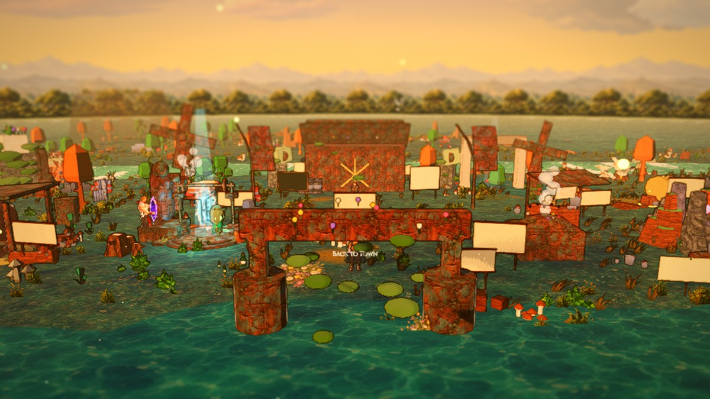 | 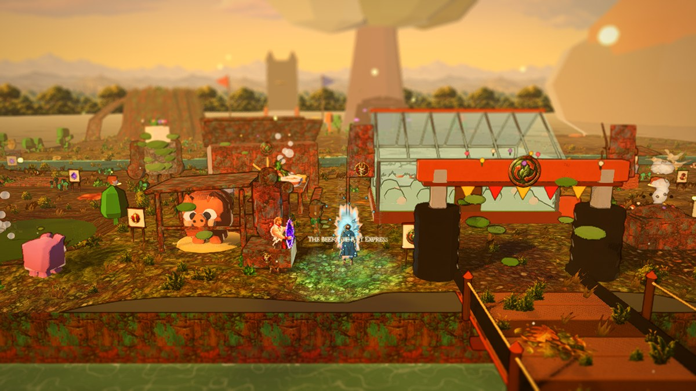 |
| The 9 camera combinations (the plaza) | | 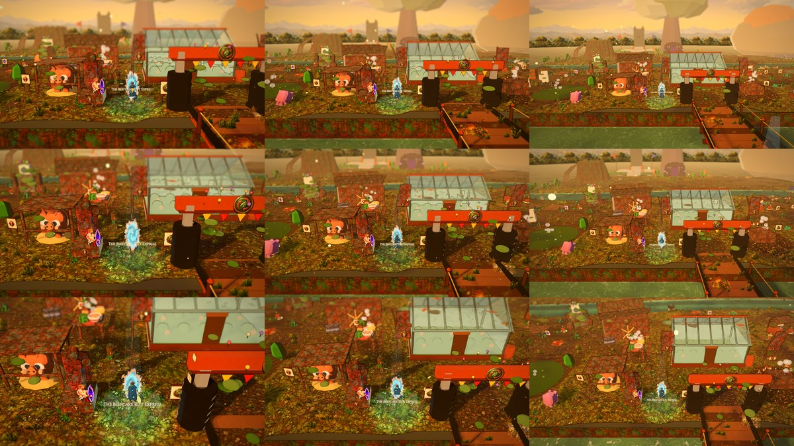 |
| The arrival on the bridge | | 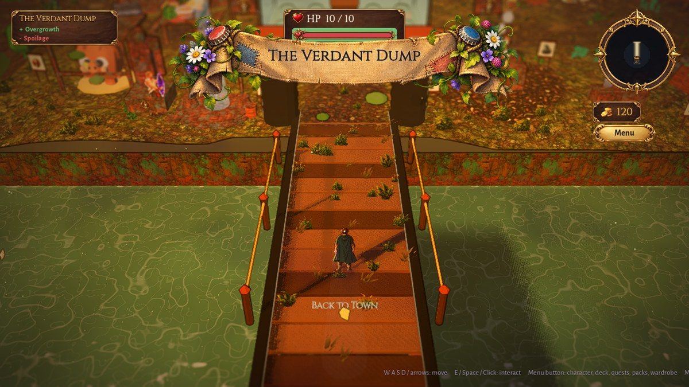 |
| The Compost Commons from the plaza | | 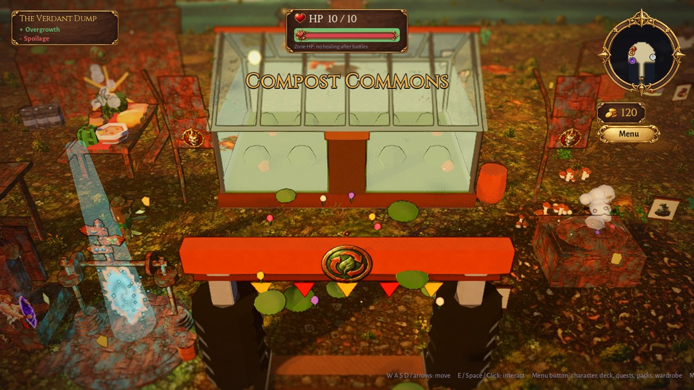 |
| The fair at Mount Scrapmore's foot | | 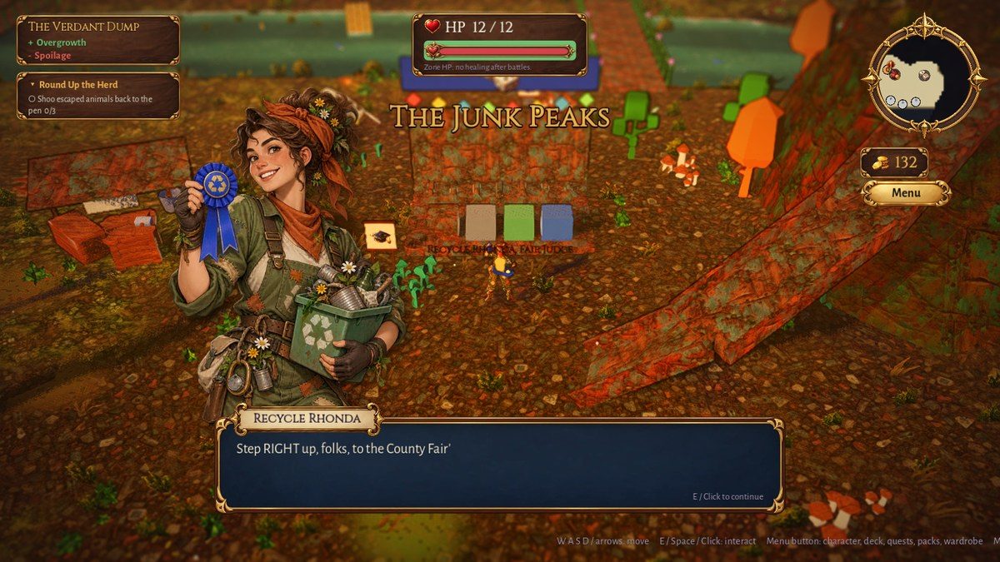 |
| The Seed Shrine on Rust Peak | | 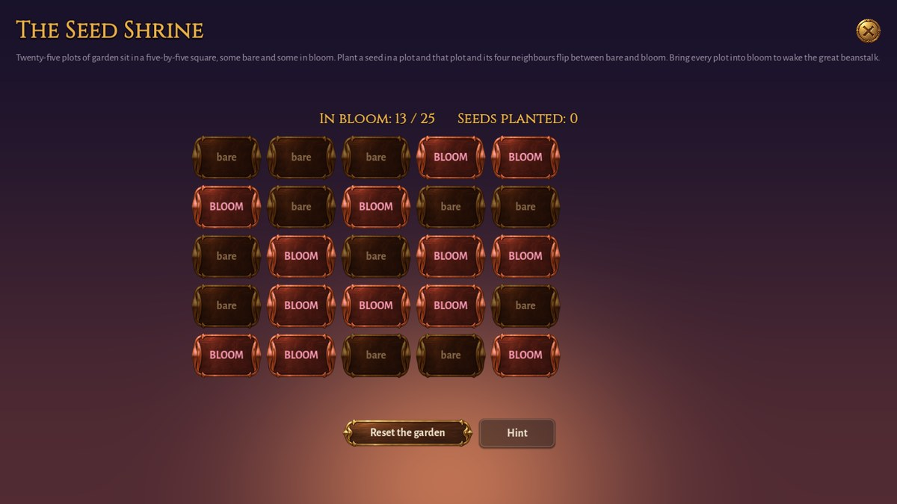 |
| The Landfill Depths door at the throne's steps | | 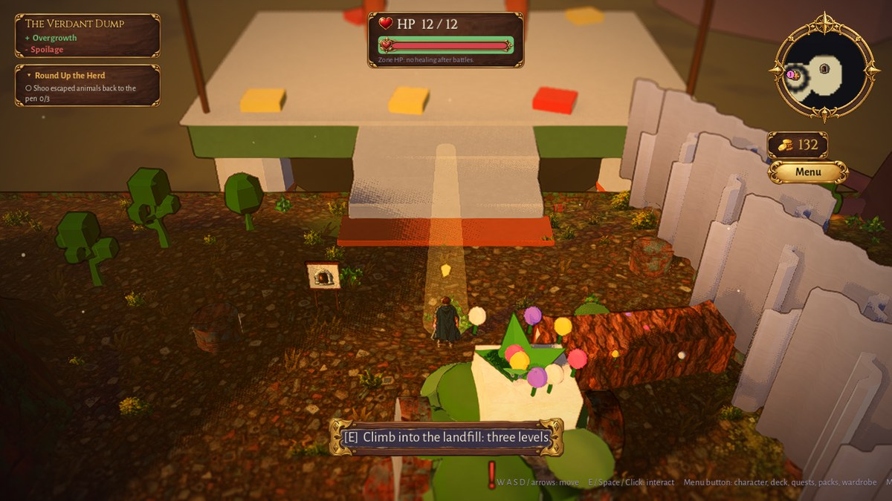 |
| The Rotheart's root gate | | 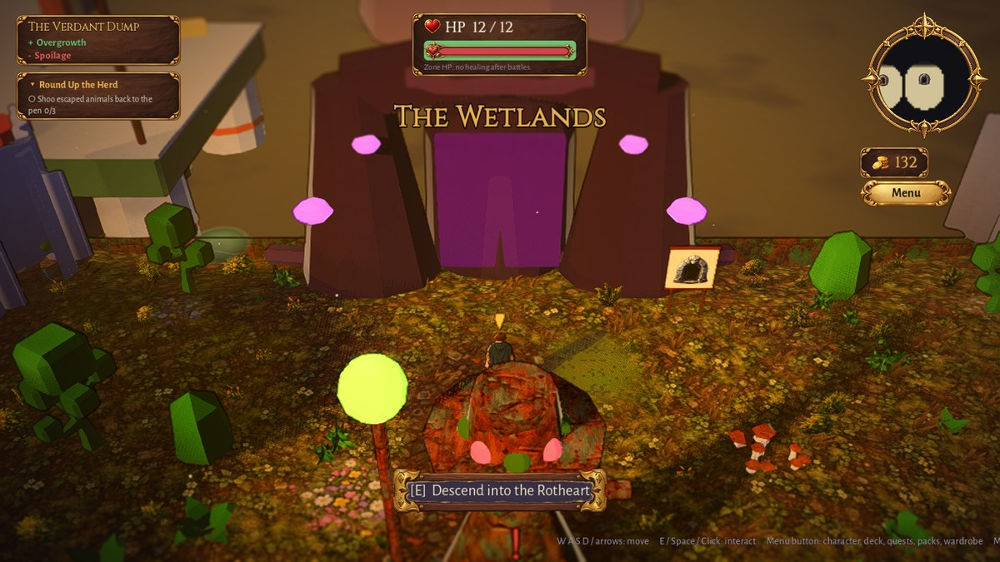 |
| The vault lever in the secret corner | | 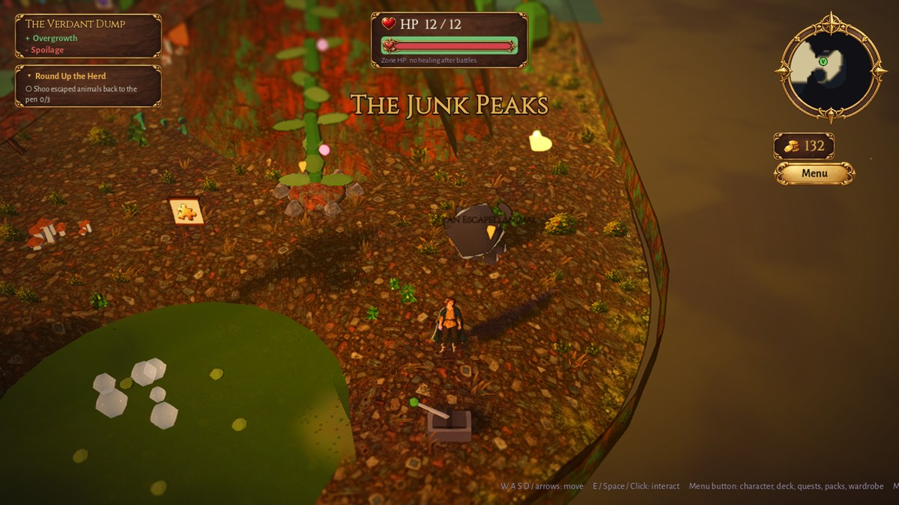 |
| Leaving over the bridge | | 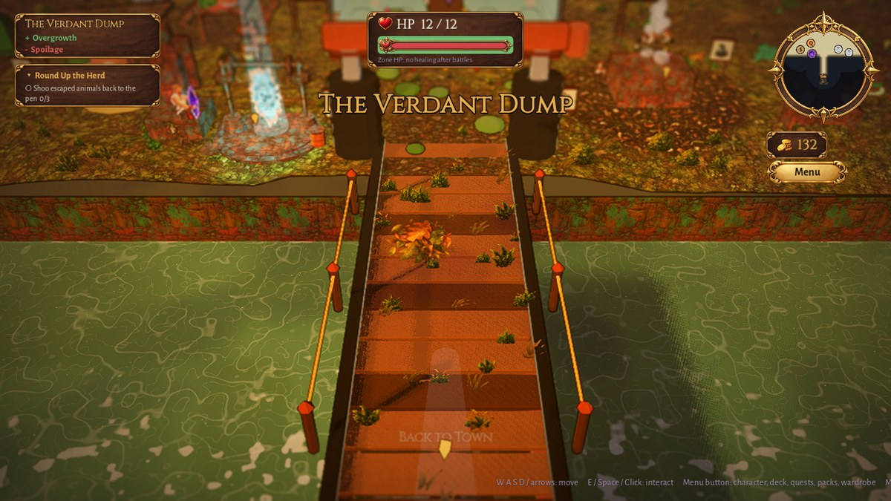 |

The "before" shot shows the sea plane flooding the land, the tyre arch and the scatter.

**fps on Medium** (`bash tools/fps.sh res://scenes/heap_zone.tscn 1 --at=<spot>`, the dev iGPU, 60 fps is the cap):

| Spot | avg fps | min fps | GPU ms | CPU ms |
|---|---|---|---|---|
| po_hub | 60.0 | 60.0 | 13.1 | 2.5 |
| po_farm_rows | 60.0 | 60.0 | 10.0 | 1.6 |
| po_junk_peaks | 60.0 | 60.0 | 11.4 | 1.9 |
| po_stream | 60.0 | 60.0 | 12.9 | 2.1 |
| po_wetlands | 60.0 | 60.0 | 12.3 | 1.8 |
| po_throne_approach | 60.0 | 60.0 | 11.5 | 1.5 |
| main_dungeon (the root gate) | 60.0 | 49.9 | 9.6 | 1.2 |

**Checks**: 1568 GUT tests, 1567 passing (the one failure is GC-6, the local camera FOV, pre-existing); `tests/world/test_heap_slice.gd` (the regions, the routes, the open ground, the clusters, the plaza, the boards, the bridge, the landmarks, the gradient, the cameras, the fresh visit) and `tests/core/zone/test_heap.gd` (the gating with the door moved); the walkability probe; the windowed walk smoke `bash tools/run_heap_walk_smoke.sh <camera>` (21 screenshots: the bridge, the plaza, every quest NPC and the vendor, every interactable, the boar mounted and dismounted, the quiz, the fair, the Seed Shrine, the Landfill Depths door sealed and unlocked into the Trash Panda Throne node map, the root gate, the giant chest, the lever, the walk back out) passes at the Cinematic (0) and the Overview (2) camera.

**Things to look at**: the stand-ins are plain `KitMesh` shapes in the zone's colours (the Rotheart reads pale through the golden haze at 80 m); the divider posts between the districts are the old pale slabs (a knee-high wall as in the Buffet, BF-11, is a Part B/C candidate); the eighth brief smoke (`tools/run_eighth_brief_final_smoke.sh`) walks hard-coded positions of the old layout and was not run in this pass (its legs will need the new anchors).

## Part B: paint-over inputs

One clean shot per region at Cinematic / Normal, 1600 x 900, the hero visible, no UI, no world labels or spot markers (`bash tools/shot.sh res://scenes/heap_zone.tscn PO-DUMP-<REGION> --at=po_<region> --nohud=true --clean=true --wait=2.6 --set=camera_angle:0,camera_zoom:1.5`; `--clean` is new in `tools/screenshot.gd`, it hides the Label3D plates and the gold markers as `tools/zone_shots.gd` does). Saved to `docs/art/paintover_inputs/heap/` and copied to `G:\My Drive\Card Game Art\Paintover_Inputs\verdant_dump\` (nothing else in the Drive touched). The cameras are layout data (`HeapLayout.PO_CAMERAS`, the hero's standing spot; the camera looks north from behind), so the final art pass shoots the same views; each stands on open ground off every interact spot and enemy line (VD-10) and has the Rotheart in frame.

| File | Camera spot (x, z) | What it frames |
|---|---|---|
| `PO-DUMP-HUB.png` | `po_hub` (50, 72.5), on the road just inside the entrance gate | the arrival: the tyre gate's pillars either side, the plaza and the greenhouse centrepiece ahead, the rift station and the boar stable left, the compost bin and the shed right, the Rotheart over the greenhouse |
| `PO-DUMP-JUNK-PEAKS.png` | `po_junk_peaks` (80, 71), the secret corner by the fridge | Mount Scrapmore with its chute ahead, the fair at its foot left, the compost pit in front, Junk Mountain beyond the north-east corner right, the Rotheart far left |
| `PO-DUMP-FARM-ROWS.png` | `po_farm_rows` (11.5, 70), the south-west corner by the compost heap | the rusty windmill left, the crop rows and the appliance grove ahead, the barn and the Commons beyond, the Rotheart top right |
| `PO-DUMP-STREAM.png` | `po_stream` (50, 51), the south bank road at the plaza's north junction | the stream and the centre crossing ahead with Druid Sorrel, the dam and the barn left, the haybale right, the wetlands' junk clusters and the root gate beyond, the Rotheart centre |
| `PO-DUMP-WETLANDS.png` | `po_wetlands` (50, 22), the wetlands road past the barricade | the reed beds, the junk clusters by the wall either side, the Rotheart's root gate with its hollow ahead and the trunk above; the barricade in the foreground |
| `PO-DUMP-THRONE-APPROACH.png` | `po_throne_approach` (32, 17), the avenue | the Trash Panda Throne's dais, banners and steps ahead with the Landfill Depths board, Rust Peak's cliff left, the divider right, the Rotheart top right |

| | |
|---|---|
| 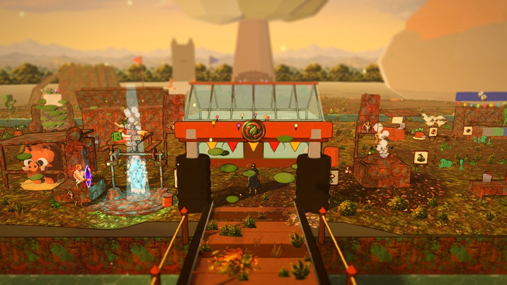 HUB | 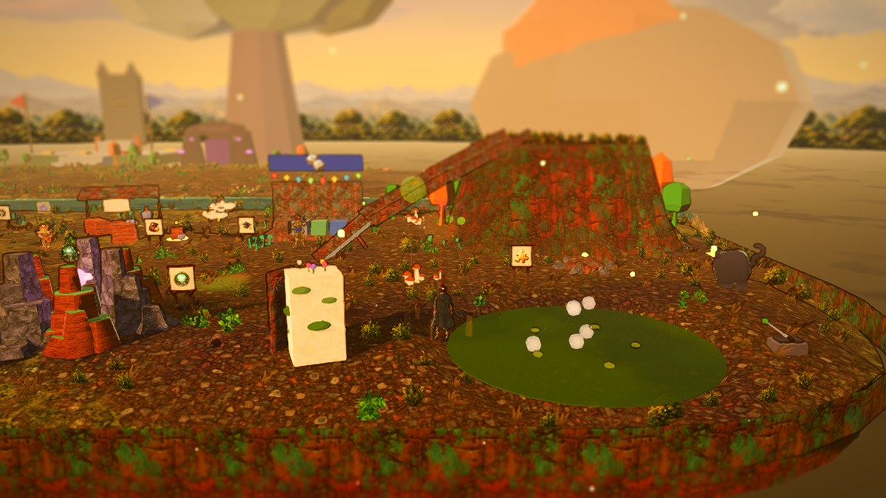 JUNK-PEAKS |
| 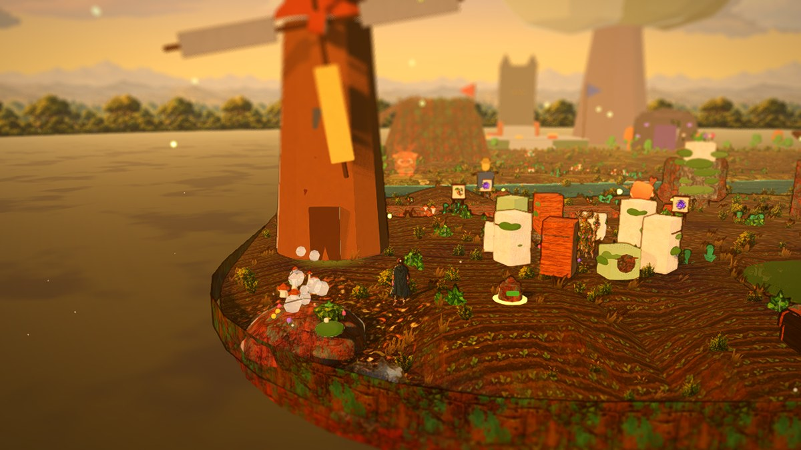 FARM-ROWS | 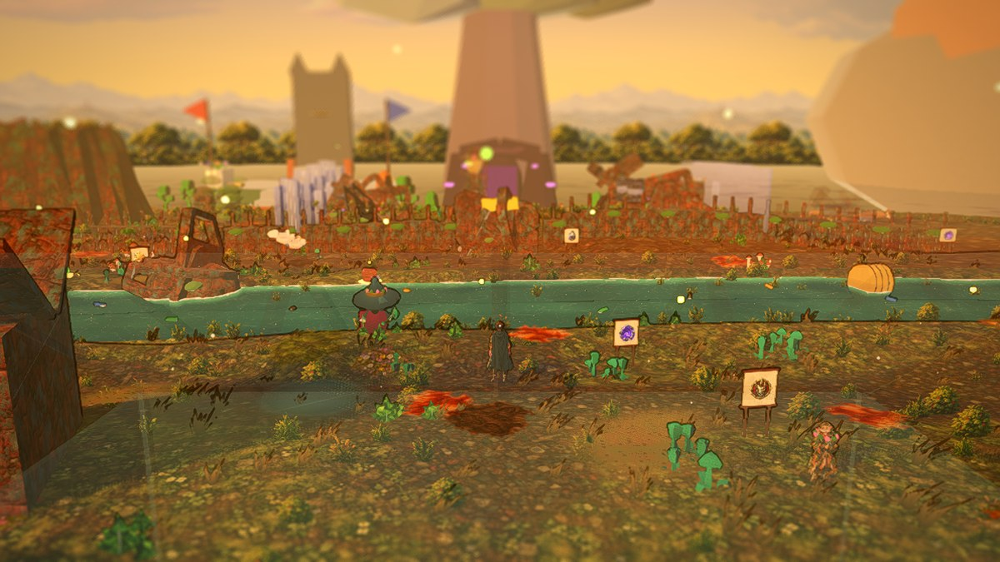 STREAM |
| 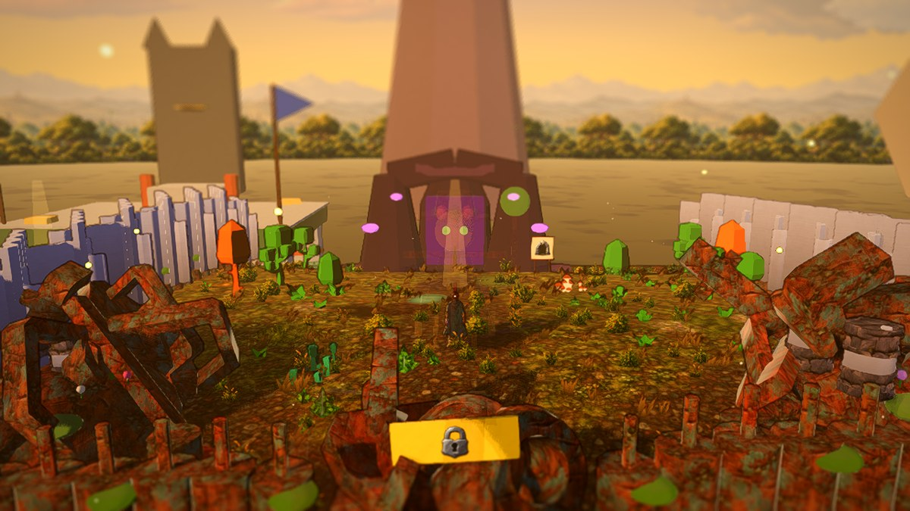 WETLANDS | 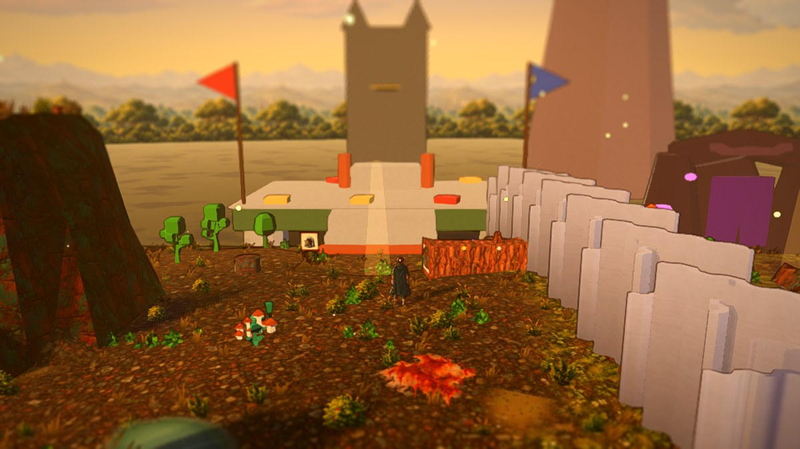 THRONE-APPROACH |

**The stand-ins in the pictures** (what the painter replaces): the greenhouse (glass house, 9 x 5.5 x 6.5 m), the Rotheart (giant tree, 44 x 46 x 44 m, pale through the haze at 80 m), its root gate (10 x 6 x 4 m, the violet hollow), Junk Mountain (mound, 48 x 28 x 26 m), the Trash Panda Throne (dumpster-lid dais on can towers, 18 x 14 x 12 m), the rusty windmill (5 x 12 x 5 m), the entrance bridge (16 m) and its tyre gate. The pale divider slabs between the north districts are the old posts (a knee-high wall as the Buffet's, BF-11, is for the art pass).

**fps on Medium** at the six camera spots: 60.0 average and 60.0 minimum at every one (the Part A table above, same spots).

# The art pass: the Verdant Dump dressed from its approved kit

The zone kit (`Approved_ZoneKits/VerdantDump`, 33 files, and the six paint-overs `PAINTOVER-DUMP-*` that sat in the same folder) brought in and dressed by the playbook (`docs/art/zone_rollout_playbook.md` sections 1 to 4), on the layout of the prep pass above (regions, routes, plaza, clearances and anchors unchanged). Judgment calls VD-11... in `docs/design/open_questions.md`. The compare strips are paint-over left, game right, from the recorded `PO_CAMERAS` (`bash tools/heap_po_shots.sh <prefix> [region ...]` shoots them and writes `heap_slice/<prefix>_compare_<region>.jpg`).

## Art Part A: import

- **The sheet**: `data/source/heap_kit.csv` did not exist; it was rebuilt from `docs/art/zone_kits/heap.md` and the 33 delivered files (VD-11). The delivered kit differs from the planned list: no DUMP-WALL-SCRAP, -ROOF-THATCH, -GROUND-GRAVEL / -COMPOST, -PROP-WINDMILL, -DEC-RUST / -MOSS, -TREE-ROTHEART, -BD-ROTHEART; new are DUMP-ROOF-REED, -GROUND-CORRUPT, -TREE-TWISTED, -PLANT-FUNGUS, -DEC-CORRUPT, -PROP-SCRAPPILE and a fifth concept, the Commons greenhouse. The painted textures and decals of the earlier batches (TEX-DUMP-MOSSYDIRT, -JUNKGRAVEL, -COMPOST, -FARMROWS, -RUSTMETAL, DEC-RUST, DEC-MOSS, DEC-FLOWERS) are registry aliases.
- **"import zone kit heap"**: the Drive folder is `VerdantDump`, not the area id, so `art_config.cfg` gains `zonekit_folders={"heap": "VerdantDump"}` (read by `tools/import_zone_kit.gd`; the importer also read `zonekits_dir` from the wrong config section and only worked because the default matched). Report `docs/art/zone_kits/heap_import_report.md`: 33 imported, 0 missing, the six paint-overs unmatched (right: they are copied to `docs/art/paintovers/`), one note (DUMP-SKY-SUNSET is opaque: a real full-frame sunset sky, used as the sky panorama).
- **Slices and pivots** checked on magenta: the four 3x2 sheets slice clean (doors, windows, icon signs, rag flags); the trees, plants and props trim clean with no halo. DUMP-TREE-BIRCH measured its pivot at 0.79 (a stray leaf at the base) and gets a hand pivot 0.47 (`pivot_hand`, a new hand key the importer keeps over the measured one). Hand heights in the registry: birch 5.4, oak 6.2, twisted tree 6.0, wildflower crate 1.2, reeds 2.2, fungus 1.9, tyre garden 1.5, bottle wall 1.3, compost 1.8, goat cart 2.2, scrap pile 1.7 m; windows 1.4 m, flags 3.0 m wide.
- **Style**: every image is painted (soft cel shading, no pixel grid), including the sky; nothing reads as pixel art.
- **The hero landmarks** (`world/heap/heap_landmarks.gd`, registered as `DUMP-HERO-` in `HeroLandmarks.BUILDERS`; every stand-in is gone): the **Rotheart** (44 x 46 x 44 m view beyond the north rim: a trunk with nine twisting root strands, a heart-shaped hollow with a pulsing violet glow and a real light, veins, twelve mutated fungi, six arms under a wide green-gold canopy with hanging moss and wisteria, swallowed doors, a wheel and pipes, a treehouse in the crown, twelve roots spilling out over a corrupted mound; refined in Part B), **Junk Mountain** (48 x 28 x 26 m view at the north-east corner turned toward the zone: a steep cone of doors, tin, crates, wheels, barrels and green, a zig-zag plank stair with rope rails and lanterns, the summit shack with lit windows, a turning six-blade windmill and a rag flag, tree and flower cards on its shoulders), the **windmill** (5 x 12 x 5 m on the farm rows' west edge: an eight-sided tower of mossy planks patched with tin and doors, a tin cap, a sliced door and window, a lit round window, a porch with a two-tone awning, flower crates and a lantern, a violet root creeping up its side, four patchwork sails that turn slowly), the **Trash Panda Throne** (18 x 14 x 12 m beyond the north-west rim, its stair on the land: three tiers of crates, bins and barrels, the stair between lantern posts, two raccoon guards with lollipop staves, the crowned raccoon king with a scepter and a red cape on a bin throne, rag pennants on rope, two little windmills, a lit doorway with a sliced door), the **Commons greenhouse** (9 x 5.5 x 6.5 m centrepiece: warm glass on a timber frame, a lit rose window over a green arched door, a little windmill on the ridge, an awning, a rusty water tank and a compost crib, vines and planters, a warm real light inside). Their blocking circles are the stand-ins' (the layout's `LANDMARK_BLOCKERS` unchanged).
- **Sky and backdrop**: the `heap` mood carries `sky.panorama: DUMP-SKY-SUNSET` and five DUMP-BD-JUNK cards on the far ring at 60 degrees each (BF-7).
- **Real lights**: the greenhouse's warm light, the windmill's lantern and the Rotheart's heart (pulsed with its glow, about one slow beat every five seconds) are the zone's only `KitLights`; every other lantern is emissive.

| Region | Paint-over beside the game after Part A |
|---|---|
| Hub | 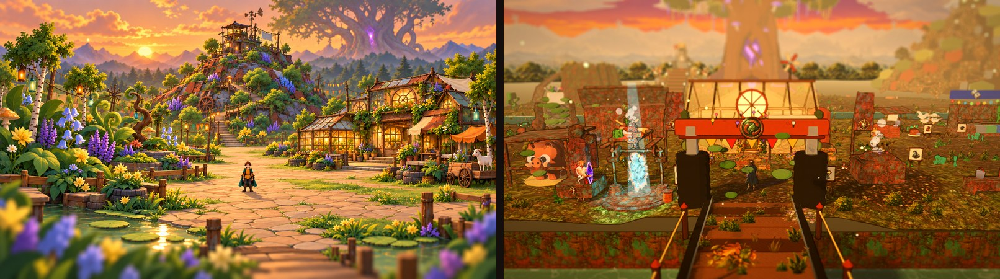 |
| Junk Peaks | 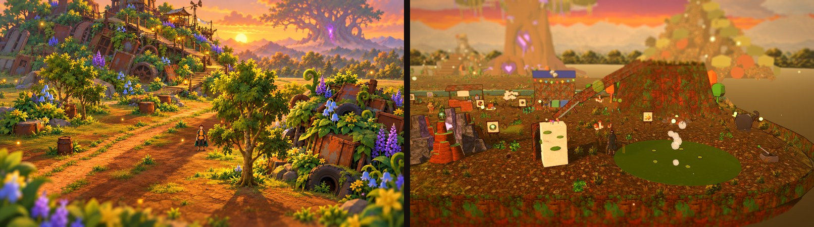 |
| Farm Rows | 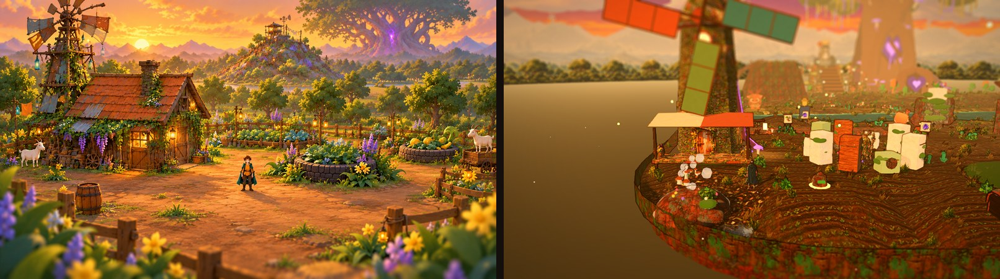 |
| Stream | 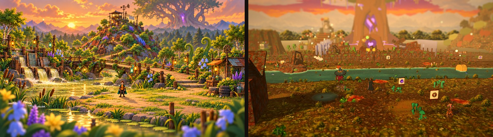 |
| Wetlands | 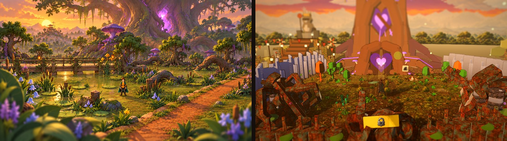 |
| Throne Approach | 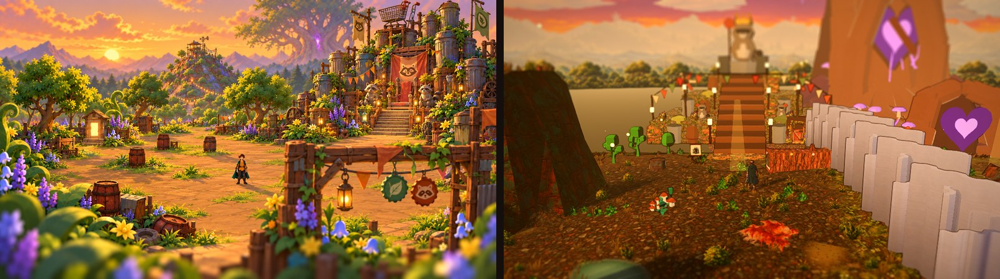 |

**What the Part A shots show** (the list for the next parts): the land floats over a flat beige plane (the far ground 26 m down, through the fog) where the paint-overs have land, forest and mountains to the horizon; the ground is one dark brown where they have green clover, orange paths and flowers; the old rusty junk models, the white tyre-wall slabs and the pale divider posts are still there; the Rotheart stands dead centre and too near in every view where the paint-overs set it upper right, far and whole.

**fps on Medium** after Part A: po_hub 59.9 (min 55.4, 726 draw calls), po_wetlands 60.0, po_farm_rows 60.0.

## Art Part B: the Rotheart

The zone's centrepiece and the main dungeon's goal (`HeapLandmarks._rotheart`, `root_gate`), modelled after DUMP-HERO-ROTHEART and the WETLANDS paint-over.

- **Where and how big** (VD-14): on the zone's centre line beyond the north rim at (50, -30), 76 x 46 x 56 m. The Cinematic camera shows only about 11 degrees of sky, so from the hub (100 m) a tall crown sat wholly above the frame and every view saw a bare trunk; the paint-overs show the canopy. Pushing the tree hundreds of metres out would have cut it off from its gate. Instead the crown is low and wide: a trunk to 20 m, nine long arms weeping outward from 16 m, a canopy about 70 m across whose underside and hanging moss fringe the top of the hub, stream and wetlands views like the wetlands paint-over, with the trunk and its glowing hollow framed under it. The paint-overs each set it upper right; one tree cannot be upper right from six cameras 70 m apart and still stand over its door at the centre, so it stays centred (its gate is the end of the wetlands road).
- **The model**: a broad trunk with eleven root strands twisting round it and moss on them; the heart-shaped hollow framed by two great strands that part round it and meet over it like lips, two thinner strands crossing its foot; inside, one gradient glow (bright core low in the middle, dark violet rim) on an unshaded material whose colour pulses, never a flat icon (VD-15: soft lobes first made a face in the doorway); violet motes drifting out; fourteen veins cracking out across the bark; thirteen mutated fungi (some in pairs) on the strands, the arms and the roots; doors half sunk in the bark, a spoked wagon wheel, pipes threading the strands, a treehouse lookout with a lit window and a rag flag in the crown; green-and-gold canopy clumps (a dark underside, five or six lobes, light lobes on top where the low sun catches them) with tapering moss drapes and a little wisteria; arching roots at the sides like the concept, short ones behind, and four long approach roots with violet veins and fungi running south over the corrupted mound to the root gate (meta `approach`).
- **The heart's light**: one real violet OmniLight in front of the hollow (range 30 m), pulsed with the glow (a gentle double beat about every five seconds, `HeapBuilder._pulse_heart`); the root gate's doorway pulses in step.
- **The root gate** (the main dungeon's door, `HEAP-ROOT-GATE` at (50, 5.5), its blocking circles unchanged): the approach roots end in two great roots rising either side and arching round over a heart-shaped doorway lit violet from within, a thinner violet strand twisting round each, side roots spreading back to the rim (never south), fungi and moss; the way in invites: a plank walk (DUMP-PATH-PLANK) from the wetlands road to the threshold between two warm lanterns on posts (thin and not solid, VD-16); the icon board (ICON-MAP-DUNGEON) beside it, no lettering, no placeholder shapes. The main_dungeon spot and its interaction are unchanged.
- **Freed**: `HeapLandmarks.set_freed` turns the heart, the veins, the fungi, the wisteria and the gate's doorway a soft green and dims them (wired to the zone's freed state in Part C).

| | |
|---|---|
| The Rotheart alone (kit bench, 85 m) | 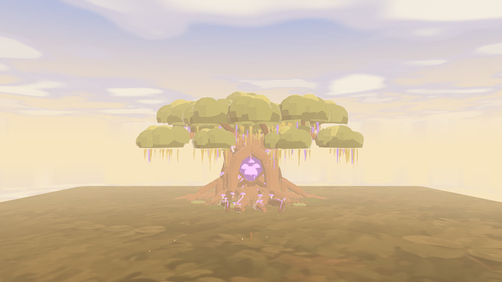 |
| The root gate from the main_dungeon spot | 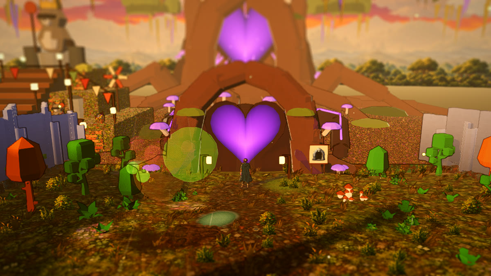 |
| From the hub | 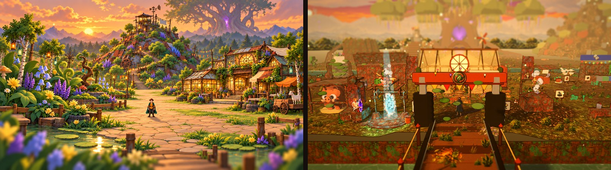 |
| From the farm rows | 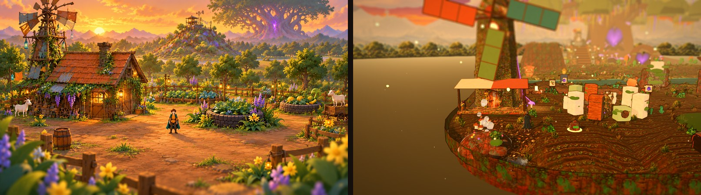 |
| From the stream |  |
| From the wetlands | 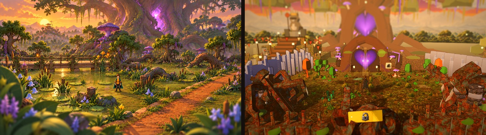 |

It reads in every view: the hollow's violet is the brightest accent under the crown from the hub, the stream and the wetlands; from the farm rows the windmill frames it on the left. Still to come: the ground and the old junk around it (Parts C, D) and the haze that turns the bark orange at 100 m (Part E).

**Checks**: `test_the_rotheart_is_the_concept_model_with_a_living_heart` (the concept model, the pulsing glow, one light, the motes, the approach roots ending at the gate, freed and back, the walk and the doorway glow); 1570 GUT, 1569 passing (GC-6); 60 fps Medium at po_hub, po_wetlands and the main_dungeon spot.

## Art Part C: the corruption gradient

The Dump grows sick toward the Rotheart as one smooth gradient, all of it data in `data/zone_styles/heap.json` `corruption` (read by `HeapLayout.corruption_at`, scaled by `HeapBuilder.twist_at`):

- **The shape**: from the plaza's north edge (`start_z` 54) to the roots (`end_z` 8), smoothstepped and strongest in the centre district (`centre_x` 50, `spread` 30): 0 at the hub and the farm rows, about 0.1 to 0.3 across the stream, 0.6 to 0.9 in the wetlands, 1 at the root gate; never more than 0.08 per metre (no hard line, tested).
- **The ground** (`PaintedContexts.heap`, the `heap` texture preset): the kit's DUMP-GROUND-CLOVER is the base everywhere, the farm rows paint the farm, warm mossy dirt the routes and the plaza, junk gravel the junk yards, and DUMP-GROUND-CORRUPT paints in by the gradient (`texture` 0.9); the vertex tint toward the Rot's violet is lighter now (`ground` 0.22) since the soil itself carries it. Painted layers can name zone kit surfaces by id now (`PaintedLibrary.albedo`), as decals could. Decals by the same masks: DUMP-DEC-CORRUPT veins (36) where it is corrupted, DUMP-DEC-PETALS and the flower and moss decals only where it is healthy, DUMP-DEC-OIL and rust on the junk ground.
- **The plants** (`HeapBuilder._build_props`, painted kit cards, one MultiMesh field per kind): vine oaks and tyre birches where it is healthy give way to DUMP-TREE-TWISTED through a dithered band (`trees` 0.42, `trees_band` 0.22); bushes become wildflower beds where it is healthy, reeds where it is wet (the stream and the wetlands) and DUMP-PLANT-FUNGUS (its own soft violet glow) above `fungus` 0.4; the flower clumps thin to 15 % toward the roots (the prep pass) and turn to small fungus there. The generic dressing's grass carpet was brown (its patch colours); it is meadow green and gold now.
- **The grade** (`HeapScene._update_corruption_grade`): where the hero stands, the look rig's targets move toward `grade` (fog lilac and a little thicker, saturation 0.94, warmth 0.06, vignette 0.36) in 5 % steps (the rig blends them; each step redraws the sky's haze), and the sun sinks from -22 to -15 degrees and turns rose (longer shadows) while the ambient turns lilac (`light`), eased over a second or two, jumping only on a teleport. Violet is the accent (the hollow, the veins, the fungus, the soil's veins), never a wash: the full-strength grade was lifted after the first pass made the gate a dark violet murk (VD-17).
- **The base grade** moved toward the paint-overs at the same time: warmth 0.3 to 0.12, saturation 1.1 to 1.02, a lighter peach fog (0.0034), a warmer ambient; the fine matching is Part E.
- **Freed** (VD-18): the game has the state (`Session.is_zone_completed`), so it is built rather than logged: `HeapBuilder.freed` (set by the scene before the build) scales the whole gradient by `corruption.freed` (0): no corrupted soil (the land takes the preset's "freed" variant, rich compost round the heaps instead), healthy trees and flowers everywhere, the grade stays golden, and `HeapLandmarks.set_freed` turns the Rotheart's heart, veins, fungi and wisteria and the gate's doorway a soft warm green.

The gradient from the hub to the root gate (`bash tools/heap_gradient_shots.sh <prefix>`: po_hub, po_stream, the north bank, po_wetlands, the main_dungeon spot):

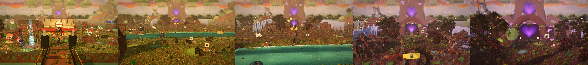

| Region | Paint-over beside the game after Part C |
|---|---|
| Hub | 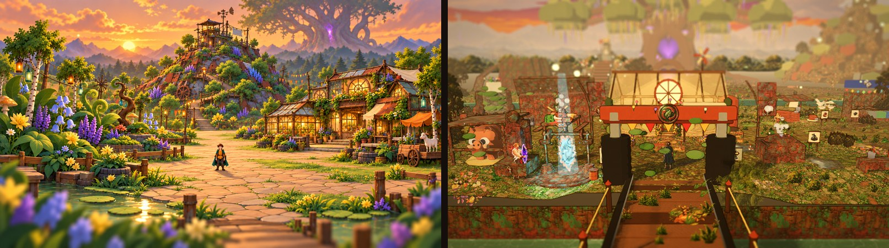 |
| Junk Peaks | 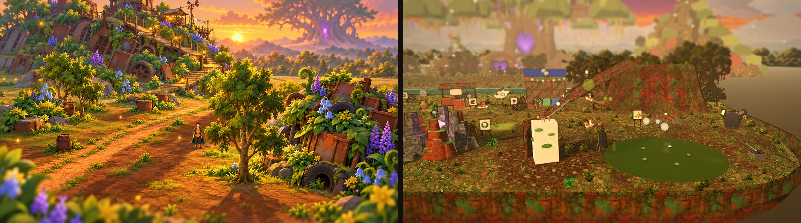 |
| Farm Rows | 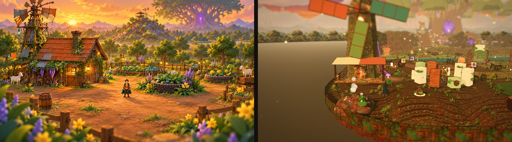 |
| Stream |  |
| Wetlands | 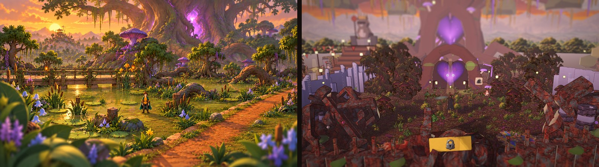 |
| Throne Approach | 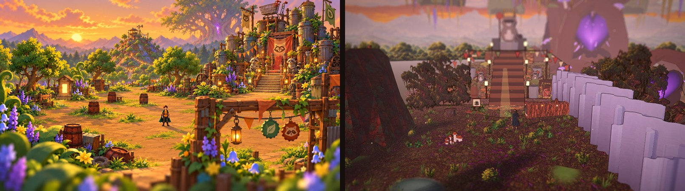 |

**Checks**: `test_the_corruption_gradient_is_data_and_recedes_when_freed` (the data keys, healthy hub and farm, rising to the roots, no step above 0.08 per metre, twisted trees only in the corruption, fungus toward the roots, freed: no twisted trees and no corruption); 1571 GUT, 1570 passing (GC-6); 60 fps Medium at po_hub (709 draw calls), po_stream, po_wetlands.

## Art Part D: dress

The decluttered layout is kept exactly (no new solid pieces on routes, in the plaza or round anchors; the layout's obstacles unchanged): the old procedural pieces became kit pieces in place, and the kit's clusters went only to doorways, walls and junctions.

- **Material swaps** (`data/zone_styles/heap.json`): every shared kit id the zone could use points at the Dump kit (timber and plank walls to DUMP-WALL-MOSSWOOD / -DOORS, the roofs to DUMP-ROOF-TIN / -REED, the eave trim to DUMP-TRIM-ROPE, doors, windows and signs to the sliced sheets, the dirt path to DUMP-PATH-PLANK, the calm grass to DUMP-GROUND-CLOVER, the trees to the Dump's oaks, birches and twisted trees).
- **Buildings** (`world/heap/heap_kit_props.gd`, VD-20): the two barns are patched shacks (mossy planks with tin patches under a tin roof in the Commons; old doors under a reed roof on the scree), with rope trim, a sliced door and two windows, rag bunting to a pole, flower crates and a lantern by the door, the icon over it; Granny Gristle's swap shed is a stall (an old-door back wall, a plank counter with a kettle and jars, shelves, a striped awning under tin, the vendor icon, a lantern, a tyre garden). No `building_presets.json` entries: the Dump has no BuildingKit buildings in its layout, so presets would have nothing to dress.
- **The walls**: the tyre wall (about ninety tyre stacks of several meshes each) and the two district dividers (pale panel slabs) are one knee-high scrap fence per run (old-door and tin panels on posts, a rope rail, a tyre stack at each end, moss), drawn from the same post positions; the blocking is the layout's, unchanged.
- **The ground pieces**: the junk piles are DUMP-PROP-SCRAPPILE and -TYRE cards spread over their blocking circles; the tyre stacks are tyre gardens; the compost bin and heap are the kit's compost heap; the druid's appliance grove is rusted tin and old-door appliances under vines with wildflower crates between; the secret corner's fridge is a faded green retro fridge with rust blooms and its door hanging open; the compost pits are dark compost with a ring of leaning plank stakes and reeds; the sign boards are salvaged planks tied to two posts.
- **Plank walks** (DUMP-PATH-PLANK): the way in from the bridge to the plaza, the road north to the stream, the wetlands road to the root gate and the throne avenue's last stretch, boards 2.6 m wide following the ground (one flat mesh, walked on, never fades).
- **The bridges**: the three vine bridges are sturdy plank bridges (a 3.1 m deck on two beams, posts, rope rails, vines and blooms), still grown segment by segment; the walk is the layout's strip, unchanged. The entrance gate lost its heavy tyre pillars and rusty beam: two mossy posts on a pair of tyres with vines, a sagging rope of rag bunting, the icon on the left post, so the Commons shows through it from the arrival.
- **Clusters** (`data/art/zone_kits/heap_clusters.json`, `HeapDressing`): tyre gardens, bottle walls, compost corners, sorted scrap, the goat on its cart, reed banks along both sides of the stream and fungus patches in the wetlands (tyre gardens instead once freed); 15 of 30 candidate spots pass the free-ground rules (off routes, plaza, entrance, landmark spots, 4 m from anchors for solid ones, 2 m from chests, 2.5 m apart); solid pieces register blockers.
- **The land goes on** (VD-21): the far ground came up from 26 m down to just under the rim's grass lip, green, so the Dump sits in meadows instead of over a beige sea; vine oaks and tyre birches stand in a band beyond the west, north and east rims (never the south, where the cameras stand, and off the Rotheart's mound, the throne and Junk Mountain); the overflow pool is only under the entrance bridge; Junk Mountain's foot and the throne's plinth reach down to the new ground.

| Region | Paint-over beside the game after Part D |
|---|---|
| Hub | 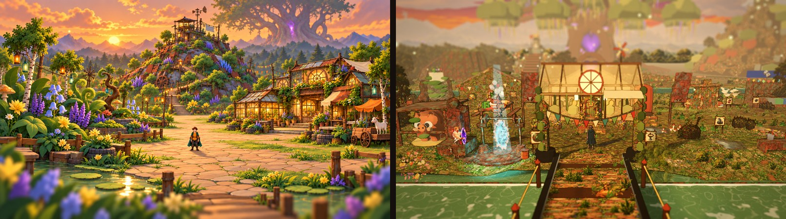 |
| Junk Peaks | 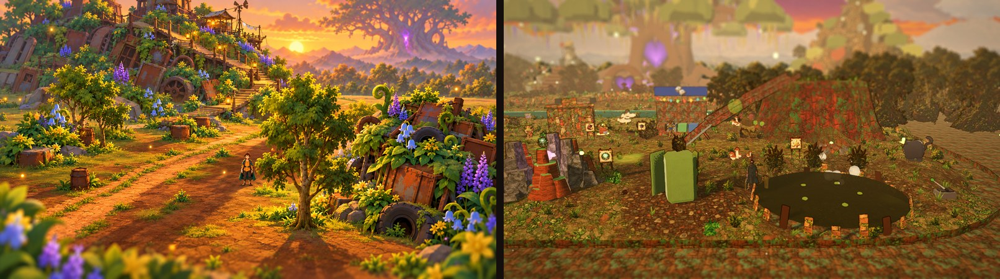 |
| Farm Rows | 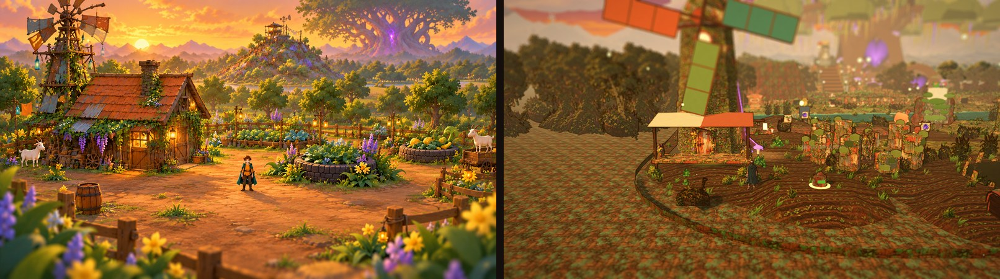 |
| Stream | 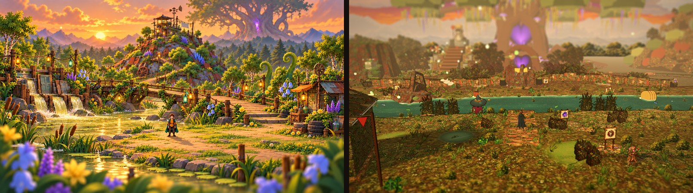 |
| Wetlands | 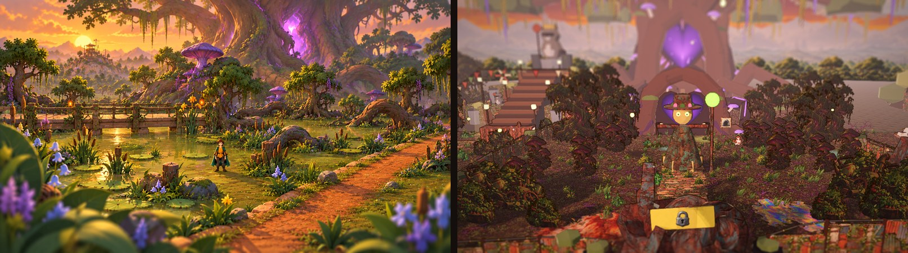 |
| Throne Approach | 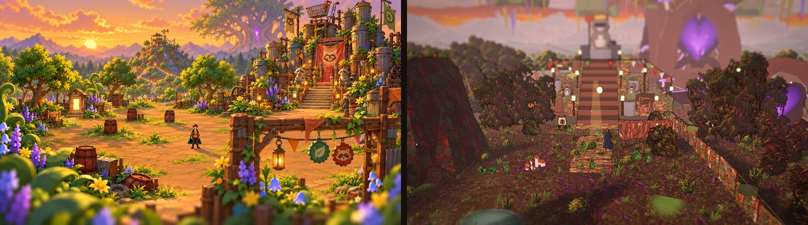 |

**fps on Medium** after Part D (draw calls dropped with the fence: the wetlands 738 to 452): po_hub 60.0 (618 draw calls; one 20.9 fps hitch in the first probe, two re-runs steady at 60), po_junk_peaks 60.0 (461), po_farm_rows 60.0 (339), po_stream 60.0 (532), po_wetlands 60.0 (452), po_throne_approach 60.0 (335).

**Checks**: `test_the_dressing_is_the_kit_in_tidy_clusters_off_the_routes`; 1572 GUT, 1571 passing (GC-6); the walk smoke passes at Cinematic (21 shots: the bridge, the plaza, every NPC and the vendor, the interactables, the boar, the quiz, the fair, the Seed Shrine, both dungeon doors, the giant chest, the lever, back to town).

## Art Part E: match the paint-overs

Four passes per region from the recorded cameras (`bash tools/heap_po_shots.sh <prefix>`), numbers first (`tools/image_stats.gd`), each pass re-shot and re-measured:

1. **Composition and the land's tone**: the grade's violet now builds late (`corruption.grade_curve` 1.8: the stream and the throne approach stay golden with violet accents, the full grade is the roots'), and the full-strength grade itself was softened (lilac fog, saturation 0.98, a rose sun at -16 degrees); the painted ground brighter (clover 1.42, paths 2.4, vertex tint 0.3); the grass carpet keeps off the bridge, the routes and the vine bridges so the paths read clear; the rose window is warm glass, not a white disc; the gate's vines round.
2. **Density and palette**: the throne approach is healthy in its paint-over (green oaks), so twisted trees begin at 0.62 and fungus at 0.6 (the throne approach sits near 0.5, the wetlands above 0.7); the terrain's overall brightness 1.3.
3. **Light, shadows and haze**: the corrupted soil paints in late (`smoothstep(0.35, 0.95)` of the gradient), so the stream and the throne approach keep golden ground with only the odd vein; the ambient 0.78 for the paint-overs' soft shadows; more fireflies (40).
4. **The farm rows**: the crop rows' soil brighter (1.5).

The numbers after the four passes (paint-over above the game, Cinematic / Normal, 1600 x 900):

| image | mean RGB | luma p5 / p50 / p95 | saturation | sky / mid / ground |
|---|---|---|---|---|
| PAINTOVER-DUMP-HUB | 146, 113, 67 | 46 / 114 / 194 | 0.58 | 165,122,86 / 132,103,50 / 140,113,66 |
| game hub | 153, 120, 64 | 55 / 123 / 190 | 0.61 | 180,141,95 / 151,110,50 / 128,109,46 |
| PAINTOVER-DUMP-JUNK-PEAKS | 135, 97, 45 | 43 / 97 / 182 | 0.68 | 147,109,74 / 123,92,31 / 136,91,30 |
| game junk peaks | 135, 100, 50 | 46 / 99 / 173 | 0.66 | 164,129,86 / 129,91,39 / 114,78,25 |
| PAINTOVER-DUMP-FARM-ROWS | 148, 103, 51 | 47 / 108 / 187 | 0.67 | 173,124,77 / 124,89,34 / 146,97,42 |
| game farm rows | 133, 94, 46 | 55 / 94 / 170 | 0.68 | 155,119,76 / 130,90,38 / 115,74,25 |
| PAINTOVER-DUMP-STREAM | 144, 113, 64 | 45 / 114 / 194 | 0.60 | 166,123,83 / 130,102,47 / 138,115,61 |
| game stream | 143, 109, 54 | 47 / 113 / 181 | 0.65 | 174,135,92 / 129,101,46 / 127,92,24 |
| PAINTOVER-DUMP-WETLANDS | 125, 92, 53 | 43 / 90 / 180 | 0.59 | 148,103,74 / 113,85,42 / 114,88,44 |
| game wetlands | 126, 87, 59 | 35 / 89 / 178 | 0.57 | 167,126,103 / 109,71,45 / 101,63,30 |
| PAINTOVER-DUMP-THRONE-APPROACH | 149, 107, 59 | 45 / 112 / 189 | 0.64 | 170,122,81 / 141,98,43 / 136,102,52 |
| game throne approach | 122, 82, 56 | 39 / 83 / 172 | 0.59 | 160,118,97 / 101,63,39 / 104,66,32 |

The hub, the junk peaks, the stream and the wetlands sit within a few points of their paint-overs on mean colour, median luma and saturation (they started 10 to 30 points off on the ground third and 0.13 off on the wetlands' saturation); the farm rows and the throne approach stay 10 to 20 % darker (the honest list, Part F). The game's ground third is still more orange (less blue) than the paint-overs everywhere.

| Region | Paint-over beside the game after Part E |
|---|---|
| Hub | 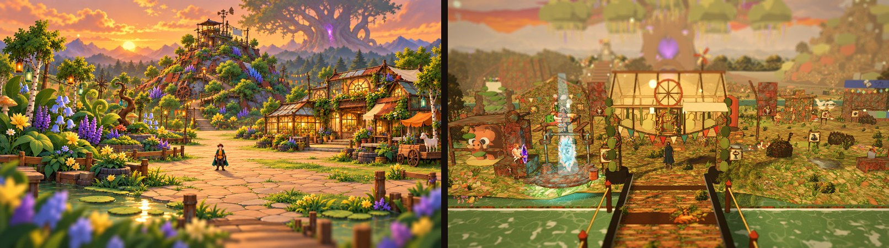 |
| Junk Peaks | 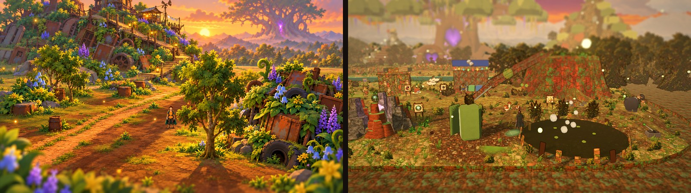 |
| Farm Rows | 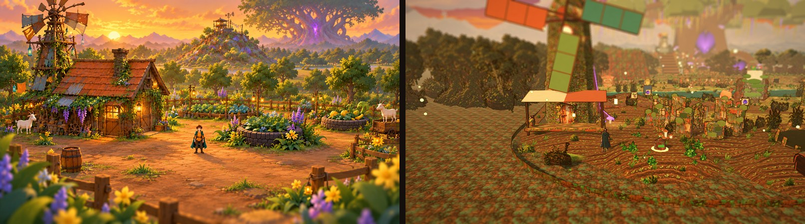 |
| Stream | 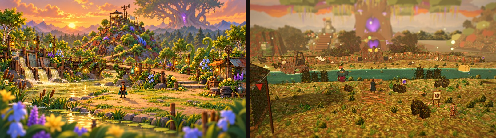 |
| Wetlands | 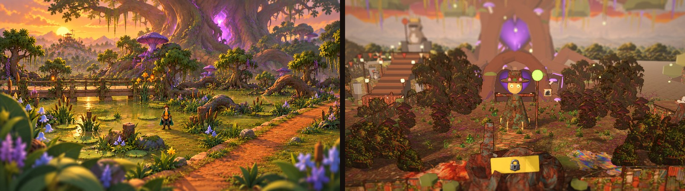 |
| Throne Approach | 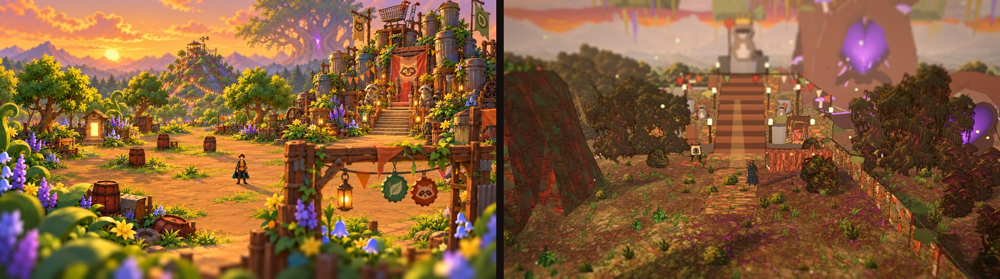 |

**The hub at all 9 camera combinations** (`tools/zone_shots.gd --area=heap --mode=grid`; every combination reads finished):

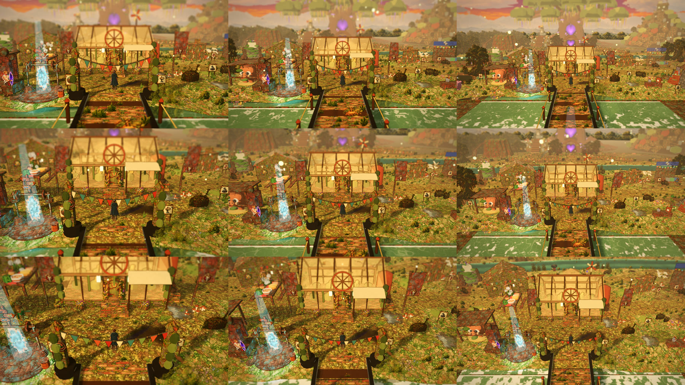

**fps on Medium** (VD-22): the stream camera was at 52 to 56 since Part D (the Part D table's 60 there was taken before the views and the woods were all in; re-measured at the Part D commit it is 52). The `HEAP_HIDE=<name,...>` knob (an exact name with `=`) found it: the camera trails the hero by about 12 m and 6 m up, so whenever the hero walks north of the plaza the greenhouse stands between them, and the fader dims it to a 12 % ghost that still covers a big part of the screen in the transparent pass (3.5 ms of GPU). Neither the views' shadows, nor the terrain's fifth layer, nor the tree fields, nor the grade, nor mipmaps were it (each was measured); a ghost that faint reads as nothing, so `HeapScene` hides the greenhouse outright while it blocks the lens-to-hero line, and the glass is its own mesh that never fades. The Dump's ground and path surfaces now import with mipmaps (they shimmered at a distance).

| Spot | avg fps | min fps | GPU ms | draw calls |
|---|---|---|---|---|
| po_hub | 60.0 | 60.0 | 14.1 | 834 |
| po_junk_peaks | 60.0 | 60.0 | 11.7 | 588 |
| po_farm_rows | 60.0 | 60.0 | 11.6 | 491 |
| po_stream | 60.0 | 60.0 | 12.9 | 692 |
| po_wetlands | 60.0 | 60.0 | 11.8 | 434 |
| po_throne_approach | 60.0 | 60.0 | 12.5 | 340 |
| main_dungeon (the root gate) | 60.0 | 60.0 | 11.1 | 351 |
| mini_dungeon (the throne's door) | 60.0 | 60.0 | 11.6 | 287 |

**Checks**: 1572 GUT, all passing (GC-6 passed in this run).
