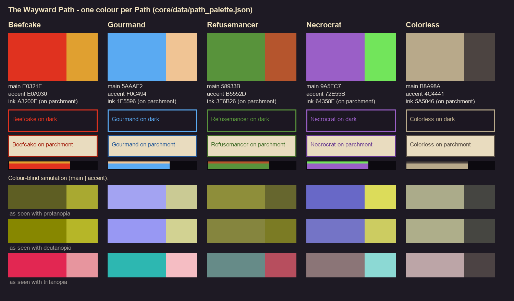

# Path colour guide (The Wayward Path)

Written Nov 19 2026 (Fable Nov 19, Part 3); the palette was changed on Nov 20 (Gourmand blue, Necrocrat violet). **One official colour per Path, everywhere a Path is shown by colour.** It is the colour
companion of `docs/art/path_icon_style_guide.md`: the icon says which Path, the colour agrees with the icon.

- The palette lives in **one file: `core/data/path_palette.json`**. Change a hex value there and every screen follows.
- Code reads it through `PathPalette` (`core/data/path_palette.gd`); `UIStyle.affinity_color()` is the same table.
- Swatches: `docs/art/path_colour_swatches.png` (made by `python tools/path_palette_check.py`, which also prints the colour-blind check).

## The palette (Fable Nov 20: the owner's decision)

**Gourmand is blue again and Necrocrat is violet again**; Beefcake red and Refusemancer moss green stay as set on Nov 19. (The cream
of Nov 19 was too neutral for Gourmand; the Necrocrat's Path icon keeps its green ghost-flame, which is fine.)

| Path | Main | Accent | Text on dark | Ink on parchment | In words |
|---|---|---|---|---|---|
| **Beefcake** | `#E0321F` | `#E0A030` | `#F26A54` | `#A3200F` | strong red, gold accent (the gold arm on the red disc) |
| **Gourmand** | `#5AAAF2` | `#F0C494` | `#96C8F7` | `#1F5596` | clear blue, cream accent (the white chef's hat) |
| **Refusemancer** | `#58933B` | `#B5552D` | `#86BE64` | `#3F6B26` | deep moss green, rust accent (the leaf in rust arrows) |
| **Necrocrat** | `#9A5FC7` | `#72E55B` | `#C39BE6` | `#64358F` | the old violet, ghost-green accent (the flame round the skull) |
| *Pathless* (no Path; called Colorless before Nov 21) | `#B8A98A` | `#4C4441` | `#CFC3A8` | `#5A5046` | stone (unchanged) |

Roles:
- **main**: bars (the essence tracker), borders, glows, map and quest markers, battle effects, filter chips, the hero's outline behind a wall.
- **accent**: the second colour where a place uses two (a bar's highlight line, a rim, a dual trim). Never used alone to mean the Path.
- **text**: small text on the dark panels (a lighter step of the main).
- **ink**: text and thin lines on parchment (a darker step of the main).
- **frame**: the cloth tint of the tinted card frames (`CardView`), kept exactly as it was so the cards do not change.

## Do the four read apart?

`tools/path_palette_check.py` (the smallest difference between any two Paths, CIE Lab units; under about 10 two colours are hard to tell
apart at a glance):

| Palette | Normal | Protanopia | Deuteranopia | Tritanopia |
|---|---|---|---|---|
| UI tints until Nov 18 (red, blue `#4A8FE0`, green, violet) | 40 | 14 | **9** | 18 |
| Nov 19 (cream, ghost green) | 38 | 22 | 21 | 29 |
| **This palette** | 49 | 21 | **14** | 23 |

- For normal vision the four are further apart than ever (49).
- The close pair for red-green colour-blind players is **Gourmand blue against Necrocrat violet** (14 for deuteranopia): violet loses
  its red and reads as a darker blue. That is why the blue is a step **lighter** than the old one (`#5AAAF2` against `#4A8FE0`): the two
  then differ by brightness (14 against 9 with the exact old blue). The violet is the old one, unchanged. **The owner confirmed the
  lighter blue on Nov 20: it stays.** The exact old blue and the Nov 19 palette are still listed under `"alternatives"` in the JSON
  file, marked "not chosen" (a record only).
- Beefcake red against Refusemancer moss is 21 to 22 for red-green colour-blind players, as on Nov 19.
- Colour is never the only signal: the Path icon is always beside it.
- Readable on both backgrounds: each main is at least 3.9:1 on the dark panel (`#1C1722`), each ink at least 4.6:1 on parchment
  (`#E9DCBF`).

## Where each colour is used (the audit)

In code, every row reads the palette (before this pass the "was" column):

| Place | File | Was | Now |
|---|---|---|---|
| The UI's Path tint (text, borders, glows; about 60 call sites) | `ui/ui_style.gd` `affinity_color()` | own table: red, **blue**, green, **violet** | `PathPalette.main` |
| Alembic: jar rows, essence orbs, essence bars, the two-Path recipe | `ui/town/alchemist_screen.gd` | through the UI tint (blue / violet bars) | main; the bar's top line is the accent |
| Essence toasts | `app/toast_layer.gd` | UI tint | main |
| Card frames: cloth tint of tinted frames | `ui/card/card_view.gd` `FRAME_CLOTH` | own table (already the icon colours) | `PathPalette.frame` (same values) |
| Card accents, cost pips, pip dots | `ui/card/card_view.gd` | UI tint | main |
| Battle board: play, attack, buff and death effects; infrastructure glow; resource buttons | `ui/battle/battle_board.gd`, `battle_hud.gd`, `battle_screen.gd` | UI tint | main |
| Deck filters (the Path chips) | `ui/town/card_filter_bar.gd` | UI tint | main |
| Deck Station racks, the Deck box | `ui/widgets/deck_rack.gd` | UI tint | main |
| Character page essence counts | `ui/town/character_screen.gd` | UI tint | main |
| Collection Book progress bars | `ui/town/codex_screen.gd` | UI tint | main |
| Pack shop covers, pack glow, pack opening | `ui/town/pack_shop_screen.gd`, `core/data/pack_definitions.gd` `PATH_COLORS`, the packs' `art_color` | own table: orange, **yellow**, green, **violet** | main (path packs take the palette at load: `PackData.tint()`) |
| Zone title cards | `ui/screens/zone_title_card.gd` | the packs' table | main |
| Boss intros (the name band) | `core/dungeon/boss_intros.gd` `PATH_COLORS` | own table: orange, **yellow**, green, **violet** | main |
| Path choice in dungeons (element offers) | `ui/dungeon/element_choice_screen.gd` | UI tint | main |
| Memory screen (the four Paths) | `ui/screens/memory_screen.gd` | UI tint | main |
| The ending's Path row; the cutscene's Beefcake speaker | `core/dungeon/ending_defs.gd`, `ui/dungeon/cutscene_screen.gd` | hex in data | main |
| Map: the hero's Path tint, zone portals | `world/town_scene.gd`, `world/zone_portals.gd` | UI tint | main |
| Corrupted NPC glow, springs, vault levers | `world/town_scene.gd`, `world/vault/vault_lever_event.gd` | UI tint | main |
| The crest texture's four fields | `world/kit/kit_textures.gd` `PATH_COLORS` | red, yellow, **blue**, **violet** | the ring of four mains |
| The Lab's four tanks, the castle's district lights | `world/dungeon_backdrop.gd` | two own lists (yellow, **violet**) | the ring of four mains |
| The hero's outline behind a wall (Part 1) | `world/sprites/world_sprite.gd` `outline_color` | new | the hero's Path main, lightened |

A test (`tests/core/data/test_path_palette.gd`) keeps it so: the file has the five rows and every role, no hex value of a Path colour is
gone from the code, and the listed files hold no Path colour table of their own.

## Painted art

The card frames, the Path icons (medallions), the essence flasks, the plinths and the Beefcake, Gourmand and Refusemancer card backs
and packs stay as they are: they are painted in the icons' own colours (Gourmand's cream and copper, the Necrocrat's green flame on
slate) and the owner is fine with that; the UI's tint beside them is blue and violet.

Painted art still wrong under this palette (Batch 18 rows in `docs/art/batch18_nov18.csv`, re-checked Nov 20):

| File | What is wrong | Right colours |
|---|---|---|
| `UI-CARDBACK-N` | its field is the same deep green as the Refusemancer back; side by side the two backs read as one Path | violet field, bone trim, the green-flame medallion unchanged |
| `UI-PACK-N` (and `UI-PACK-LOCKED-N`) | the wrapper is the same green as the Refusemancer pack | violet wrapper, the medallion unchanged |
| `VS-ALEMBIC` (her shop picture; low priority) | the four jars are blue, red, **orange** and green | red, blue, moss green, violet, in the fixed order |

Dropped on Nov 20: `V-ALEMBIC` (her flasks and apron splashes are red, yellow, blue, green and violet: with blue and violet back as
Path colours nothing in it is wrong any more).

## Rules for new work

- A Path's colour is its **main**; never invent a fifth.
- Where two Paths meet (a dual card, an Alembic recipe) show both colours side by side, first Path on the left; never a blend.
- All four together: the fixed order Beefcake, Gourmand, Refusemancer, Necrocrat (`PathPalette.ring()`).
- In code never write a Path colour as a hex value: ask `PathPalette` (or `UIStyle.affinity_color`).
