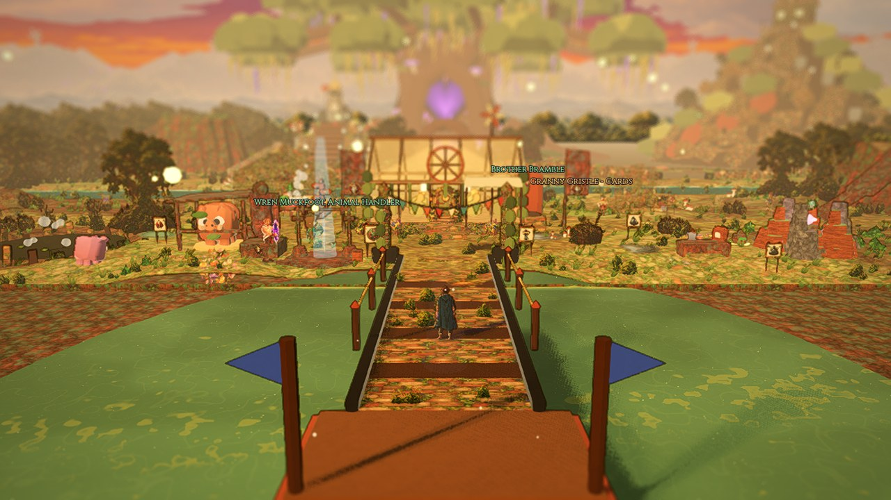
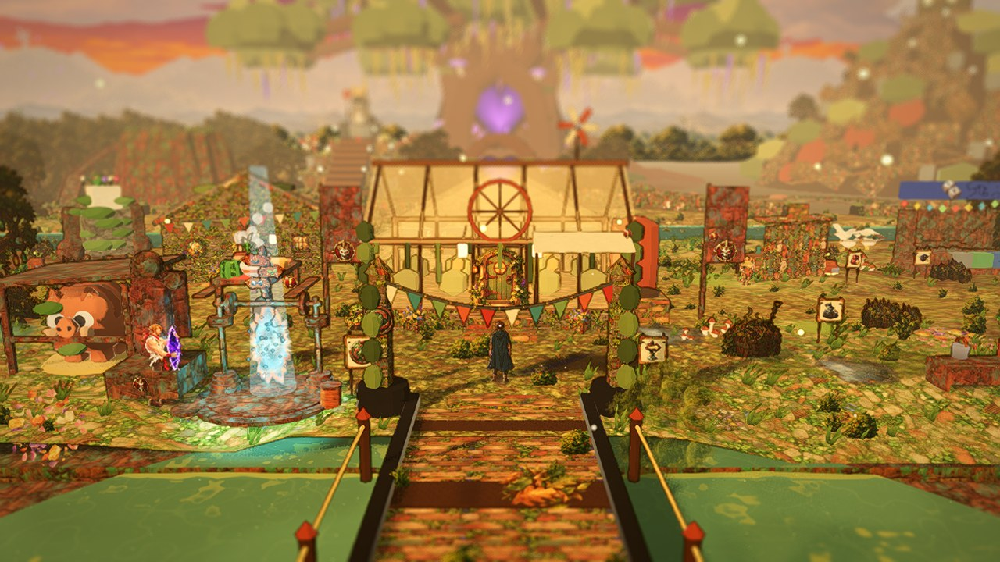
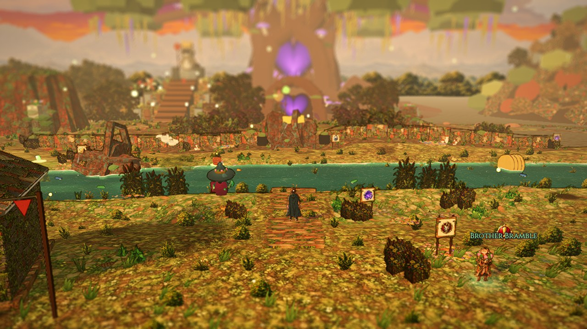
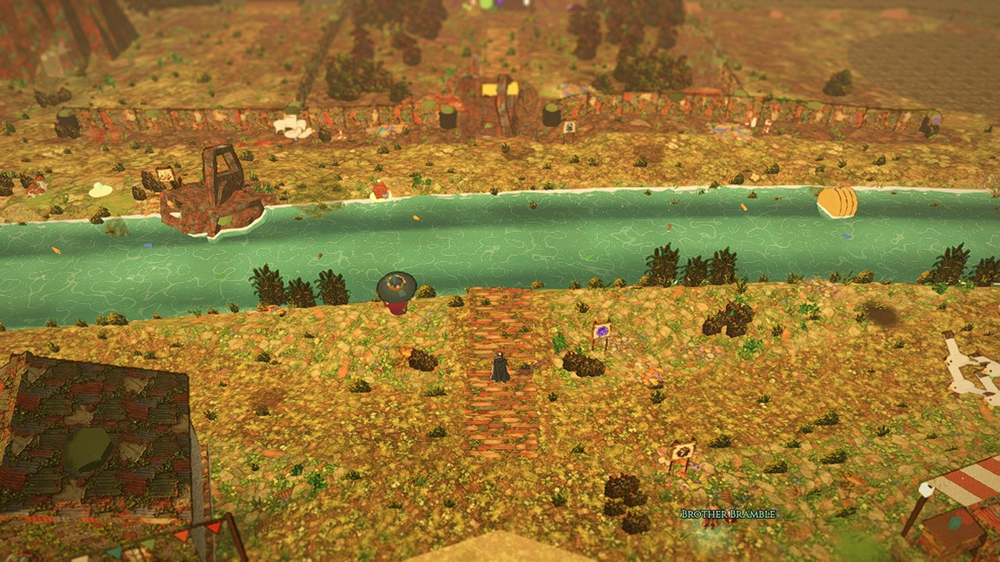
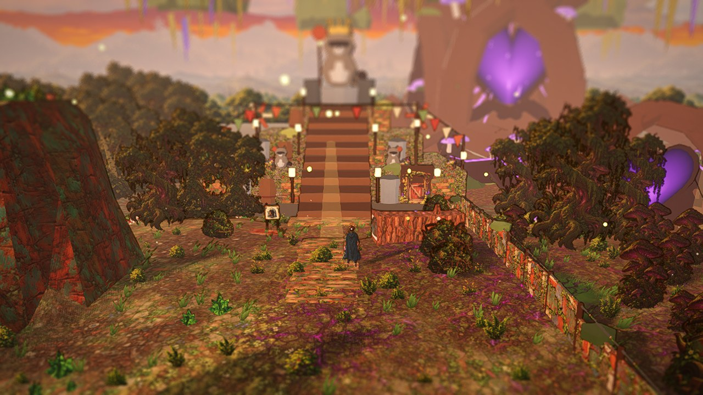
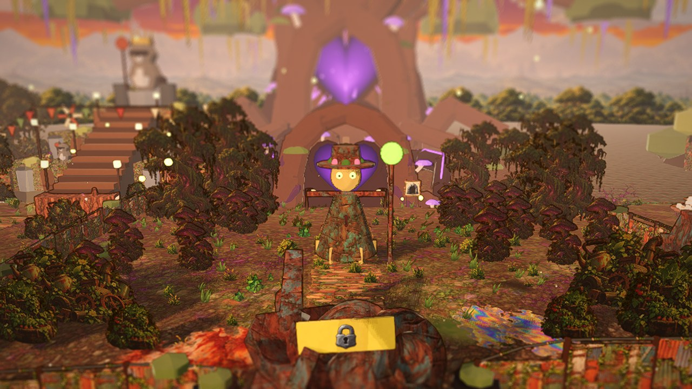
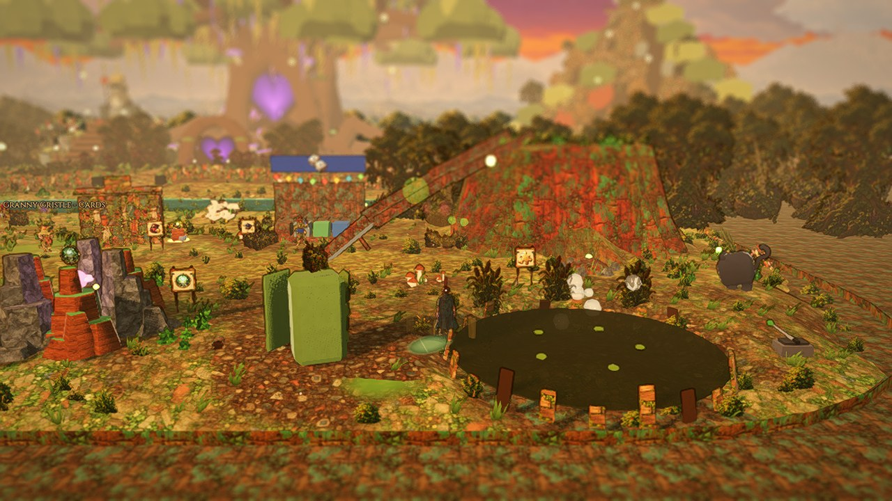
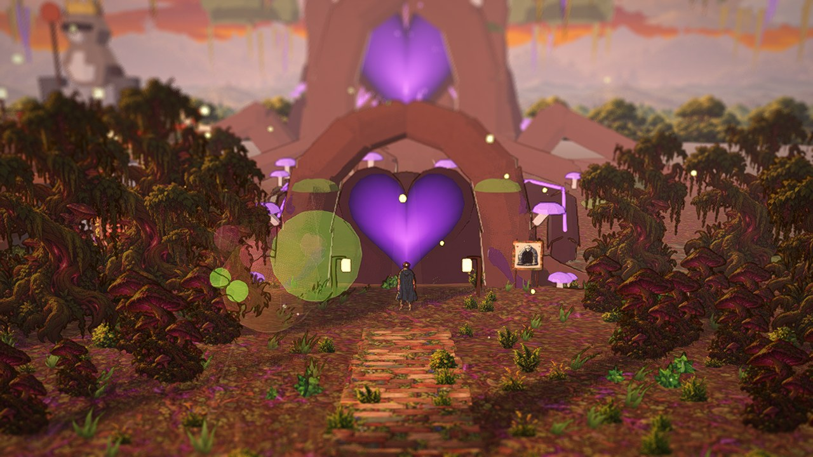
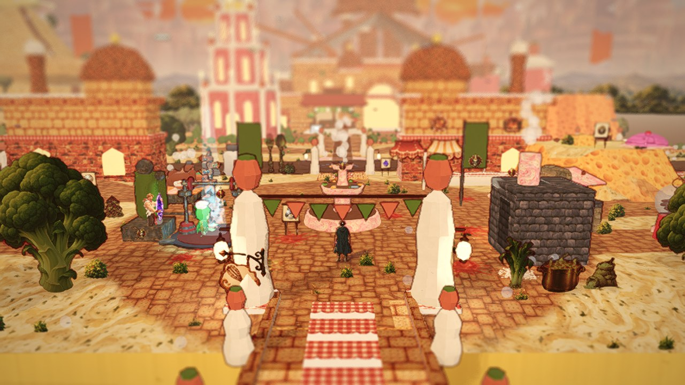

# The Verdant Dump v2: a deep, terraced ravine, not a second Buffet

The Verdant Dump (area `heap`, zone `refusemancer`, `scenes/heap_zone.tscn`) rebuilt as clearly its own place: narrower and much deeper, rising in terraces from the market at the entrance to the Rotheart at the back, a turquoise river winding through a ravine below, waterfalls spilling between the tiers, vine bridges and vine ladders, violets and purples over the warm golden light. Visual target: `docs/art/paintovers/verdant_dump_v2_reference.png`. Built from the existing Verdant Dump kit and the other approved kits only (no new art); the art that would close the remaining gap is listed at the end. Judgment calls are VD-01... at the bottom of this file. The earlier passes (the layout pass and the art pass of 2026-10-15) are in `docs/art/heap_slice.md`.

Rules kept throughout: ONE walkable zone, no sub-areas, dungeons node-based (Art Bible G-07); walkable ground has ONE height per (x, z) (`HeapBuilder.height_at`), so every bit of verticality is a terrace, a cliff, a stair, a ramp, a vine ladder or a vine bridge across a gap, and nothing walkable ever lies under a bridge or a ledge; storybook scale (hero 1.7 m), routes four hero-widths (stairs, ladders and vine bridges two to three), clutter at the edges, no readable text, the hero the clearest thing on screen, 60 fps on Medium.

## Part A: audit

### Before (2026-10-19, the zone as found, Cinematic / Normal, no UI)

| | |
|---|---|
|  the entrance bridge |  the hub |
|  the river and its three bridges |  wide (Overview camera, Far zoom) from the same spot |
|  the north-west district (throne approach) |  the centre district (wetlands) |
|  the east (junk peaks, the scree beyond) |  the Rotheart approach at the root gate |

The Endless Buffet's hub from its paint-over camera, for comparison: 

**fps baseline on Medium** (`bash tools/fps.sh res://scenes/heap_zone.tscn 1 --at=<spot>`, the dev iGPU, vsync off so 60 is the cap):

| Spot | avg fps | min fps | GPU ms | draw calls |
|---|---|---|---|---|
| po_hub | 59.6 | 19.9 (one load hitch) | 14.5 | 848 |
| po_stream | 60.0 | 60.0 | 13.0 | 708 |
| po_wetlands | 60.0 | 57.9 | 11.9 | 483 |
| po_throne_approach | 59.9 | 30.2 (one hitch) | 12.0 | 343 |

GUT baseline: 1920 / 1920 passing (468 s).

### What makes it read like the Endless Buffet

Side by side the two zones are the same drawing with different stickers:

1. **The same table.** A 92 x 72 m rounded rectangle (corner radius 12) floating over a far plane, entered over a bridge at x 50 from z 74 to z 90 (the Buffet: 74 to 92), the plaza round a centrepiece at (50, 64) of radius 9.5 (the Buffet: 8.5 round the Soup Fountain), the hub's things spread round its rim.
2. **A river across the middle with three bridges.** The recycling stream at z about 43 (the gravy river: 44) with crossings at x 22, 50 and 78 (the Buffet's rafts and bridges: the same three x). The south bank road and the north bank road run between the same three points.
3. **A fence line with three gaps.** The tyre wall at z 30 with gaps at x 22, 50, 78 and a barricade in the middle gap (the Buffet: the fork fence at z 30, gates at x 22, 50, 78).
4. **Three walled districts side by side** north of the fence, dividers at x 38 and 64, each with its own landmark at the back (the Buffet: bakery, kitchen, cliffs).
5. **Flat ground.** Hills of 0.9 m and two 5 to 7 m knolls; the whole zone is one level, so the camera reads one flat plate of ground with the landmark views pasted along the horizon.
6. **The palette.** Golden haze over orange, cream and rust: mean colour about (146, 113, 67) against the Buffet's cream, copper and gravy; the Buffet's warmth with the Buffet's saturation.
7. **The prop rhythm.** Boards and clusters at the plaza rim, two framing trees in the south corners either side of the bridge head, bushes and reeds in the same bands along the banks and the rim.

### The reference, read

`verdant_dump_v2_reference.png`: the hero stands on a sunlit market terrace in the foreground (patchwork awnings, planters, barrels, crates, a rope fence, lanterns, violet and blue flowers framing the frame's lower corners); the land drops away in front into a ravine where a turquoise river winds below; an arched, vine-wrapped bridge crosses it in the middle distance; on the right, stone stairs climb terrace by terrace up a cliff to a second market under awnings; on the left, waterfalls spill from terrace to terrace past a giant rusty water wheel and old machinery built into the cliff; higher terraces step up into the distance with planters and small stalls on each; purple wisteria and jacaranda-like trees stand on every ledge; giant ancient trees and floating rock pillars close the back under a warm golden sky with violet haze; birds circle the ravine.

The structure to copy: **narrow and deep, rising away from the camera in four or five steps, with the river below and the goal above.**

## The plan

### Top-down map (metres; x east across, z south down the page; north = the Rotheart = up)

```
                          x 18                      x 50                       x 82
z   4  +-----------------------------------------------------------------------+   views beyond the rim: the ROTHEART (50,-30) on
       | T3  THE OVERGROWN PLATEAU  y 10        [root gate 50,5.5 / door 50,9]  |   its mound, the Trash Panda THRONE (31,-3.5),
       | [throne door 31,9.5]  cnw*         back lane      *cbe   [car husk*]   |   JUNK MOUNTAIN beyond the north-east corner,
       |     ^avenue      RUST PEAK   (48,30)              SCREE FIELD (rough)  |   giant trees and floating rock pillars behind
       |   chute_b~~~    (28,22) r5     |landing     gulls   [scrap barn 74,13]  |
       |       ~~~      [mound_b]  junk-pile lane      cbarn*  csne*            |
z  34  |~~~~~~~ spring/pipe ~~~~~~ ||barricade|| ~~~~~~~ [scree slope 66-74]    |   cliffs 3.5 m between tiers, wavy edges
       |#gorge#  T2  THE COMPOST TERRACE  y 6.5     ||stairs|| mount only ramp  |
       |#  W  #  water wheel   compost heaps     (50,55)  |  sludge chASM  |   |
       |#  A  #  [chute_b_end]  machinery  fert_3  |landing |  ====bridge_east (bean, 56-64 at z 50)
       |#  T  #                          [mound_east] [bank_e]|  [land_e] pit  hollow log*clog  |
z  62  |#  E  #~fall~ ======================== ||stairs|| ~ladder~ ===root ramp=== |
       |#  R  # T1  THE FARM TERRACE  y 3   (50,68)   (44,62)   (62-67, 54-70) |
       |#  F  # [windmill 28,65]  crops 31/36/41 x z70   hay*   junk_2   MOUNT SCRAPMORE (72,76) r5 |
       |#  A  # [junk DAM 26,77] grove+quiz (40,80)  land_c    [fair stage 62,88] [mound_a] chute_a~~ |
       |#  L  # [goat stable 33,87]  overlook+ladder (36,85)   gulls  Rhonda (62,84)  animal_3     |
       |#  L  # [land_w 28,89]            (46,89)  golem                 [stairs top 78,90]  |
z  92  |~~~~~~~~ THE RAVINE: the river winds west->east at y -3.2, 6.4 m of water + cliff banks ~~~~ DRAIN |stairs|
       |  ====bridge_west (bean)====    ====ARCHED VINE BRIDGE (Sorrel)====     ~~~ pool  |  x 76-80 |
z 100  |  [mound_w / bank_w 28,103]        [bank_c 46,103] [Sorrel 43,104]     chute_a_end (54,106) scarecrow |
       | T0  THE MARKET TERRACE  y 0                                                      |
       |  golem   pit (34,112)    heal table (39.5,118)   PLAZA r 9.5     Bramble (57,112)  fert/junk pickups |
       |  fert_1          Wren (41,124)  (50,120) GREENHOUSE   Gristle's stall (62,116) stalls+awnings |
       |  [giant chest 24,131]  boar stable (36,127)  rift (42,130)  compost bin (58,127) trough (64,129) shrine (70,127) |
       |  animal_2                   po_hub (50,128.5)                        [fridge* 77,132] lever (79.5,127) |
z 136  +-------------------------------||entrance road||---------------------------------------+
                                   [ENTRANCE BRIDGE x 50, z 134..150 over the overflow pool -> town]
```

`*` = hidden chest; `~` = water or a chute; `=` = a vine bridge; `||` = stairs; `#` = the west gorge (the river's course down the tiers before it turns into the ravine).

Size: walkable rectangle x 18..82 (64 m wide), z 4..136 (132 m deep), corner radius 6: about 8450 m2 of plate against the old 92 x 72 rounded table (about 6400 m2); minus the ravine, the gorge, the chasm, the pits and the cliff bands the walkable ground is still larger than before (measured in Part B).

### Side section along x = 50 (south on the left, looking west)

```
 y 15 .                                                        Rust Peak summit (west)  .   Scrapmore summit (east, y 8)
 y 10 .                                      _________________ T3 plateau ____________ root gate / Rotheart's mound ->
 y 6.5.                   ______ T2 ________|| stairs + barricade (z 44..32)
 y 3  .        ____ T1 ___|| stairs (z 68..56) / root ramp / vine ladder
 y 0  . T0 ___|                       arched vine bridge (z 100 -> 90, rises 0 -> 3 with a 1.2 m arch)
 y -3 .       |_ RAVINE _|  water at -3.2, bed -4.2, cliff banks 0.9 m each side (unwalkable), the river winds west -> east
       z 136  120   100  92      68   56        44    32           4
```

The west gorge (x 18..24) carries the river down from a rusty pipe in the T3 cliff at z 38: a fall onto T2 (water 6.0), a fall over the T2 cliff onto T1 (water 2.5) past the big water wheel, and a 6 m fall into the ravine at z 92; the ravine runs east to a junk-choked drain pool at its east end (x 70), and the land neck east of it carries the stone stairs from the market up to the farm terrace.

### Tiers, routes and what lives where

| Tier (region id, title) | Height | What is there | Up from here |
|---|---|---|---|
| **T0 The Market Terrace** (`commons`, Compost Commons, the hub) | 0 | the entrance bridge, the plaza round the greenhouse, the market stalls under patchwork awnings, Brother Bramble, Granny Gristle's stall, Wren, the Harvest Meal, Boris's stable, the rift station, the compost bin, trough and shrine, the giant chest (west) and the fridge chest and vault lever (east corner), a compost pit, Druid Sorrel at the arched bridge's foot | the ARCHED VINE BRIDGE (Sorrel grows it after the herd), the WEST VINE BRIDGE (a Magic Bean at its mound), the EAST STONE STAIRS (always open); the Scrapmore chute lands back here |
| **The Ravine** (`stream`, The Ravine) | water -3.2 | the turquoise river, the two vine bridges, the drain, the west gorge with its falls and the water wheel, reeds and mist | the bridges only |
| **T1 The Farm Terrace** (`farm` west, `peaks` east) | 3 | west: the windmill, the crop plots, Thistlewick's appliance grove and quiz, the junk dam at the gorge (the Root Cause favour), Gideon's goat stable, the overlook ledge with its vine ladder and chest; east: the fair stage and Recycle Rhonda, Mount Scrapmore with its beanstalk mound, two summit chests and the chute, the haybale chest, animals and pickups | the CENTRAL STONE STAIRS, the GIANT ROOT RAMP (east), the VINE LADDER (west of the stairs) |
| **T2 The Compost Terrace** (`farm` / `stream` / `peaks`) | 6.5 | compost heaps steaming, the machinery and the second water wheel at the gorge's fall, the sludge chasm with the EAST VINE BRIDGE (bean) to the east pocket (a compost pit, the hollow-log chest, a pickup), the Rust Peak chute's landing | the STONE STAIRS behind the JUNK BARRICADE (a charging mount) or the SCREE SLOPE in the east pocket (a mount) |
| **T3 The Overgrown Plateau** (`wetlands` centre, `throne` west, `peaks` east scree) | 10 | the road to the Rotheart's ROOT GATE (the main dungeon), the car-husk chest, the throne avenue past RUST PEAK (the Seed Shrine on its summit, its beanstalk and its chute down to T2) to the TRASH PANDA THRONE's door (the side dungeon), the back-edge and corner chests, the scree field with the scrap barn and its two chests (mount only); corruption at full strength | the beanstalk up Rust Peak |

Routes between every pair of neighbouring tiers: T0-T1 three (two bridges, the stairs) plus the chute down; T1-T2 three (stairs, ramp, ladder); T2-T3 two (the barricade stairs, the scree slope) plus the chute down. Loops: the plaza's four roads, the east stairs up and a bridge back down, the T1 lane round Scrapmore and the fair, the T3 lane round Rust Peak, the chutes. Sightlines: from the market the ravine, the arched bridge, the stairs and three cliff faces step up to the Rotheart on the centre line; from the arched bridge the river below and the waterfalls on the left.

Gating kept: the summits need a Magic Bean (beanstalks), the T2 east pocket needs a bean (the east vine bridge), the plateau needs a mount (the barricade or the scree), the throne door its quest, the Rotheart its gate; the growth flags, barricade flags, chest ids, pickup ids, anchor names and quest hooks keep their ids so old saves load (positions are re-read from the anchors on load; nothing in a save stores a world position in the Dump).

### The reference's elements and the kit pieces that stand in for them

| In the reference | In the game (existing art only) |
|---|---|
| terraced cliffs stepping up into the distance | the tier terrain itself (vertex-coloured strata, as the Gainlands' sandstone), DUMP-GROUND-CLOVER on the terraces, DEC-MOSS and vines (`KitMesh` tubes + leaf blobs) on the faces |
| waterfalls between tiers, mist | `GainlandsWater.waterfall` (the scrolling-streak sheet, foam pool, mist puffs) recoloured turquoise-white |
| the turquoise river below | `StyleWater` in the ravine's bed, turquoise shallow / deep teal, bottles drifting |
| the arched vine bridge | `HeapKitProps.bridge` segments on an arched deck, posts wrapped in vine tubes, leaf and violet blossom blobs, still grown segment by segment |
| stone stairs between terraces | `KitMesh` stepped boxes in the stone flats with cheek walls (as `GainlandsTerrain.stairs`), moss blobs, a lantern post at the foot |
| vine ladders up cliff faces | thick vine tubes with rung tubes and leaf blobs on a steep walkable strip |
| purple wisteria / jacaranda trees | the kit's DUMP-TREE-OAK and -BIRCH cards tinted violet through the card shader's mood tint (per-field tint), DUMP-TREE-TWISTED on the plateau |
| violet and blue flowers in the foreground | DUMP-PLANT-WILD cards tinted violet and blue, the foliage atlas's foxglove cell, DEC-FLOWERS / DUMP-DEC-PETALS decals |
| purple blossoms on vines | `petal_violet` blobs on the vine tubes (bridges, ladders, cliff vines) |
| glowing violet mushrooms in shade | DUMP-PLANT-FUNGUS (its own glow), under the cliffs and the giant trees |
| giant ancient trees and floating rock pillars at the back | the Rotheart (already the goal), DUMP-TREE-OAK cards at 3x beyond the north rim, `LandmarkKit` island / mound rocks hung in the air behind the rim |
| patchwork-awning market stalls | `PropKit.stall` with the Dump's rag flags (DUMP-SHEET-FLAGS) and `cloth_*` awnings, Granny's `HeapKitProps.stall` |
| planter boxes, barrels, crates, rope fences, lanterns | `PropKit.planter / barrel / crate / lantern_post`, rope fences as `KitMesh` posts and rope tubes |
| rusty water wheels and machinery in the cliffs | a new `KitMesh` wheel (rim, spokes, paddles) in the rust and metal flats with a `spinner` meta; the appliance-grove pieces as machinery |
| warm golden light with violet haze | the `heap` style: key light kept warm, fog colour toward lilac, the corruption grade stronger, a second violet rim ambient |
| birds circling the ravine | `AmbientBirds` over the ravine; `HeapFlock` gulls stay the enemies |
| critters, bees, moths, drifting petals, spores | Cube Pets rats / raccoons on short loops, `AmbientFx` motes recoloured, `HeapLook.fireflies` kept, a petal particle |
| junkyard-farm identity | the scrap fence, tyre gardens, bottle walls, compost heaps, the car husks and barn, the drain under a rusty grate, the junk barricade, the junk dam, DUMP-GROUND-CORRUPT and DEC-CORRUPT toward the roots |

## Judgment calls

| ID | Call | Why |
|---|---|---|
| VD-01 | The reference file was delivered as `verdant_dumpv2_reference.png`; renamed to the brief's `verdant_dump_v2_reference.png` and committed under `docs/art/paintovers/`. | One path for the brief, the tools and the report. |
| VD-02 | The zone keeps x 50 as its centre line and z 4 as its north rim, so the Rotheart (50, -30), the root gate (50, 5.5), the main_dungeon spot (50, 9.2), the throne (31, -3.5) and its door (31, 9.5) keep their coordinates; the zone grows southward (z 4..136, x 18..82) and the entrance bridge moves to z 134..150. | The soundscape, the audio tests and the landmark models read those constants; moving the south end costs nothing. |
| VD-03 | The river comes down the west edge of the zone in a gorge (three falls, the water wheel) and turns east into the ravine; the ravine ends at a junk-choked drain against the east wall so that a land neck carries the stone stairs. | The reference has the waterfalls on the left and the stairs on the right; a stair cannot cross water, and a river that spans the full width would make the market reachable only by bridges. |
| VD-04 | The farm terrace is reachable on foot by the east stairs; Druid Sorrel's arched bridge and the bean bridges become shortcuts and loops rather than the only way across. | "Never linear" and "two routes between every pair of tiers"; the bridges still gate nothing the quests need (the herd quest is turned in to Wren, not by crossing). |
| VD-05 | Both routes onto the plateau (the barricade stairs and the scree slope) need a mount, so the Rotheart and the throne stay behind the "ride something" beat as before. | Keeps the old gating tests meaningful; the boar is free at the hub, so it is a moment, not a wall. |
| VD-06 | Mount Scrapmore's chute slides back down to the market terrace across the ravine (a flying trough, not walkable); Rust Peak's chute slides down to the compost terrace. | Loops back down are asked for; the chutes already fly (their points keep above the ground). |
| VD-07 | The old region ids stay (`commons`, `farm`, `peaks`, `stream`, `wetlands`, `throne`) with new titles where the place changed, so the footstep surfaces, the soundscape profile and the tests keep working. | Ids are code; titles are canon shown in the HUD. |
