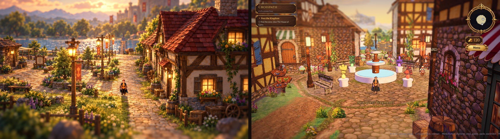
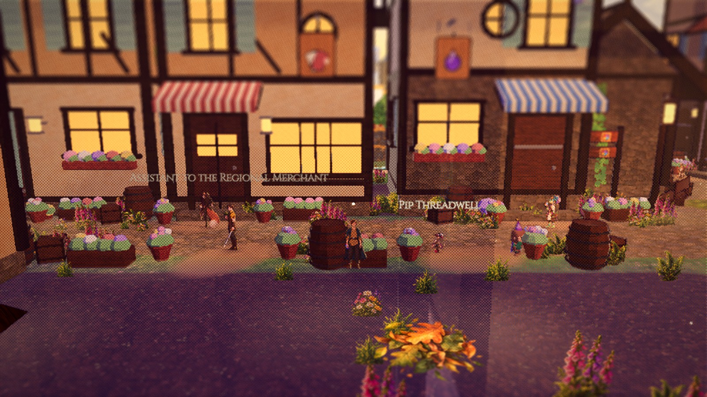
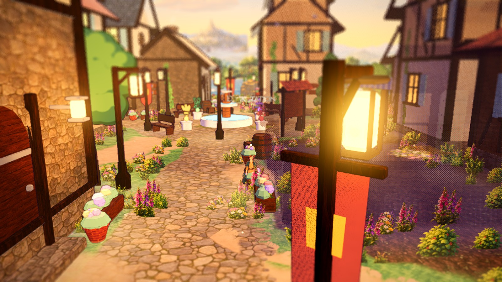
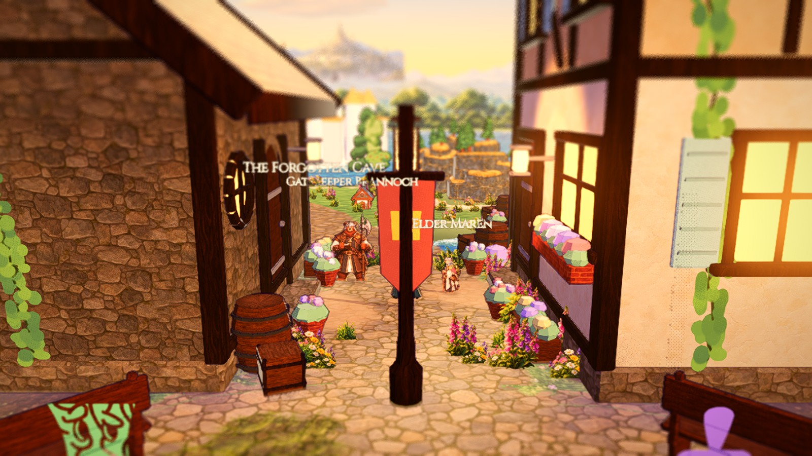
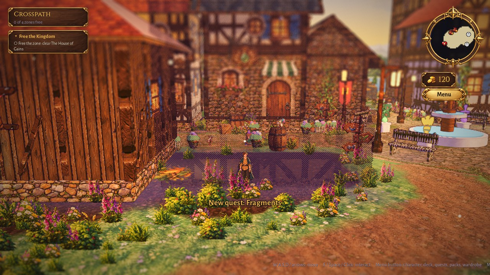
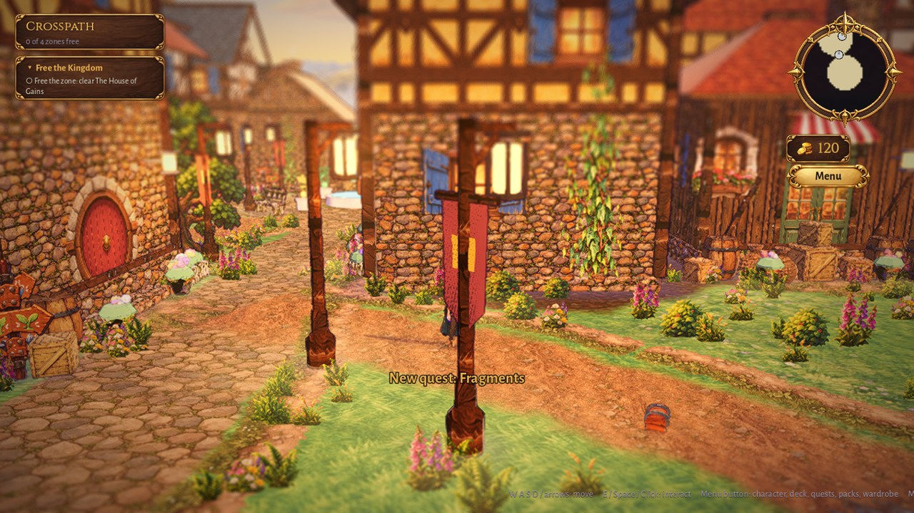
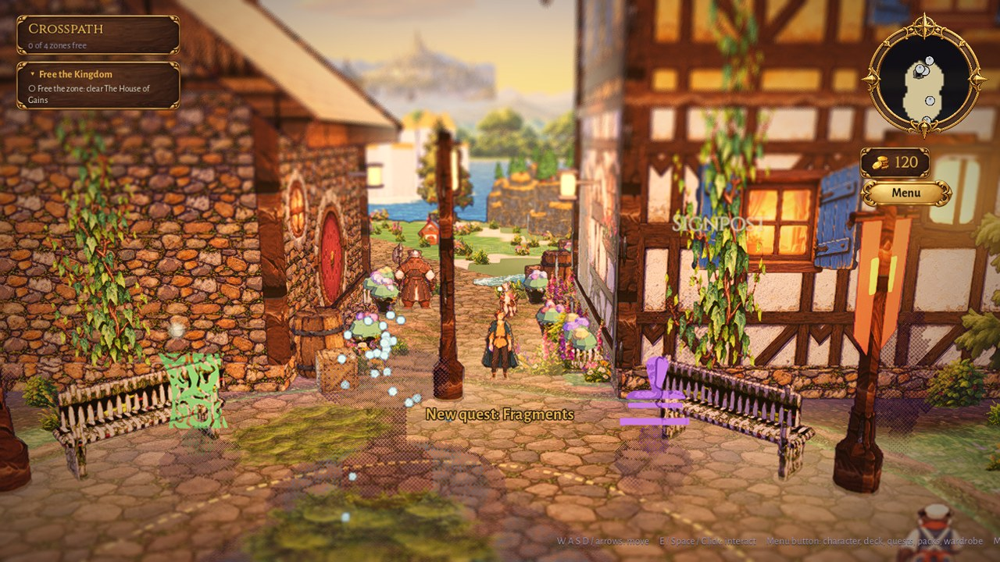
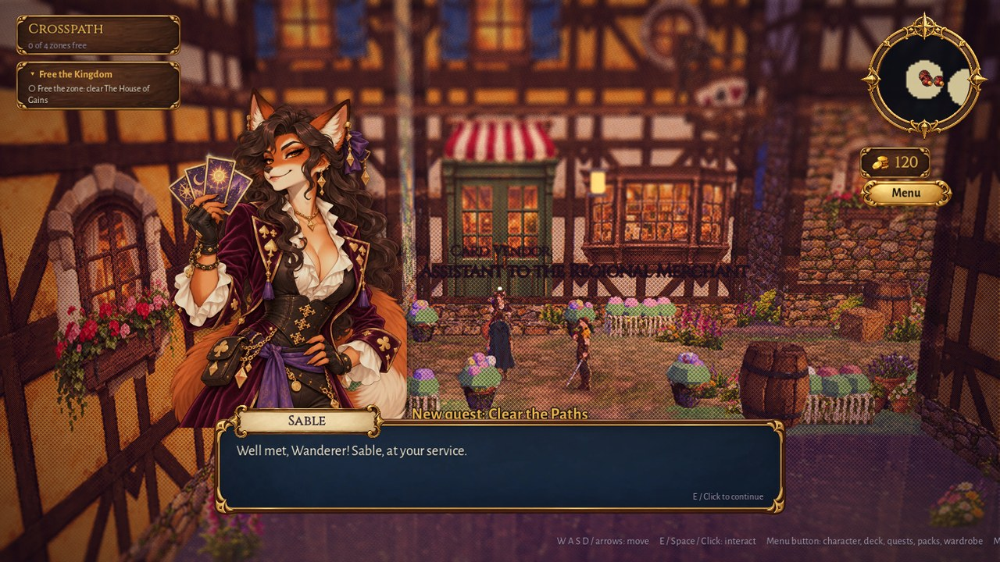

# Vertical slice: the main town square

The first vertical slice rebuilds the town square to match the approved paint-over (`docs/art/paintovers/PAINTOVER-TOWN.png`, an HD-2D, Octopath-like look, painted).
Everything is built in code from an **Environment Kit**: the real approved art is in (see "Environment kit art pass"); a missing file falls back to a placeholder, and every slot takes the real
kit art by dropping a file in `assets/art/env_kit/`. Judgment calls are VS-1 ... VS-14 in `docs/design/open_questions.md`. Gameplay, quests, NPC logic and the camera style
are untouched (the camera rig, FOV, pitch and tilt-shift are the approved values).

Left: the paint-over. Right: the rebuilt square from the default camera (the hero at the spawn).

| Other angles | |
|---|---|
| West Market Street (card shop, potion shop opposite the clothier and the smithy) |  |
| The Deck Station (the inn) and the south end of the square |  |
| Gate Road: the cave hut, Elder Maren's house, the Hall of Records, the castle beyond |  |

## What is where

| Part | Code | Data |
|---|---|---|
| **A** modular building kit | `world/kit/building_kit.gd` (walls, foundation band, posts, beams, half-timbering, gable / hip / thatch / spire roofs with real overhangs, eave trim, chimneys, dormers, sockets for doors / windows / awnings / signs / lanterns / ivy / stains / flower boxes, lit glass), `building_presets.gd`, `kit_mesh.gd` | `data/art/building_presets.json` (11 presets: home_a, home_b, cottage, inn, card_shop, potion_shop, equipment_shop, clothing_shop, pack_shop, alchemist, stone_hut, chapel, hall) |
| **B** props and plants | `prop_kit.gd` (barrel, crate, sack, flowerpot, planter, bench, well, lantern post, banner post, stall, cart, fences, hedge, stone wall, signpost, notice board), `prop_clusters.gd` (doorstep, crates, market set, garden bed, bench nook, well corner, fenced garden, banner lamp, barrel pair), `tree_cards.gd` / `kit_foliage.gd` (painted tree cards, flower and grass clumps) | |
| **C** ground and paths | `path_tool.gd` + `kit_path.gdshader` (dirt / cobble along curves, soft edge, DEC-PATHEDGE strips, worn patches, irregular clumps, cobbled plaza) | `TownLayout.road_kinds()` |
| **D** light and atmosphere | `kit_ao.gd`, `kit_pools.gd` (baked-look occlusion pools, light pools), `kit_lights.gd`, per-vertex AO in `kit_mesh.gd`, `world_post.gdshader` (`green_calm`, `red_calm`) | `StylePresets` (TOWN), `data/art/zone_looks.json` |
| **E** the square | `world/town_layout.gd` (shops as kit presets), `town_builder.gd`, `town_square.gd`, `town_streets.gd`, `world/kit/town_kit.gd`, `kit_batch.gd` | |
| Registry | `world/kit/env_kit.gd`, `kit_textures.gd`, `kit_canvas.gd` | `data/art/environment_kit.json` (merged with the sheet by `tools/env_kit_sync.gd`) |

Tools: `tools/kit_bench.tscn` (`bash tools/shot.sh res://tools/kit_bench.tscn name --presets=home_a,inn --props=barrel --clusters=doorstep --trees=oak --hero=0,24`),
`bash tools/import_env_kit.sh` (art import, copy-only), `tools/env_kit_status.gd` (the table below), `tools/side_by_side.gd` (the comparison images),
`bash tools/run_town_slice_smoke.sh` (windowed e2e: 14 spots, prompt / interact / close, plus walking).

## What matches the paint-over

- **Composition from the default camera:** buildings frame both sides of the cobbled square, a lamp-post avenue with banners and lanterns, the fountain (the crest) in the middle,
  the Gate Road opening to the castle, the lake and the far trees. Props are clustered at doorsteps and walls; nothing is scattered on the lanes.
- **Materials and shapes:** half-timbered plaster houses on stone foundations, tiled roofs with overhangs, eave trim, chimneys, shuttered windows with warm glass and flower
  boxes, striped awnings, hanging icon signs, ivy; barrels, crates, sacks, pots, benches, fences, a market stall, a cart, a well; painted tree cards (no cones).
- **Ground:** cobbled square and streets, calm grass, worn dirt tracks with soft edges, flowers in natural clumps along walls and paths (never an even scatter); the old saturated
  moss patches and the mown stripes are gone.
- **Light:** one warm low sun from the east, soft shadows, cool violet shade with warm lantern and window glow on top, occlusion at the foot of walls and under eaves, a gentle
  vignette, loud greens and reds pulled back (`green_calm` 0.4, `red_calm` 0.3).
- **No readable text in the world:** signposts carry the Path crest on arrow boards, the Rift Express and the zone passages carry the crest in their destination colour, the
  closed Alchemist and Arena show a padlock; what the signs said is read in a popup when the hero uses them (signposts) or in the dialogue and the prompt (the others).
- **Scale rule:** the hero (1.25 m) reaches a third of the way up a 3.4 m door; lamp posts 4.2 m, fences 1.1 m, barrels 1.1 m.

## Environment kit art pass (the real art, Parts A - D)

All 48 kit ids of the sheet (`data/source/env_kit.csv`, rows 8 - 55) are now real art in the game. The Drive folder `G:\My Drive\Card Game Art\Approved_EnvKit` is read-only
(copy-only import: `bash tools/import_env_kit.sh`, path in `data/source/art_config.cfg` as `envkit_dir`). **Missing ids: none. Files that match no id: none**
(`PAINTOVER-TOWN.png` and `PAINTOVER-GAINLANDS.png` sit in the same folder as targets, not kit art). Report: `docs/art/env_kit_import_report.md`; judgment calls EK-1 .. EK-5
in `docs/design/open_questions.md`.

### Paint-over beside the square

| Angle | |
|---|---|
| West market street: the card shop's painted arch door, awning, window box, flowerpot cards, barrel, signposts |  |
| South end of the square, the Deck Station |  |
| Gate Road north |  |
| An NPC dialogue open (the card vendor) |  |

### What was done

- **Surfaces**: seams measured on the tiling axes the sheet names and repaired by an edge-band crossfade only where it lowers the seam (cobble, dirt, grass, plank, hedge); the timber
  walls and the foundation are left as painted (a crossfade ghosted their posts, the raw art already tiles). Normal and roughness maps are derived from the painted luminance
  (`<ID>_n.webp`, `<ID>_r.webp`) and read by the toon shader (a gentle relief and a soft sheen on iron / varnish). One texel density (400 px/m: a 1024 px tile is 2.56 m) for every
  surface; a painted wall repeats once per storey so beams land on the floor lines.
- **Cut-outs and trees**: transparency was already clean (corners alpha 0); faint alpha is cleared, colour is bled into the border (no gray fringe under linear filtering), the
  art is trimmed and given a pivot (doors / windows / awnings at the base, signs at the iron bracket plate, trees and the signpost at the trunk base). Numbers in
  `data/art/env_kit_prep.json`.
- **Concept props**: the well (stone curb, posts, crank, bucket, red-tiled gable), the stall (plank counter, crates of produce, striped scalloped awning, lantern, optional cloth goods
  card) and the cart (plank bed, spoked wheels, canvas hood, crate, sacks) are rebuilt after ENV-PROP-WELL / -STALL / -CART and textured with kit surfaces.
- **Square**: painted doors on a stone step (arch, glazed double, round), painted windows (shutters and flower boxes are in the art; lit glass keeps its light pool), awnings
  as one slanted card, shop signs hung on their bracket (cards, potion, shield, needle, pack, flask, inn), flowerpot cards at doorsteps, painted tree cards by aspect and
  trunk base, fence cards, the Path signpost, cloth goods on a stall counter. Kit buildings no longer dither away at the lens edge (only their core blocks the hero).

### Numbers

| | paint-over | square (final) |
|---|---|---|
| mean RGB | 127, 90, 57 | 135, 94, 65 |
| luma p5 / p50 / p95 | 26 / 89 / 208 | 24 / 100 / 203 |
| mean saturation | 0.58 | 0.55 |

**fps (Medium, `tools/fps.sh res://scenes/town.tscn medium`)**: **59.7 - 59.9 avg** (16.7 ms; 590 draw calls, 1,190 objects, 355k primitives; was 55 - 57), min 28 - 34 on the
first frames while the scene streams. GUT: 1461 / 1461.

### What still does not match (honest list)

1. **Camera framing**: the camera is fixed (approved), so the right-hand building (the Deck Station) fills a third of the frame from the spawn where the paint-over shows the lake
   and a pier. The paint-over's composition is one painter's cropping; the game cannot move the building without moving the layout. Closest fix: shift the spawn / the inn.
2. **Fountain and pedestals** are still the one white, out-of-palette set in the square (no kit art; see `ENV-PROP-FOUNTAIN`).
3. **Roof tiles**: the three roof surfaces are not on the sheet; the existing TEX-MAT-ROOF-* are used (they are redder / flatter than the paint-over's mossy tiles).
4. **Lamp posts and banners** are built in code (iron and wood, flat red banner); the paint-over's carved posts with bracket scrolls and gold-fringed banners need art.
5. **Flower beds and low stone walls** are the foliage atlas and a stone box; the paint-over's flowers are denser and brighter in the mid ground.
6. **Haze and depth**: the paint-over has a stronger warm haze over the lake and a brighter horizon; the tilt-shift is matched in strength but the far trees are flatter.
7. **Signposts**: the four Path signposts around the fountain are busier than the paint-over's empty lane; they are functional (popups) so they stay, at a calmer size.
8. **Characters**: sprites remain the clearest things on screen (the environment's saturation was not raised; shadows were lifted slightly so they do not sink into dark walls).

### Extra assets that would close the gap (paste into the sheet)

| ID | Asset | Category | Lock | Image Description | Size / Format | In-Game Use | Priority |
|---|---|---|---|---|---|---|---|
| ENV-ROOF-TILE-RED | Red clay roof tiles | Roof surface | SURFACE | Terracotta-red clay roof tiles in soft overlapping rows with a few mossy tiles, seamless | 1024x1024 PNG, tileable both ways | Town roofs (the paint-over's big red roof) | High |
| ENV-ROOF-TILE-BLUE | Slate blue roof tiles | Roof surface | SURFACE | The same tile pattern in slate blue-grey | 1024x1024 PNG, tileable both ways | Alchemist, chapel, hall | Medium |
| ENV-ROOF-THATCH | Golden thatch | Roof surface | SURFACE | Golden thatch with shaggy straw lines and a darker band at the eave | 1024x1024 PNG, tileable both ways | Cottages, huts | Medium |
| ENV-ROOF-RIDGE | Ridge cap | Trim | CUTOUT | A short run of curved ridge cap tiles seen from the side | 1536x512 PNG, transparent | Roof ridges | Low |
| ENV-CHIMNEY-STONE | Stone chimney | Cut-out | CUTOUT | A stone chimney stack with a stepped cap and two clay pots, straight-on | 1024x1536 PNG, transparent | Chimneys (the paint-over's stone chimney) | Medium |
| ENV-WALL-STONE | Fieldstone wall | Wall surface | SURFACE | A full fieldstone wall in warm greys and tans with a little moss | 1024x1024 PNG, tileable horizontally | Cave hut, hall, chapel | High |
| ENV-BANNER-01 | Hanging banner (red) | Cut-out | CUTOUT | A hanging cloth banner with gold fringe and the Path symbol, red | 768x1536 PNG, transparent | Lamp-post banners | High |
| ENV-BANNER-02 | Hanging banner (blue) | Cut-out | CUTOUT | The same banner in blue | 768x1536 PNG, transparent | Lamp-post banners, Gainlands | Medium |
| ENV-PROP-LAMPPOST | Wooden lamp post | Prop concept | CUTOUT | The tall carved lamp post with iron lantern bracket from the low game camera | 1024x1536 PNG, transparent | Avenue lamps | High |
| ENV-PROP-FOUNTAIN | Town fountain | Prop concept | CUTOUT | Warm worn stone basin with moss, a pillar and a small crest | 1536x1536 PNG, transparent | Town square centre (the one white piece left) | High |
| ENV-PROP-BENCH | Plank bench | Prop | CUTOUT | A weathered plank bench seen from the front | 1536x512 PNG, transparent | Benches | Low |
| ENV-PROP-FLOWERBOX | Window flower box | Cut-out | CUTOUT | A long wooden window box brimming with mixed flowers | 1536x512 PNG, transparent | Window sills | Medium |
| ENV-PLANT-FLOWERS-01 | Flower clump (daisy) | Plant | CUTOUT | Daisies and yellow blooms, base at bottom centre | 1024x1024 PNG, transparent | Beds, verges | Medium |
| ENV-PLANT-FLOWERS-02 | Flower clump (lavender) | Plant | CUTOUT | Lavender spikes with grass | 1024x1024 PNG, transparent | Beds, verges | Medium |
| ENV-PLANT-FLOWERS-03 | Flower clump (foxglove) | Plant | CUTOUT | Foxgloves and ferns | 1024x1024 PNG, transparent | Beds, verges | Medium |
| ENV-GROUND-CURB | Stone curb | Ground surface | SURFACE | A strip of cut stone curb and low garden wall | 1536x512 PNG, tileable horizontally | Flower beds, square edge | Medium |
| ENV-PROP-PIER | Wooden pier | Prop concept | CUTOUT | The little wooden pier at the end of the street, three-quarter view | 1536x1024 PNG, transparent | Gate Road end, lake edge | Medium |
| ENV-PROP-BUCKET | Bucket | Prop | CUTOUT | A wooden bucket with an iron handle | 1024x1024 PNG, transparent | Doorsteps, stalls | Low |
| ENV-PROP-HAYBALE | Hay bale | Prop | CUTOUT | A round straw bale | 1024x1024 PNG, transparent | Farms, carts | Low |
| ENV-PROP-WHEELBARROW | Wheelbarrow | Prop | CUTOUT | A wooden wheelbarrow with a sack | 1024x1024 PNG, transparent | Doorsteps, work sites | Low |
| ENV-DEC-LIGHTPOOL | Lantern light pool | Decal | CUTOUT | A soft warm elliptical pool of light with a brighter core | 1024x1024 PNG, additive | Under lamps and windows | Medium |
| ENV-GROUND-COBBLE-WARM | Warm cobble | Ground surface | SURFACE | The cobble in a warmer, sunlit tone with fewer moss patches | 1024x1024 PNG, tileable both ways | Sunlit plaza | Low |

### Kit status (generated by `tools/env_kit_status.gd`)

| Kit ID | Slot | Lock / size | Now | Placeholder | Used by |
|---|---|---|---|---|---|
| `ENV-WALL-TIMBER` | wall.main | SURFACE 1024x1024 PNG, tileable horizontally | art | tex:mat_plaster | 6 building presets (home_a, home_b, card_shop) |
| `ENV-WALL-TIMBER-WARM` | wall.warm | SURFACE 1024x1024 PNG, tileable horizontally | art | tex:mat_plaster | 8 building presets (home_a, home_b, inn) |
| `ENV-WALL-PLANK` | wall.plank | SURFACE 1024x1024 PNG, tileable horizontally | art | tex:mat_woodplanks | 2 building presets (cottage, equipment_shop) |
| `ENV-WALL-FOUNDATION` | wall.foundation | SURFACE 1024x512 PNG, tileable horizontally | art | tex:mat_stonewall | 13 building presets (home_a, home_b, cottage) |
| `ENV-ROOF-EAVE` | roof.eave | CUTOUT 1536x512 PNG, transparent | art | tex:mat_timber | 13 building presets (home_a, home_b, cottage) |
| `ENV-BEAM` | wall.beam | CUTOUT 1536x512 PNG, transparent | art | tex:mat_timber | 13 building presets (home_a, home_b, cottage) |
| `ENV-AWNING-01` | awning.a | CUTOUT 1536x1024 PNG, transparent | art | gen:stripes_red | 5 building presets (home_b, inn, card_shop) |
| `ENV-AWNING-02` | awning.b | CUTOUT 1536x1024 PNG, transparent | art | gen:stripes_green | 2 building presets (potion_shop, clothing_shop) |
| `ENV-DOOR-01` | door.a | CUTOUT 1024x1536 PNG, transparent | art | tex:mat_woodplanks | 5 building presets (home_a, home_b, cottage) |
| `ENV-DOOR-02` | door.b | CUTOUT 1024x1536 PNG, transparent | art | tex:mat_woodplanks | 4 building presets (inn, card_shop, equipment_shop) |
| `ENV-DOOR-03` | door.c | CUTOUT 1024x1024 PNG, transparent | art | tex:mat_woodplanks | 4 building presets (alchemist, stone_hut, chapel) |
| `ENV-WINDOW-01` | window.a | CUTOUT 1024x1024 PNG, transparent | art | gen:window_cross | 13 building presets (home_a, home_b, cottage) |
| `ENV-WINDOW-02` | window.b | CUTOUT 1024x1024 PNG, transparent | art | gen:window_wide | 7 building presets (home_a, home_b, inn) |
| `ENV-WINDOW-03` | window.c | CUTOUT 1024x1024 PNG, transparent | art | gen:window_dark | 1 building presets (home_a) |
| `ENV-WINDOW-04` | window.d | CUTOUT 1024x1024 PNG, transparent | art | gen:window_round | 6 building presets (home_b, card_shop, potion_shop) |
| `ENV-WINDOW-05` | window.e | CUTOUT 1536x1024 PNG, transparent | art | gen:window_shop | 2 building presets (card_shop, clothing_shop) |
| `ENV-SIGN-CARDS` | sign.cards | CUTOUT 1024x1024 PNG, transparent | art | gen:sign_cards | 1 building presets (card_shop) |
| `ENV-SIGN-POTION` | sign.potion | CUTOUT 1024x1024 PNG, transparent | art | gen:sign_potion | 1 building presets (potion_shop) |
| `ENV-SIGN-SHIELD` | sign.shield | CUTOUT 1024x1024 PNG, transparent | art | gen:sign_shield | 1 building presets (equipment_shop) |
| `ENV-SIGN-NEEDLE` | sign.needle | CUTOUT 1024x1024 PNG, transparent | art | gen:sign_needle | 1 building presets (clothing_shop) |
| `ENV-SIGN-PACK` | sign.pack | CUTOUT 1024x1024 PNG, transparent | art | gen:sign_pack | 1 building presets (pack_shop) |
| `ENV-SIGN-FLASK` | sign.flask | CUTOUT 1024x1024 PNG, transparent | art | gen:sign_flask | 1 building presets (alchemist) |
| `ENV-SIGN-INN` | sign.inn | CUTOUT 1024x1024 PNG, transparent | art | gen:sign_inn | 1 building presets (inn) |
| `ENV-SIGNPOST` | sign.post | CUTOUT 1024x1536 PNG, transparent | art | gen:sign_path | PropKit signpost (Path crest), passage signs, Rift Express sign |
| `ENV-GROUND-DIRTPATH` | ground.dirt | SURFACE 1024x1024 PNG, tileable | art | tex:mat_plaster | PathTool dirt paths (grave road, south road), worn patches |
| `ENV-GROUND-COBBLE` | ground.cobble | SURFACE 1024x1024 PNG, tileable | art | tex:town_stone | PathTool cobble streets and the plaza |
| `ENV-GROUND-GRASS-CALM` | ground.grass | SURFACE 1024x1024 PNG, tileable | art | tex:town_grass | kit bench ground (the town keeps its painted TEX-TOWN-GRASS ground) |
| `DEC-PATHEDGE` | decal.pathedge | CUTOUT 1536x512 PNG, transparent | art | gen:pathedge | PathTool edge strips |
| `DEC-WORNPATCH` | decal.worn | CUTOUT 1024x1024 PNG, transparent | art | gen:wornpatch | doorsteps, bends (PathTool.patch) |
| `DEC-IVY` | decal.ivy | CUTOUT 1024x1536 PNG, transparent | art | gen:ivy | 5 building presets (home_a, cottage, inn), wall sockets (ivy) |
| `DEC-WALLSTAIN` | decal.stain | CUTOUT 1024x1024 PNG, transparent | art | gen:wallstain | wall sockets (stain) |
| `ENV-TREE-OAK` | tree.oak | TREE 1024x1536 PNG, transparent | art | gen:tree_oak | TreeCards / tree fields |
| `ENV-TREE-FRUIT` | tree.fruit | TREE 1024x1536 PNG, transparent | art | gen:tree_fruit | TreeCards / tree fields |
| `ENV-TREE-PINE` | tree.pine | TREE 1024x1536 PNG, transparent | art | gen:tree_pine | TreeCards / tree fields |
| `ENV-TREE-BIRCH` | tree.birch | TREE 1024x1536 PNG, transparent | art | gen:tree_birch | TreeCards / tree fields |
| `ENV-HEDGE` | hedge | SURFACE 1024x1024 PNG, tileable | art | tex:mat_leaves | PropKit hedge, bush |
| `ENV-PROP-BARREL` | prop.barrel | SURFACE 1024x1024 PNG, tileable horizontally | art | tex:mat_woodplanks | PropKit barrel |
| `ENV-PROP-CRATE` | prop.crate | SURFACE 1024x1024 PNG | art | tex:mat_woodplanks | PropKit crate |
| `ENV-PROP-SACK` | prop.sack | SURFACE 1024x1024 PNG, tileable | art | gen:burlap | PropKit sack, stall, cart |
| `ENV-PROP-FENCE` | prop.fence | CUTOUT 1536x512 PNG, transparent | art | tex:mat_woodplanks | PropKit picket fence, bench, planter |
| `ENV-PROP-FENCE-RAIL` | prop.rail | CUTOUT 1536x512 PNG, transparent | art | tex:mat_woodplanks | PropKit rail fence |
| `ENV-PROP-CANVAS` | prop.canvas | SURFACE 1024x1024 PNG, tileable | art | gen:stripes_cream | PropKit cart hood |
| `ENV-PROP-CLOTHGOODS` | prop.cloth | CUTOUT 1536x1024 PNG, transparent | art | gen:stripes_blue | (clothier counter: not built yet) |
| `ENV-PROP-FLOWERPOTS` | prop.pots | CUTOUT 1024x1024 PNG, transparent | art | tex:mat_brick | PropKit flowerpot, building pots and window boxes |
| `ENV-PROP-LANTERN` | prop.lantern | CUTOUT 1024x1024 PNG, transparent | art | tex:mat_metal | (lantern meshes are built; the card is for hung lanterns) |
| `ENV-PROP-WELL` | prop.well | CUTOUT 1024x1536 PNG, transparent | art | tex:mat_stonewall | PropKit well |
| `ENV-PROP-STALL` | prop.stall | CUTOUT 1024x1536 PNG, transparent | art | tex:mat_woodplanks | PropKit stall |
| `ENV-PROP-CART` | prop.cart | CUTOUT 1024x1536 PNG, transparent | art | tex:mat_woodplanks | PropKit cart |
| `ENV-ROOF-TILE-RED` | roof.red |   | placeholder | tex:mat_roof_red | 6 building presets (home_a, home_b, inn) |
| `ENV-ROOF-TILE-BLUE` | roof.blue |   | placeholder | tex:mat_roof_blue | 4 building presets (potion_shop, alchemist, chapel) |
| `ENV-ROOF-THATCH` | roof.thatch |   | placeholder | tex:mat_thatch | 3 building presets (cottage, pack_shop, stone_hut) |

The three roof surfaces (`ENV-ROOF-TILE-RED`, `-BLUE`, `ENV-ROOF-THATCH`) are suggested ids, not on the sheet: they still use TEX-MAT-ROOF-*.

## Rollout plan

### Method (the same for every area)

1. **Reference first**: the zone's paint-over goes next to the shot (`tools/side_by_side.gd`) and the grade is matched by numbers (mean RGB, luma p5 / p50 / p95, saturation: the
   script in this pass's report) before art is judged by eye. Grade is data (`StylePresets`, `zone_looks.json`).
2. **Layout, then kit**: each building is a preset (`data/art/building_presets.json`) and a `TownLayout._kit` row; roads are `PathTool` curves; props are `PropClusters`
   placed at doorsteps and corners, never scattered on lanes. Painted surfaces are dropped in by id (`bash tools/import_env_kit.sh`), nothing else changes.
3. **Check**: `tools/occlusion_probe.gd` (what dithers at the spawn), `tools/kit_bench.tscn` (one preset / prop in isolation), `tools/fps.sh` (Medium must hold 60), the e2e
   smoke of the area changed, then side by side.
4. **Budget**: batch anything repeated (`KitBatch`, MultiMesh, `KitPools`); cut-out cards over geometry where the art carries the detail (fences, signs, pots, signposts, doors);
   keep real lights to the lantern budget.

### Rest of the main town

| Area | Kit pieces already there | Needs |
|---|---|---|
| Gate Road and the castle approach | cobble, dirt path + edge, fence cards, pine / oak / birch cards, lamp posts | `ENV-PROP-PIER`, `ENV-WALL-STONE` (gatehouse), `ENV-BANNER-01` |
| Houses on the side streets (Maren, homes) | timber walls (plain / warm), plank, foundation, eave, beam, doors 01 / 03, windows 01 - 04, ivy, stain, pots | `ENV-ROOF-TILE-RED`, `ENV-CHIMNEY-STONE`, `ENV-PROP-FLOWERBOX` |
| Hall of Records, chapel | foundation, doors, windows, beams | `ENV-WALL-STONE`, `ENV-ROOF-TILE-BLUE`, `ENV-ROOF-RIDGE` |
| Lake edge and the dock | hedge, fence rail, barrels, crates, sacks | `ENV-PROP-PIER`, `ENV-GROUND-CURB`, reeds |
| Fountain plaza | cobble, benches (geometry) | `ENV-PROP-FOUNTAIN`, `ENV-PROP-BENCH` |

### Zones

| Zone | Reuses from the kit | Zone-specific additions (suggested ids) |
|---|---|---|
| **Starting forest** | `ENV-TREE-PINE / -OAK / -BIRCH` (replaces the cones first), `ENV-GROUND-DIRTPATH`, `DEC-PATHEDGE`, `ENV-HEDGE`, `ENV-PROP-FENCE-RAIL`, `ENV-GROUND-GRASS-CALM` | `ENV-PLANT-FERN-01` (fern clump), `ENV-PLANT-MUSHROOM-01`, `ENV-PROP-STUMP`, `ENV-PROP-LOG`, `ENV-GROUND-MOSS` (darker moss floor), `ENV-DEC-LEAFLITTER`; a blue-dusk grade only |
| **Gainlands (the gym)** | barrels, crates, sacks, canvas stalls (`ENV-PROP-STALL`, `-CANVAS`, awnings 01 / 02), fence cards, lanterns, pine trees, `DEC-WORNPATCH`, dirt path, hedge, `ENV-GROUND-GRASS-CALM`, signposts | see "Gainlands slice" below |
| **Buffet (restaurants)** | plank walls, awnings, shop windows 05, signs (needle / flask pattern), `ENV-PROP-CLOTHGOODS` pattern, lanterns, crates | `ENV-SIGN-FORK`, `ENV-SIGN-CAKE`, `ENV-WALL-TILE-CHECKER` (kitchen tile surface), `ENV-PROP-TABLE`, `ENV-PROP-CHAIR`, `ENV-PROP-OVEN`, `ENV-PROP-SERVINGCART`, glossy sauce / counter surface (uses `kit_sheen`) |
| **Heap / Dump** | plank walls, barrels, crates, sacks, cart, fence (weathered), `DEC-WALLSTAIN`, dirt path | `ENV-WALL-SCRAP` (corrugated metal), `ENV-PROP-JUNKPILE`, `ENV-PROP-TIRE`, `ENV-PROP-OILDRUM`, `ENV-GROUND-ASH` (grey rubble), `ENV-DEC-OILSTAIN` |
| **Capital (facades, outskirts)** | foundation, timber walls, doors 02, windows 02 - 05, awnings, signs, lanterns, cobble, banners | `ENV-WALL-STONE-ASHLAR`, `ENV-ROOF-SLATE`, `ENV-WINDOW-GOTHIC`, `ENV-BANNER-03` (the Kingdom crest), `ENV-PROP-STATUE`, `ENV-GROUND-FLAGSTONE`; dark / freed variants are grades |
| **D.N.A. (office)** | none of the cosy kit (cold monochrome by design) | `ENV-WALL-OFFICE`, `ENV-PROP-DESK`, `ENV-PROP-CUBICLE`, `ENV-GROUND-CARPET` in the desaturated grade |
| **Dungeons** | stone foundation as wall, beams, barrels, crates, lanterns, ivy | `ENV-WALL-DUNGEON`, `ENV-GROUND-FLAGSTONE`, `ENV-PROP-TORCH`, `ENV-PROP-CHAINS`, `ENV-PROP-COBWEB` |

### The Gainlands slice (from `PAINTOVER-GAINLANDS.png`)

What the paint-over shows: a bright, saturated gym-fair on a green meadow at the lake: a **barrel-shaped gym hut** with a dumbbell crest, a glowing **quest portal beam** on a
stepped stone platform with the hero, big **wooden signboards with a dumbbell** pictogram, blue-and-white and red-and-white **striped canvas stalls** hung with lanterns and
**bunting**, a counter with coloured **jars**, **barbells and weight plates** on racks, **punching posts and ropes**, wooden fences, barrels, pines in the foreground, a dirt
track and a stream in the lower right. It is warmer, greener and much busier than the town; the light is a lower, orange sun with a bright flare through the portal.

| Need | Reuse | New (suggested ids, same locks as the town kit) |
|---|---|---|
| Stalls and counters | `ENV-PROP-STALL` shape with `ENV-AWNING-01` (red) and a blue variant; barrels, crates, sacks, lanterns | `ENV-AWNING-03` (blue / cream stripes, 1536x1024 cut-out), `ENV-AWNING-04` (plain red canvas), `ENV-PROP-JARS` (a row of coloured jars, 1536x512 cut-out) |
| Signage | `ENV-SIGNPOST`, `ENV-SIGN-*` bracket style | `ENV-SIGN-DUMBBELL` (big plank board on two posts, 1536x1024), `ENV-SIGN-DUMBBELL-SMALL`, `ENV-BANNER-DUMBBELL-BLUE / -RED` |
| Gym hut | `ENV-WALL-PLANK`, `ENV-BEAM`, door 03 | `ENV-PROP-BARRELHUT` (the big barrel building as a concept image, 1536x1536), `ENV-ROOF-CANVAS` |
| Equipment | wood and iron surfaces | `ENV-PROP-BARBELL-RACK`, `ENV-PROP-WEIGHTPLATE-YELLOW / -RED` (large painted discs), `ENV-PROP-KETTLEBELL`, `ENV-PROP-PUNCHPOST`, `ENV-PROP-ROPE` (the hung rope lines) |
| Festival dressing | lanterns | `ENV-DEC-BUNTING` (a swag of triangular flags, 1536x512 tileable left-right), `ENV-PROP-FLAGPOLE` |
| Hub | `DEC-WORNPATCH`, cobble | `ENV-PROP-PLATFORM-STEPS` (a round stepped stone dais), `ENV-DEC-PORTALBEAM` (an additive vertical light beam) |
| Ground | `ENV-GROUND-GRASS-CALM`, `-DIRTPATH`, `DEC-PATHEDGE` | `ENV-GROUND-GRASS-BRIGHT` (a more saturated meadow), `ENV-WATER-STREAM` edge decal |
| Grade | `green_calm` 0 (already in `zone_looks.json`), warmth 0.12, saturation 1.16 | a lower sun (pitch about -22) and a stronger lake haze |

Build order for the slice: layout and paths (the dais, three spokes), stalls and fences with existing kit, then the barrel hut and signboards as the first new art, then equipment
and bunting; side by side after each step.
